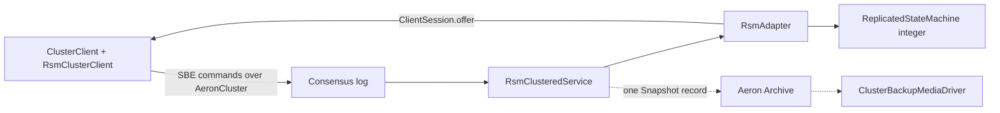
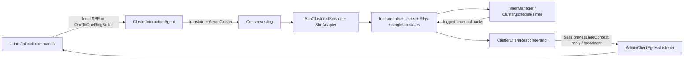

# Cookbook application catalog: Cluster RSM and RFQ

This catalog covers **every file** in `cluster-rsm` (13 files, 8 Java) and `rfq` (99 files, 49 Java) at
[`aeron-io/aeron-cookbook-code` revision `6fc95e9b07a9a25d9ed7cda10508d5ecde924fa0`](https://github.com/aeron-io/aeron-cookbook-code/tree/6fc95e9b07a9a25d9ed7cda10508d5ecde924fa0).
Java sources, Gradle definitions, SBE schemas/XSDs, scripts, deployment manifests and documentation were
read individually; the duplicate RFQ XSDs were additionally byte-compared and the supporting GIF was inventoried. The companion
[source-inventory.json](source-inventory.json) contains the exact 112-file coverage for these modules within the complete source inventory.
No HCL files occur in these two modules. Source links below name this immutable revision.

The upstream README calls this demonstration code. Extract small patterns and preserve Spine’s tested contracts;
do not treat the RFQ business logic, snapshots, authentication or deployment settings as production recipes.
Reading source establishes implementation behavior, not measured performance. No cookbook build, container,
fault-injection or deployment script was executed during this review.

## Version and API boundary

| Layer | Cookbook revision | Spine pin | How to use the example |
|---|---|---|---|
| Aeron | 1.52.1 | 1.53.3 | Recheck Cluster/client/backup/tool APIs against the pinned source before copying. |
| Agrona | 2.5.0 | 2.6.1 | Single-owner maps/rings remain useful; pre-size bounds, preserve threading and deterministic wire order. |
| SBE tool | 1.39.0 | 1.40.2 | Generate with Spine’s pin; cookbook-generated output is not a compatibility promise. |
| Java | 21 | 25 default; 21 supported | Match actual runtime module opens and selected dependencies; avoid copying blanket flags. |
| Container diagnostic JAR | 1.47.0 | Deployment must match 1.53.3 | Both setup scripts download older tools than even the cookbook’s main build. |

These versions come from the cookbook’s [root catalog](https://github.com/aeron-io/aeron-cookbook-code/blob/6fc95e9b07a9a25d9ed7cda10508d5ecde924fa0/gradle/libs.versions.toml), not from example comments.
The historical checks below used locally cached release source JARs for Aeron 1.53.0 and Agrona 2.6.0, plus the SBE
source analysis linked in [patterns.md](patterns.md). They are not a revalidation against the current Spine pins:

- [ClusterConfig at Aeron 1.53.0](https://github.com/aeron-io/aeron/blob/af20315a6b6323783ae717b075ba4a70c9abbf0c/aeron-samples/src/main/java/io/aeron/samples/cluster/ClusterConfig.java)
  still supplies `create`, `ingressEndpoints`, `calculatePort` and contexts. `PORTS_PER_NODE=100` and the default
  `CLIENT_FACING_PORT_OFFSET=2`; RSM intentionally overrides ingress and its client to offset 10. RFQ uses the default.
- [ClusterBackup](https://github.com/aeron-io/aeron/blob/af20315a6b6323783ae717b075ba4a70c9abbf0c/aeron-cluster/src/main/java/io/aeron/cluster/ClusterBackup.java)
  retains the used context setters, `SourceType.ANY` and `ReplayStart.BEGINNING`; the
  [events-listener signatures](https://github.com/aeron-io/aeron/blob/af20315a6b6323783ae717b075ba4a70c9abbf0c/aeron-cluster/src/main/java/io/aeron/cluster/ClusterBackupEventsListener.java)
  still carry physical recording/log positions. They do not imply a recorded canonical-event head.
- [Cluster](https://github.com/aeron-io/aeron/blob/af20315a6b6323783ae717b075ba4a70c9abbf0c/aeron-cluster/src/main/java/io/aeron/cluster/service/Cluster.java)
  documents retrying `scheduleTimer` with the Cluster idle strategy. Deadlines use `cluster.timeUnit()`; RFQ’s
  millisecond names assume its default configuration. Use logged callback time for the reducer and monotonic
  local elapsed time for client timeouts.
- [ClientSession](https://github.com/aeron-io/aeron/blob/af20315a6b6323783ae717b075ba4a70c9abbf0c/aeron-cluster/src/main/java/io/aeron/cluster/service/ClientSession.java)
  offers are mocked on followers; successful leader egress is still distinct from durable application output.
  [AeronCluster](https://github.com/aeron-io/aeron/blob/af20315a6b6323783ae717b075ba4a70c9abbf0c/aeron-cluster/src/main/java/io/aeron/cluster/client/AeronCluster.java)
  retains `pollEgress`, `sendKeepAlive`, context endpoints and listener callbacks. Keep polling for leader changes;
  never turn an unchecked offer or a timed-out confirmation into evidence of failed admission.
- [OneToOneRingBuffer](https://github.com/aeron-io/agrona/blob/879ff419c620c30e88bde9e86a38220de76cccf2/agrona/src/main/java/org/agrona/concurrent/ringbuffer/OneToOneRingBuffer.java)
  still copies writes into a capacity-limited SPSC ring and reports failure when full. Its capacity includes a
  trailer; its storage is not a crash-safe pending-proposal spool. `AgentRunner` should receive real work counts.
- [SBE Java generator](https://github.com/aeron-io/simple-binary-encoding/blob/95f4e5c2e932c6befa2da58d19564ecf17670851/sbe-tool/src/main/java/uk/co/real_logic/sbe/generation/java/JavaGenerator.java)
  supports reused flyweights and caller-owned byte paths, but String access/encoding allocates. Exact received
  lengths and schema/version validation remain application responsibilities; XSD validation only validates XML.
- [ClusterTool at Aeron 1.53.0](https://github.com/aeron-io/aeron/blob/af20315a6b6323783ae717b075ba4a70c9abbf0c/aeron-cluster/src/main/java/io/aeron/cluster/ClusterTool.java)
  includes `describe`, `errors`, `snapshot` and `is-leader` (success exit status for leader). Prefer version-matched
  typed APIs/tool results to the cookbook’s hardcoded election-counter number 17 and text parsing.

## Cluster RSM architecture and reusable boundaries

Use this module to learn the smallest transport-to-reducer shape: one reused decoder per template, one explicit
integer model, and lifecycle wiring around the standard Cluster runtime. Keep mutation driven by committed
commands. The backup example demonstrates standard log/snapshot replication, not a bespoke global sequencer.

Repair the demonstrated boundaries before applying them: validate input before mutation, support null/replay
sessions, classify terminal offer failures, make client completion depend on actual correlated receipts, poll and
assemble the entire snapshot, publish every snapshot record successfully, and assign restored state. The existing
two reducer tests cannot establish any of those recovery properties. For Spine use its durable scoped proposals,
bounded exact retry receipts, complete snapshots and separate committed-output/recorded-output contracts.

## RFQ architecture and reusable boundaries

The gateway owns network/client polling while the REPL owns ring production; one service thread owns domain maps,
sessions, timer tasks and codec scratch. That separation is reusable. Each command is translated from a local
schema to a different Cluster schema, and results versus broadcasts are separate templates. The two schemas both
claim schema 101/version 1, yet their bodies/template assignments differ: channel separation and explicit translation
are essential, and a production protocol should avoid ambiguous identities.

Reuse stateless state singletons and explicit stored state IDs, but validate the executable transition table and
party/turn rules. RFQ expiry is an absolute epoch-millisecond input checked against logged Cluster time; the admin
constructs it using its own wall clock. This is not a cross-host clock-uncertainty model. The supplied model has no
session-to-user authentication, durable retry deduplication, bounds/retention policy or implemented snapshots.

For latency work, keep the reused primitive codecs/direct buffers but replace per-command UUID Strings, generated
String access, stream/list materialization, captured Runnable tasks and terminal/domain logging when profiling
shows they matter. Pre-size Agrona tables against declared maximums. Reused buffers demand **all required fields
be written every message**: the demo responder omits fields and copies RFQ IDs into participant fields. A direct
buffer and Agrona dependency alone do not certify low allocation.

The provided containers/manifests teach address wiring, shared-memory mounts, stable pod identity and manual fault
injection. They do not provide persistent Archive/Cluster mounts, readiness/quorum checks, failure-domain placement,
authentication or a tested recovery plan. Namespace deletion and leader-pod deletion are destructive demonstration
steps requiring explicit operational intent; this catalog does not authorize executing them.

## Individual file catalog

Each row below identifies the exact file, its reusable role and the caveat needed to adapt it safely. “Scaffold”
and “boilerplate” are intentional classifications where no functional recipe is implemented.

### Cluster RSM: every Java file

| Immutable source | Role, pattern and caveat |
|---|---|
| [cluster-rsm/src/main/java/com/aeroncookbook/cluster/rsm/client/ClusterClient.java](https://github.com/aeron-io/aeron-cookbook-code/blob/6fc95e9b07a9a25d9ed7cda10508d5ecde924fa0/cluster-rsm/src/main/java/com/aeroncookbook/cluster/rsm/client/ClusterClient.java) | Launches an embedded SHARED MediaDriver and an owned AeronCluster client with ephemeral UDP egress. Builds member ingress endpoints using a custom offset 10 matching RsmCluster; validate nonempty hosts and preserve that explicit port contract rather than substituting ClusterConfig’s default offset 2. |
| [cluster-rsm/src/main/java/com/aeroncookbook/cluster/rsm/client/RsmClusterClient.java](https://github.com/aeron-io/aeron-cookbook-code/blob/6fc95e9b07a9a25d9ed7cda10508d5ecde924fa0/cluster-rsm/src/main/java/com/aeroncookbook/cluster/rsm/client/RsmClusterClient.java) | Reuses SBE Add/Multiply encoders, a header, response decoder and direct send buffer while offering commands and polling egress. Demo completion is flawed: increments through 101 yet checks the sent field against 100 instead of received correlation; negative offers loop without terminal handling, and keepalives only occur after the completion flag. |
| [cluster-rsm/src/main/java/com/aeroncookbook/cluster/rsm/node/ReplicatedStateMachine.java](https://github.com/aeron-io/aeron-cookbook-code/blob/6fc95e9b07a9a25d9ed7cda10508d5ecde924fa0/cluster-rsm/src/main/java/com/aeroncookbook/cluster/rsm/node/ReplicatedStateMachine.java) | Small deterministic integer reducer for add, multiply and set, separated from transport. loadFromSnapshot only logs the decoded value and never restores currentValue; arithmetic wraps and correlation is diagnostic rather than retry deduplication. |
| [cluster-rsm/src/main/java/com/aeroncookbook/cluster/rsm/node/RsmAdapter.java](https://github.com/aeron-io/aeron-cookbook-code/blob/6fc95e9b07a9a25d9ed7cda10508d5ecde924fa0/cluster-rsm/src/main/java/com/aeroncookbook/cluster/rsm/node/RsmAdapter.java) | Template-ID switch routes reused SBE decoders to the reducer and encodes CurrentValue replies into one reusable buffer. Add exact header/body/schema/version checks at a trust boundary; its single unchecked session.offer is not a reliable reply contract or a null-session-safe replay path. |
| [cluster-rsm/src/main/java/com/aeroncookbook/cluster/rsm/node/RsmCluster.java](https://github.com/aeron-io/aeron-cookbook-code/blob/6fc95e9b07a9a25d9ed7cda10508d5ecde924fa0/cluster-rsm/src/main/java/com/aeroncookbook/cluster/rsm/node/RsmCluster.java) | Composes ClusterConfig, ClusteredMediaDriver and ClusteredServiceContainer under a ShutdownSignalBarrier. Overrides ingress to localhost:9010 and retains the cluster directory, but starts only one node and prints errors; this is wiring rather than failover or recovery acceptance. |
| [cluster-rsm/src/main/java/com/aeroncookbook/cluster/rsm/node/RsmClusterBackup.java](https://github.com/aeron-io/aeron-cookbook-code/blob/6fc95e9b07a9a25d9ed7cda10508d5ecde924fa0/cluster-rsm/src/main/java/com/aeroncookbook/cluster/rsm/node/RsmClusterBackup.java) | Runs ClusterBackupMediaDriver with a local Archive plus cloned remote-Archive context, consensus/catchup endpoints, ANY source and BEGINNING replay. Backup callbacks expose snapshots, recording-log updates and local recording progress; those physical positions do not establish Spine canonical-output completeness or logical consumer agreement. |
| [cluster-rsm/src/main/java/com/aeroncookbook/cluster/rsm/node/RsmClusteredService.java](https://github.com/aeron-io/aeron-cookbook-code/blob/6fc95e9b07a9a25d9ed7cda10508d5ecde924fa0/cluster-rsm/src/main/java/com/aeroncookbook/cluster/rsm/node/RsmClusteredService.java) | Adapts Cluster lifecycle callbacks to RsmAdapter and emits a one-record snapshot. Startup polls the snapshot just once and snapshot publication is offered once without checking success; together with the reducer’s missing assignment this is an incomplete snapshot/replay recipe. |
| [cluster-rsm/src/test/java/com/aeroncookbook/cluster/rsm/ReplicatedStateMachineTests.java](https://github.com/aeron-io/aeron-cookbook-code/blob/6fc95e9b07a9a25d9ed7cda10508d5ecde924fa0/cluster-rsm/src/test/java/com/aeroncookbook/cluster/rsm/ReplicatedStateMachineTests.java) | Two transport-free reducer tests cover additive updates and set-then-multiply. Useful model isolation; they do not cover snapshots, malformed frames, retry identity, session loss, elections or replay equivalence. |

### Cluster RSM: build and resources

| Immutable source | Role, pattern and caveat |
|---|---|
| [cluster-rsm/build.gradle.kts](https://github.com/aeron-io/aeron-cookbook-code/blob/6fc95e9b07a9a25d9ed7cda10508d5ecde924fa0/cluster-rsm/build.gradle.kts) | Java/SBE build pattern: generated codecs join the main source set, XSD-validated SbeTool execution precedes compileJava, and separate client/cluster uber JARs set their Main-Class. Resolve versions from the root catalog; do not import its sample dependencies or compiler flags wholesale. |
| [cluster-rsm/src/main/resources/messages.xml](https://github.com/aeron-io/aeron-cookbook-code/blob/6fc95e9b07a9a25d9ed7cda10508d5ecde924fa0/cluster-rsm/src/main/resources/messages.xml) | Schema 100/version 1 uses an eight-byte header and distinct Add, CurrentValue, Multiply, Set and Snapshot templates. Fixed root primitives make a useful reducer protocol; as in Spine’s version 1 contract, validate the schema version explicitly. |
| [cluster-rsm/src/main/resources/sbe/sbe.xsd](https://github.com/aeron-io/aeron-cookbook-code/blob/6fc95e9b07a9a25d9ed7cda10508d5ecde924fa0/cluster-rsm/src/main/resources/sbe/sbe.xsd) | Vendored FIX SBE XSD boilerplate validates types, composites, enums, sets, ordered fixed fields/groups/variable data, offsets, presence and sinceVersion/deprecated attributes. Build-time XML validity does not validate received binary message bounds. |
| [cluster-rsm/src/main/resources/logback.xml](https://github.com/aeron-io/aeron-cookbook-code/blob/6fc95e9b07a9a25d9ed7cda10508d5ecde924fa0/cluster-rsm/src/main/resources/logback.xml) | Console logging configuration with message-only pattern and LOG_LEVEL defaulting to info. Per-command logging in reducer/client paths allocates and performs I/O; remove or sample it for measured hot-path behavior. |
| [cluster-rsm/src/test/resources/logback-test.xml](https://github.com/aeron-io/aeron-cookbook-code/blob/6fc95e9b07a9a25d9ed7cda10508d5ecde924fa0/cluster-rsm/src/test/resources/logback-test.xml) | Test console logging configuration uses the same message-only pattern and info default as runtime. It controls diagnostics, not timing, durable recording or recovery correctness. |

### RFQ service: composition and infrastructure

| Immutable source | Role, pattern and caveat |
|---|---|
| [rfq/cluster/src/main/java/com/aeroncookbook/rfq/ClusterApp.java](https://github.com/aeron-io/aeron-cookbook-code/blob/6fc95e9b07a9a25d9ed7cda10508d5ecde924fa0/rfq/cluster/src/main/java/com/aeroncookbook/rfq/ClusterApp.java) | Environment/system-property bootstrap creates ClusterConfig from node index, host list and port base, sets UDP ingress and a three-second leader heartbeat, then owns driver/Archive/consensus/container lifecycles. DNS retry/delay is deployment startup scaffolding; validate addresses/node bounds and replace container-local data paths for persistence. |
| [rfq/cluster/src/main/java/com/aeroncookbook/rfq/infra/AppClusteredService.java](https://github.com/aeron-io/aeron-cookbook-code/blob/6fc95e9b07a9a25d9ed7cda10508d5ecde924fa0/rfq/cluster/src/main/java/com/aeroncookbook/rfq/infra/AppClusteredService.java) | Composition root wires context, sessions, SBE adapter, instruments, users, RFQs and timers; command/timer callbacks use the logged Cluster timestamp. onStart explicitly does not load snapshots and onTakeSnapshot is unimplemented: do not prune the command log assuming application state was captured. |
| [rfq/cluster/src/main/java/com/aeroncookbook/rfq/infra/ClientSessionListener.java](https://github.com/aeron-io/aeron-cookbook-code/blob/6fc95e9b07a9a25d9ed7cda10508d5ecde924fa0/rfq/cluster/src/main/java/com/aeroncookbook/rfq/infra/ClientSessionListener.java) | Optional open/close observer interface carries the ClientSession and Cluster-provided timestamp. This separates transport session notifications from the domain, but session existence is not authenticated user identity. |
| [rfq/cluster/src/main/java/com/aeroncookbook/rfq/infra/ClientSessions.java](https://github.com/aeron-io/aeron-cookbook-code/blob/6fc95e9b07a9a25d9ed7cda10508d5ecde924fa0/rfq/cluster/src/main/java/com/aeroncookbook/rfq/infra/ClientSessions.java) | Tracks sessions in an insertion-ordered ArrayList plus Agrona Long2ObjectHashMap lookup, notifying an optional listener on open/close. Both are service-thread-owned, unbounded, and the mutable session list escapes; preserve ownership and explicit iteration order if simplifying containers. |
| [rfq/cluster/src/main/java/com/aeroncookbook/rfq/infra/ClusterClientResponder.java](https://github.com/aeron-io/aeron-cookbook-code/blob/6fc95e9b07a9a25d9ed7cda10508d5ecde924fa0/rfq/cluster/src/main/java/com/aeroncookbook/rfq/infra/ClusterClientResponder.java) | Domain-facing interface separates instrument/RFQ confirmations and broadcasts from encoding and session offers. Use its separation when several transport-independent operations justify it; it is not an independent durable event stream. |
| [rfq/cluster/src/main/java/com/aeroncookbook/rfq/infra/ClusterClientResponderImpl.java](https://github.com/aeron-io/aeron-cookbook-code/blob/6fc95e9b07a9a25d9ed7cda10508d5ecde924fa0/rfq/cluster/src/main/java/com/aeroncookbook/rfq/infra/ClusterClientResponderImpl.java) | Reuses per-template SBE encoders and one ExpandableDirectByteBuffer for confirmations, lists and broadcasts. Populate every required field on every wrap: several broadcasts write RFQ ID into user-ID fields, and accepted/rejected/quoted events omit schema fields including correlations/participants, exposing stale buffer contents. |
| [rfq/cluster/src/main/java/com/aeroncookbook/rfq/infra/SbeAdapter.java](https://github.com/aeron-io/aeron-cookbook-code/blob/6fc95e9b07a9a25d9ed7cda10508d5ecde924fa0/rfq/cluster/src/main/java/com/aeroncookbook/rfq/infra/SbeAdapter.java) | Checks only minimum header length, then dispatches reused generated decoders into the instrument/RFQ model. Add schema/version/root/variable/group bounds validation; notably snapshot InstrumentRecord is also admitted through command dispatch, so snapshot restoration should have a distinct validated context. |
| [rfq/cluster/src/main/java/com/aeroncookbook/rfq/infra/SessionMessageContext.java](https://github.com/aeron-io/aeron-cookbook-code/blob/6fc95e9b07a9a25d9ed7cda10508d5ecde924fa0/rfq/cluster/src/main/java/com/aeroncookbook/rfq/infra/SessionMessageContext.java) | Small domain context contract exposes logged Cluster time plus reply/broadcast operations. It makes deterministic model time available without having the model read a process wall clock. |
| [rfq/cluster/src/main/java/com/aeroncookbook/rfq/infra/SessionMessageContextImpl.java](https://github.com/aeron-io/aeron-cookbook-code/blob/6fc95e9b07a9a25d9ed7cda10508d5ecde924fa0/rfq/cluster/src/main/java/com/aeroncookbook/rfq/infra/SessionMessageContextImpl.java) | Carries the current command session and logged timestamp, replying directly or broadcasting across tracked sessions with three offer attempts. Its retry-exhaustion path closes the current requester rather than the targetSession; null replay sessions, terminal CLOSED and dropped egress require explicit policy. |
| [rfq/cluster/src/main/java/com/aeroncookbook/rfq/infra/SnapshotManager.java](https://github.com/aeron-io/aeron-cookbook-code/blob/6fc95e9b07a9a25d9ed7cda10508d5ecde924fa0/rfq/cluster/src/main/java/com/aeroncookbook/rfq/infra/SnapshotManager.java) | Scaffold for polling a snapshot Image to EOS and offering records with a retry limit. It writes no state, recognizes no record templates and never marks snapshotFullyLoaded; it also lacks fragment assembly and robust EOS/closed/callback-failure handling. Study lifecycle shape only. |
| [rfq/cluster/src/main/java/com/aeroncookbook/rfq/infra/TimerManager.java](https://github.com/aeron-io/aeron-cookbook-code/blob/6fc95e9b07a9a25d9ed7cda10508d5ecde924fa0/rfq/cluster/src/main/java/com/aeroncookbook/rfq/infra/TimerManager.java) | Agrona Long2ObjectHashMap binds deterministic Cluster timer IDs to Runnable tasks; schedule retries use the Cluster idle strategy and expiry updates logged time before invoking a task. Restore does not advance its correlation counter and closures are not serialized; snapshot IDs/tasks, handle cancellation races and retain Cluster time units explicitly. |

### RFQ domain: instruments, users and RFQ model

| Immutable source | Role, pattern and caveat |
|---|---|
| [rfq/cluster/src/main/java/com/aeroncookbook/rfq/domain/instrument/Instrument.java](https://github.com/aeron-io/aeron-cookbook-code/blob/6fc95e9b07a9a25d9ed7cda10508d5ecde924fa0/rfq/cluster/src/main/java/com/aeroncookbook/rfq/domain/instrument/Instrument.java) | Instrument object keeps immutable CUSIP/minimum size and mutable enabled state; equality/hash use CUSIP identity. This is a simple service-thread domain value, not a validated financial instrument definition or immutable snapshot. |
| [rfq/cluster/src/main/java/com/aeroncookbook/rfq/domain/instrument/InstrumentAddType.java](https://github.com/aeron-io/aeron-cookbook-code/blob/6fc95e9b07a9a25d9ed7cda10508d5ecde924fa0/rfq/cluster/src/main/java/com/aeroncookbook/rfq/domain/instrument/InstrumentAddType.java) | INTERACTIVE versus SNAPSHOT_LOAD indicates whether instrument insertion should reply to a user. Suppressing side effects during restoration is useful, but neither enum value supplies schema validation or a complete snapshot implementation. |
| [rfq/cluster/src/main/java/com/aeroncookbook/rfq/domain/instrument/Instruments.java](https://github.com/aeron-io/aeron-cookbook-code/blob/6fc95e9b07a9a25d9ed7cda10508d5ecde924fa0/rfq/cluster/src/main/java/com/aeroncookbook/rfq/domain/instrument/Instruments.java) | Agrona Object2ObjectHashMap stores CUSIP instruments; insertion and enabled changes produce confirmations, listing materializes values with stream().toList(). Duplicate inserts overwrite, size is unbounded and hash iteration is not stable wire order; validate identifiers/limits and sort if deterministic encoded lists matter. |
| [rfq/cluster/src/main/java/com/aeroncookbook/rfq/domain/users/Users.java](https://github.com/aeron-io/aeron-cookbook-code/blob/6fc95e9b07a9a25d9ed7cda10508d5ecde924fa0/rfq/cluster/src/main/java/com/aeroncookbook/rfq/domain/users/Users.java) | Agrona IntHashSet contains hardcoded user IDs 500, 501, 502 for membership checks. It illustrates primitive-key membership, not authentication, session-to-user binding, entitlement checks or a replicated user-management workflow. |
| [rfq/cluster/src/main/java/com/aeroncookbook/rfq/domain/rfq/Rfq.java](https://github.com/aeron-io/aeron-cookbook-code/blob/6fc95e9b07a9a25d9ed7cda10508d5ecde924fa0/rfq/cluster/src/main/java/com/aeroncookbook/rfq/domain/rfq/Rfq.java) | Mutable RFQ aggregate keeps immutable creation attributes, participant/price fields and singleton state objects; methods guard transitions. The initial lastCounterUser sentinel is Integer.MIN_VALUE, which must match downstream comparisons; no accepted/rejected user getters exist for the event fields the schema declares. |
| [rfq/cluster/src/main/java/com/aeroncookbook/rfq/domain/rfq/Rfqs.java](https://github.com/aeron-io/aeron-cookbook-code/blob/6fc95e9b07a9a25d9ed7cda10508d5ecde924fa0/rfq/cluster/src/main/java/com/aeroncookbook/rfq/domain/rfq/Rfqs.java) | Deterministic command handlers validate users/instruments, assign IDs, mutate RFQs, confirm/broadcast and schedule expiry. Demo list stream searches/closures/logs allocate; int lastCounterUser is compared to Long.MIN_VALUE so checks never match, some turn checks are inverted, and rejectRfq lacks return after emitting a rejection. Correlation strings do not deduplicate command retries. |

### RFQ state machine: every state file

| Immutable source | Role, pattern and caveat |
|---|---|
| [rfq/cluster/src/main/java/com/aeroncookbook/rfq/domain/rfq/states/RfqState.java](https://github.com/aeron-io/aeron-cookbook-code/blob/6fc95e9b07a9a25d9ed7cda10508d5ecde924fa0/rfq/cluster/src/main/java/com/aeroncookbook/rfq/domain/rfq/states/RfqState.java) | State interface exposes explicit state ID, permitted-target check and transition result. A production transition contract should guarantee a nonnull next state whenever canTransitionTo returns true. |
| [rfq/cluster/src/main/java/com/aeroncookbook/rfq/domain/rfq/states/RfqStates.java](https://github.com/aeron-io/aeron-cookbook-code/blob/6fc95e9b07a9a25d9ed7cda10508d5ecde924fa0/rfq/cluster/src/main/java/com/aeroncookbook/rfq/domain/rfq/states/RfqStates.java) | Stable explicit short IDs enumerate CREATED=0, QUOTED=1, COUNTERED=2, ACCEPTED=3, REJECTED=4, EXPIRED=5, CANCELED=6, COMPLETED=7. Never persist enum ordinal implicitly; fromId currently returns null on unknown IDs rather than rejecting malformed state. |
| [rfq/cluster/src/main/java/com/aeroncookbook/rfq/domain/rfq/states/RfqStateHelper.java](https://github.com/aeron-io/aeron-cookbook-code/blob/6fc95e9b07a9a25d9ed7cda10508d5ecde924fa0/rfq/cluster/src/main/java/com/aeroncookbook/rfq/domain/rfq/states/RfqStateHelper.java) | Static Agrona Int2ObjectHashMap resolves IDs to stateless singleton state implementations. Avoid per-transition allocation; callers must reject unknown IDs instead of accepting null as a model state. |
| [rfq/cluster/src/main/java/com/aeroncookbook/rfq/domain/rfq/states/RfqCreated.java](https://github.com/aeron-io/aeron-cookbook-code/blob/6fc95e9b07a9a25d9ed7cda10508d5ecde924fa0/rfq/cluster/src/main/java/com/aeroncookbook/rfq/domain/rfq/states/RfqCreated.java) | Stateless singleton permits expiry, quote and cancel and selects the corresponding singleton. Its executable transitions do not include the CREATED-to-REJECTED edge shown in the accompanying PlantUML diagram. |
| [rfq/cluster/src/main/java/com/aeroncookbook/rfq/domain/rfq/states/RfqQuoted.java](https://github.com/aeron-io/aeron-cookbook-code/blob/6fc95e9b07a9a25d9ed7cda10508d5ecde924fa0/rfq/cluster/src/main/java/com/aeroncookbook/rfq/domain/rfq/states/RfqQuoted.java) | Stateless singleton permits acceptance, counter, expiry, cancel and rejection. Reusable transition table pattern; party/turn authorization remains the aggregate/application handler’s responsibility. |
| [rfq/cluster/src/main/java/com/aeroncookbook/rfq/domain/rfq/states/RfqCountered.java](https://github.com/aeron-io/aeron-cookbook-code/blob/6fc95e9b07a9a25d9ed7cda10508d5ecde924fa0/rfq/cluster/src/main/java/com/aeroncookbook/rfq/domain/rfq/states/RfqCountered.java) | Stateless singleton supports repeated counters and acceptance/cancel/rejection/expiry. The state alone does not determine which participant may respond, so audit the Rfqs turn checks separately. |
| [rfq/cluster/src/main/java/com/aeroncookbook/rfq/domain/rfq/states/RfqAccepted.java](https://github.com/aeron-io/aeron-cookbook-code/blob/6fc95e9b07a9a25d9ed7cda10508d5ecde924fa0/rfq/cluster/src/main/java/com/aeroncookbook/rfq/domain/rfq/states/RfqAccepted.java) | Terminal singleton rejects every transition and returns null. It does not implement the ACCEPTED-to-COMPLETED edge in the diagram; do not assume a trade-completion workflow exists. |
| [rfq/cluster/src/main/java/com/aeroncookbook/rfq/domain/rfq/states/RfqCanceled.java](https://github.com/aeron-io/aeron-cookbook-code/blob/6fc95e9b07a9a25d9ed7cda10508d5ecde924fa0/rfq/cluster/src/main/java/com/aeroncookbook/rfq/domain/rfq/states/RfqCanceled.java) | Terminal canceled singleton rejects transitions and allocates nothing per access. Persist the explicit state ID and test that cancellation prevents later timer-driven mutation. |
| [rfq/cluster/src/main/java/com/aeroncookbook/rfq/domain/rfq/states/RfqRejected.java](https://github.com/aeron-io/aeron-cookbook-code/blob/6fc95e9b07a9a25d9ed7cda10508d5ecde924fa0/rfq/cluster/src/main/java/com/aeroncookbook/rfq/domain/rfq/states/RfqRejected.java) | Terminal rejected singleton rejects transitions. The state object is simple; handler validation must return before mutation after a rejected command. |
| [rfq/cluster/src/main/java/com/aeroncookbook/rfq/domain/rfq/states/RfqExpired.java](https://github.com/aeron-io/aeron-cookbook-code/blob/6fc95e9b07a9a25d9ed7cda10508d5ecde924fa0/rfq/cluster/src/main/java/com/aeroncookbook/rfq/domain/rfq/states/RfqExpired.java) | Terminal expired singleton rejects transitions. It demonstrates timer-driven terminal state, but the application must restore pending timer/model identity for recovery. |
| [rfq/cluster/src/main/java/com/aeroncookbook/rfq/domain/rfq/states/RfqCompleted.java](https://github.com/aeron-io/aeron-cookbook-code/blob/6fc95e9b07a9a25d9ed7cda10508d5ecde924fa0/rfq/cluster/src/main/java/com/aeroncookbook/rfq/domain/rfq/states/RfqCompleted.java) | Inconsistent singleton reports EXPIRED and QUOTED as permitted but transitionTo always returns null. Treat this as an unfinished demo state; never copy its contract into a completed-trade reducer. |
| [rfq/cluster/src/main/java/com/aeroncookbook/rfq/domain/rfq/states/rfq-states.puml](https://github.com/aeron-io/aeron-cookbook-code/blob/6fc95e9b07a9a25d9ed7cda10508d5ecde924fa0/rfq/cluster/src/main/java/com/aeroncookbook/rfq/domain/rfq/states/rfq-states.puml) | PlantUML documents the intended RFQ lifecycle, including CREATED-to-REJECTED and ACCEPTED-to-COMPLETED edges absent from executable states. Use it to design transition acceptance tests, not as proof of implemented behavior. |

### RFQ admin: main, transport agent and utilities

| Immutable source | Role, pattern and caveat |
|---|---|
| [rfq/admin/src/main/java/com/aeroncookbook/rfq/admin/Admin.java](https://github.com/aeron-io/aeron-cookbook-code/blob/6fc95e9b07a9a25d9ed7cda10508d5ecde924fa0/rfq/admin/src/main/java/com/aeroncookbook/rfq/admin/Admin.java) | Owns a JLine/picocli REPL and AgentRunner connected by an 8192-byte OneToOneRingBuffer backed by direct storage plus trailer. Startup auto-connect ignores a failed ring write; EOF exits without closing the runner, unlike explicit exit. Keep one producer/consumer and make cleanup/full-ring policy explicit. |
| [rfq/admin/src/main/java/com/aeroncookbook/rfq/admin/cluster/ClusterInteractionAgent.java](https://github.com/aeron-io/aeron-cookbook-code/blob/6fc95e9b07a9a25d9ed7cda10508d5ecde924fa0/rfq/admin/src/main/java/com/aeroncookbook/rfq/admin/cluster/ClusterInteractionAgent.java) | Owns AeronCluster/MediaDriver, polls CLI commands and egress, sends 250 ms keepalives and translates admin SBE into Cluster SBE with new correlation UUID Strings. It always returns0 despite work, allows ten offer attempts, tracks commands even when offers fail, and does not retain durable bytes or deduplicate retries; repeated connect can replace resources without closing them. |
| [rfq/admin/src/main/java/com/aeroncookbook/rfq/admin/cluster/AdminClientEgressListener.java](https://github.com/aeron-io/aeron-cookbook-code/blob/6fc95e9b07a9a25d9ed7cda10508d5ecde924fa0/rfq/admin/src/main/java/com/aeroncookbook/rfq/admin/cluster/AdminClientEgressListener.java) | Template switch reuses decoders to display confirmations/broadcasts and clear PendingMessageManager entries by correlation; session/leader callbacks display transport events. Minimum header check is not full decoding validation, String/ANSI logging allocates, and malformed/stale broadcast correlations must not acknowledge unrelated requests. |
| [rfq/admin/src/main/java/com/aeroncookbook/rfq/admin/cluster/ConnectionState.java](https://github.com/aeron-io/aeron-cookbook-code/blob/6fc95e9b07a9a25d9ed7cda10508d5ecde924fa0/rfq/admin/src/main/java/com/aeroncookbook/rfq/admin/cluster/ConnectionState.java) | CONNECTED/NOT_CONNECTED enum is only the admin’s local connection flag. It is not quorum health, committed-head agreement, recorded-head freshness or an indication that a submission was applied. |
| [rfq/admin/src/main/java/com/aeroncookbook/rfq/admin/cluster/LineReaderHelper.java](https://github.com/aeron-io/aeron-cookbook-code/blob/6fc95e9b07a9a25d9ed7cda10508d5ecde924fa0/rfq/admin/src/main/java/com/aeroncookbook/rfq/admin/cluster/LineReaderHelper.java) | Builds styled terminal text and redraws an active prompt while asynchronous egress arrives. Useful UI integration, but formatting and terminal I/O allocate/block and are not a trading/research hot-path pattern. |
| [rfq/admin/src/main/java/com/aeroncookbook/rfq/admin/cluster/PendingMessage.java](https://github.com/aeron-io/aeron-cookbook-code/blob/6fc95e9b07a9a25d9ed7cda10508d5ecde924fa0/rfq/admin/src/main/java/com/aeroncookbook/rfq/admin/cluster/PendingMessage.java) | Record carries absolute timeout, correlation String and message-type label. Its immutable shape helps diagnostics; it does not own the command bytes or persist admission progress. |
| [rfq/admin/src/main/java/com/aeroncookbook/rfq/admin/cluster/PendingMessageManager.java](https://github.com/aeron-io/aeron-cookbook-code/blob/6fc95e9b07a9a25d9ed7cda10508d5ecde924fa0/rfq/admin/src/main/java/com/aeroncookbook/rfq/admin/cluster/PendingMessageManager.java) | LinkedList-backed queue tracks five-second wall-clock timeouts, removes by correlation and logs one overdue request per duty cycle. This is timeout notification only: no exact retry, reconnect persistence, bounded admission slots or server dedup; use monotonic time for local elapsed deadlines. |
| [rfq/admin/src/main/java/com/aeroncookbook/rfq/admin/util/EnvironmentUtil.java](https://github.com/aeron-io/aeron-cookbook-code/blob/6fc95e9b07a9a25d9ed7cda10508d5ecde924fa0/rfq/admin/src/main/java/com/aeroncookbook/rfq/admin/util/EnvironmentUtil.java) | Environment then system-property/default helpers resolve hosts, response port and user ID, plus eth0 IPv4 lookup with localhost fallback. Validate ports/IDs and explicit advertised addresses; eth0 assumptions and silently swallowed lookup failures are deployment conveniences. |

### RFQ admin: every CLI command

| Immutable source | Role, pattern and caveat |
|---|---|
| [rfq/admin/src/main/java/com/aeroncookbook/rfq/admin/cli/CliCommands.java](https://github.com/aeron-io/aeron-cookbook-code/blob/6fc95e9b07a9a25d9ed7cda10508d5ecde924fa0/rfq/admin/src/main/java/com/aeroncookbook/rfq/admin/cli/CliCommands.java) | Picocli root owns the command set and reader, sharing a single OneToOneRingBuffer producer with subcommands. Messages use type 10 and a failed write prints an error rather than retrying/persisting; ring capacity and single-producer ownership must remain explicit. |
| [rfq/admin/src/main/java/com/aeroncookbook/rfq/admin/cli/ConnectCluster.java](https://github.com/aeron-io/aeron-cookbook-code/blob/6fc95e9b07a9a25d9ed7cda10508d5ecde924fa0/rfq/admin/src/main/java/com/aeroncookbook/rfq/admin/cli/ConnectCluster.java) | Encodes baseport, response port, cluster hosts and advertised local host into a reusable admin SBE buffer. Connection configuration is supplied via CLI/environment; bound strings and validate endpoint/port values before publishing. |
| [rfq/admin/src/main/java/com/aeroncookbook/rfq/admin/cli/DisconnectCluster.java](https://github.com/aeron-io/aeron-cookbook-code/blob/6fc95e9b07a9a25d9ed7cda10508d5ecde924fa0/rfq/admin/src/main/java/com/aeroncookbook/rfq/admin/cli/DisconnectCluster.java) | Encodes a header-only local disconnect command for the transport agent. This illustrates control/data commands on the same owned ring; disconnect is not a durable admission cancellation. |
| [rfq/admin/src/main/java/com/aeroncookbook/rfq/admin/cli/InstrumentAdd.java](https://github.com/aeron-io/aeron-cookbook-code/blob/6fc95e9b07a9a25d9ed7cda10508d5ecde924fa0/rfq/admin/src/main/java/com/aeroncookbook/rfq/admin/cli/InstrumentAdd.java) | Reuses AddInstrument encoder/header/buffer to queue CUSIP, enabled flag and minimum size. Boolean.parseBoolean maps unknown text to false, and defaults permit empty CUSIP; validate user input instead of relying on a generated fixed-width string setter. |
| [rfq/admin/src/main/java/com/aeroncookbook/rfq/admin/cli/InstrumentDisable.java](https://github.com/aeron-io/aeron-cookbook-code/blob/6fc95e9b07a9a25d9ed7cda10508d5ecde924fa0/rfq/admin/src/main/java/com/aeroncookbook/rfq/admin/cli/InstrumentDisable.java) | Queues SetInstrumentEnabledFlag with FALSE using a reused encoder. Shares one wire template with enable; require a valid identifier and distinguish local queue acceptance from Cluster confirmation. |
| [rfq/admin/src/main/java/com/aeroncookbook/rfq/admin/cli/InstrumentEnable.java](https://github.com/aeron-io/aeron-cookbook-code/blob/6fc95e9b07a9a25d9ed7cda10508d5ecde924fa0/rfq/admin/src/main/java/com/aeroncookbook/rfq/admin/cli/InstrumentEnable.java) | Queues SetInstrumentEnabledFlag with TRUE using a reused encoder. This is command construction only; the domain confirms whether the CUSIP exists. |
| [rfq/admin/src/main/java/com/aeroncookbook/rfq/admin/cli/InstrumentList.java](https://github.com/aeron-io/aeron-cookbook-code/blob/6fc95e9b07a9a25d9ed7cda10508d5ecde924fa0/rfq/admin/src/main/java/com/aeroncookbook/rfq/admin/cli/InstrumentList.java) | Queues a header-only ListInstrumentsCommand; its CUSIP option is unused. Listing demonstrates a repeating-group response rather than a query-specific filtered projection. |
| [rfq/admin/src/main/java/com/aeroncookbook/rfq/admin/cli/RfqCreate.java](https://github.com/aeron-io/aeron-cookbook-code/blob/6fc95e9b07a9a25d9ed7cda10508d5ecde924fa0/rfq/admin/src/main/java/com/aeroncookbook/rfq/admin/cli/RfqCreate.java) | Queues RFQ creation with CLI quantity/user/CUSIP and an absolute local-wall-clock expiry 30 seconds ahead. Non-buy input silently becomes SELL; declare epoch/time units, validate side and account for clock skew before the Cluster compares expiry to logged time. |
| [rfq/admin/src/main/java/com/aeroncookbook/rfq/admin/cli/RfqQuote.java](https://github.com/aeron-io/aeron-cookbook-code/blob/6fc95e9b07a9a25d9ed7cda10508d5ecde924fa0/rfq/admin/src/main/java/com/aeroncookbook/rfq/admin/cli/RfqQuote.java) | Queues RFQ ID, quoting user and integer price into the admin protocol. Integer price is an opaque demo amount without declared financial scaling; existence/authorization/turn validation belongs in the service. |
| [rfq/admin/src/main/java/com/aeroncookbook/rfq/admin/cli/RfqCounter.java](https://github.com/aeron-io/aeron-cookbook-code/blob/6fc95e9b07a9a25d9ed7cda10508d5ecde924fa0/rfq/admin/src/main/java/com/aeroncookbook/rfq/admin/cli/RfqCounter.java) | Queues RFQ ID, countering user and integer price. Reused codec/buffer construction is useful; correct alternating-party checks and business price semantics are not supplied by this command. |
| [rfq/admin/src/main/java/com/aeroncookbook/rfq/admin/cli/RfqAccept.java](https://github.com/aeron-io/aeron-cookbook-code/blob/6fc95e9b07a9a25d9ed7cda10508d5ecde924fa0/rfq/admin/src/main/java/com/aeroncookbook/rfq/admin/cli/RfqAccept.java) | Queues RFQ ID and accepting user. The admin schema also declares rfqQuoteId but the CLI does not populate it and the bridge ignores it; remove/define unused required fields instead of relying on initial buffer contents. |
| [rfq/admin/src/main/java/com/aeroncookbook/rfq/admin/cli/RfqReject.java](https://github.com/aeron-io/aeron-cookbook-code/blob/6fc95e9b07a9a25d9ed7cda10508d5ecde924fa0/rfq/admin/src/main/java/com/aeroncookbook/rfq/admin/cli/RfqReject.java) | Queues RFQ ID and rejecting user through the admin RejectRfqCommand. The schema’s price field is not populated by this CLI nor by its translation path; fully initialize required fields in any production protocol. |
| [rfq/admin/src/main/java/com/aeroncookbook/rfq/admin/cli/RfqCancel.java](https://github.com/aeron-io/aeron-cookbook-code/blob/6fc95e9b07a9a25d9ed7cda10508d5ecde924fa0/rfq/admin/src/main/java/com/aeroncookbook/rfq/admin/cli/RfqCancel.java) | Queues RFQ ID and canceling user, defaulting RFQ ID to Integer.MIN_VALUE. Required identifiers should be validated before queueing; caller-supplied user IDs alone do not prove requester authorization. |

### RFQ: protocol and build files

| Immutable source | Role, pattern and caveat |
|---|---|
| [rfq/cluster-protocol/build.gradle.kts](https://github.com/aeron-io/aeron-cookbook-code/blob/6fc95e9b07a9a25d9ed7cda10508d5ecde924fa0/rfq/cluster-protocol/build.gradle.kts) | Separate java-library generates the shared Cluster schema with XSD validation and compileJava dependency. Generated source is a build artifact, not checked-in handwritten logic; keep Spine’s SBE 1.40.2 pin when borrowing this task shape. |
| [rfq/cluster-protocol/src/main/resources/protocol/protocol-codecs.xml](https://github.com/aeron-io/aeron-cookbook-code/blob/6fc95e9b07a9a25d9ed7cda10508d5ecde924fa0/rfq/cluster-protocol/src/main/resources/protocol/protocol-codecs.xml) | Cluster schema 101/version 1 declares instrument records/commands, RFQ commands, confirmations, broadcasts and repeating InstrumentsList. Uses fixed nine-byte CUSIP, 36-byte correlation Strings and millisecond expiry; inspect every encoder for required-field initialization and enforce lengths/schema/version on ingress. |
| [rfq/cluster-protocol/src/main/resources/protocol/fpl/sbe.xsd](https://github.com/aeron-io/aeron-cookbook-code/blob/6fc95e9b07a9a25d9ed7cda10508d5ecde924fa0/rfq/cluster-protocol/src/main/resources/protocol/fpl/sbe.xsd) | Vendored FIX SBE XML-schema validation boilerplate, byte-identical to the admin XSD. Governs field/group/data ordering, primitive/composite types and evolution attributes; not a runtime binary validator or an application-specific protocol. |
| [rfq/cluster-protocol/readme.md](https://github.com/aeron-io/aeron-cookbook-code/blob/6fc95e9b07a9a25d9ed7cda10508d5ecde924fa0/rfq/cluster-protocol/readme.md) | Explains generated-code module/task separation, but mentions auction terminology and an incorrect src/java/main path. The actual schema lives at src/main/resources/protocol/protocol-codecs.xml. |
| [rfq/admin/build.gradle.kts](https://github.com/aeron-io/aeron-cookbook-code/blob/6fc95e9b07a9a25d9ed7cda10508d5ecde924fa0/rfq/admin/build.gradle.kts) | Generates a separate local admin schema and depends on the shared Cluster protocol; adds JLine/picocli and builds the correct admin uber JAR. application.mainClass names io.aeron.samples.admin.Admin rather than the actual com.aeroncookbook.rfq.admin.Admin; validate task/manifest launch paths independently. |
| [rfq/admin/src/main/resources/protocol/protocol-codecs.xml](https://github.com/aeron-io/aeron-cookbook-code/blob/6fc95e9b07a9a25d9ed7cda10508d5ecde924fa0/rfq/admin/src/main/resources/protocol/protocol-codecs.xml) | Local CLI-to-agent schema also uses ID101/version1 but different layouts/template assignments than the Cluster schema: no correlation fields, int32 quantity and varData connection hosts. Translate explicitly and keep channels/modules separated; identical schema IDs do not make these formats interchangeable. |
| [rfq/admin/src/main/resources/protocol/fpl/sbe.xsd](https://github.com/aeron-io/aeron-cookbook-code/blob/6fc95e9b07a9a25d9ed7cda10508d5ecde924fa0/rfq/admin/src/main/resources/protocol/fpl/sbe.xsd) | Vendored FIX SBE XSD identical to the Cluster-protocol copy; validates XML structure, groups and schema evolution attributes. It does not enforce runtime endpoint, identity, command-body or allocation limits. |
| [rfq/cluster/build.gradle.kts](https://github.com/aeron-io/aeron-cookbook-code/blob/6fc95e9b07a9a25d9ed7cda10508d5ecde924fa0/rfq/cluster/build.gradle.kts) | Service application depends on shared generated Cluster protocol, Agrona, Aeron samples and logging; runSingleNodeCluster and uberJar name ClusterApp. Use minimal exact runtime dependencies in Spine, not the sample umbrella module or this version catalog. |
| [rfq/cluster/src/main/resources/logback.xml](https://github.com/aeron-io/aeron-cookbook-code/blob/6fc95e9b07a9a25d9ed7cda10508d5ecde924fa0/rfq/cluster/src/main/resources/logback.xml) | Message-only console appender with LOG_LEVEL default info makes domain activity visible. RFQ handlers, retry loops and lifecycle logging must be separated from low-allocation latency measurements. |

### RFQ: documentation and illustration

| Immutable source | Role, pattern and caveat |
|---|---|
| [rfq/README.md](https://github.com/aeron-io/aeron-cookbook-code/blob/6fc95e9b07a9a25d9ed7cda10508d5ecde924fa0/rfq/README.md) | RFQ overview links the animated sample and historical Docker/Kubernetes/Minikube requirements. It explicitly introduces a simple QuickStart-derived example; runtime version recommendations require current verification rather than copying 2023 assumptions. |
| [rfq/admin/readme.md](https://github.com/aeron-io/aeron-cookbook-code/blob/6fc95e9b07a9a25d9ed7cda10508d5ecde924fa0/rfq/admin/readme.md) | Documents commands, gateway-style local-SBE-to-Cluster-SBE conversion and environment variables. Its sample uses add-instrument instead of the actual instrument-add command and describes two users while code accepts three; check concrete CLI names and paths against source. |
| [rfq/cluster/readme.md](https://github.com/aeron-io/aeron-cookbook-code/blob/6fc95e9b07a9a25d9ed7cda10508d5ecde924fa0/rfq/cluster/readme.md) | Lists local launch, Cluster environment variables and bundled operations scripts. Some names are stale (streamsstat versus streamstat); treat executable script filenames and pinned tool APIs as authority. |
| [rfq/cluster/src/main/java/com/aeroncookbook/rfq/domain/readme.md](https://github.com/aeron-io/aeron-cookbook-code/blob/6fc95e9b07a9a25d9ed7cda10508d5ecde924fa0/rfq/cluster/src/main/java/com/aeroncookbook/rfq/domain/readme.md) | Explicitly states the RFQ workflow is unrealistic and exists to demonstrate a stateful multi-user Cluster application. Keep this limitation attached to any extracted state-machine/business pattern. |
| [rfq/image/rfq-sample-flow.gif](https://github.com/aeron-io/aeron-cookbook-code/blob/6fc95e9b07a9a25d9ed7cda10508d5ecde924fa0/rfq/image/rfq-sample-flow.gif) | 408-frame 1470×868 terminal demonstration asset linked from README, decoded and inspected as an illustration. It is not an executable test, latency benchmark, recoverability proof or API specification. |

### RFQ: container construction and runtime

| Immutable source | Role, pattern and caveat |
|---|---|
| [rfq/admin/Dockerfile](https://github.com/aeron-io/aeron-cookbook-code/blob/6fc95e9b07a9a25d9ed7cda10508d5ecde924fa0/rfq/admin/Dockerfile) | Builds a Java 21 root-owned image, installs helper tooling, copies the admin uber JAR/run script and sleeps indefinitely for interactive exec. Floating image tags/root execution and no health/lifecycle contract are demo deployment choices. |
| [rfq/admin/setup-docker.sh](https://github.com/aeron-io/aeron-cookbook-code/blob/6fc95e9b07a9a25d9ed7cda10508d5ecde924fa0/rfq/admin/setup-docker.sh) | Installs bash/wget and downloads aeron-all 1.47.0 diagnostic tooling without a checksum. That tool version differs from cookbook 1.52.1 and Spine 1.53.3; use a verified tool matching the deployment instead of this stale download. |
| [rfq/admin/run-admin.sh](https://github.com/aeron-io/aeron-cookbook-code/blob/6fc95e9b07a9a25d9ed7cda10508d5ecde924fa0/rfq/admin/run-admin.sh) | Launches the admin uber JAR with JDK internal-misc and zip opens. Those flags reflect its runtime dependencies; do not infer low allocation or production readiness from launch success. |
| [rfq/cluster/Dockerfile](https://github.com/aeron-io/aeron-cookbook-code/blob/6fc95e9b07a9a25d9ed7cda10508d5ecde924fa0/rfq/cluster/Dockerfile) | Builds a Java 21 root-owned Cluster image and includes entrypoint plus diagnostic/snapshot scripts. No persistent volume or image-digest/security policy is defined here; operational commands need explicit paths and matching tool versions. |
| [rfq/cluster/setup-docker.sh](https://github.com/aeron-io/aeron-cookbook-code/blob/6fc95e9b07a9a25d9ed7cda10508d5ecde924fa0/rfq/cluster/setup-docker.sh) | Installs shell/procps/less/sysstat/wget and downloads aeron-all 1.47.0. Reconcile diagnostic binaries with the actual Cluster version; downloads/apt state are not reproducible or checksum-verified in this demo. |
| [rfq/cluster/entrypoint.sh](https://github.com/aeron-io/aeron-cookbook-code/blob/6fc95e9b07a9a25d9ed7cda10508d5ecde924fa0/rfq/cluster/entrypoint.sh) | Forwards JVM arguments, prefers IPv4 and sets Aeron IPC MTU 8 KiB before launching ClusterApp. This is an IPC framing choice, not a network-MTU guarantee; maximum payload/fragmentation rules still apply. |
| [rfq/build-container-images.sh](https://github.com/aeron-io/aeron-cookbook-code/blob/6fc95e9b07a9a25d9ed7cda10508d5ecde924fa0/rfq/build-container-images.sh) | Builds admin and Cluster images from sibling directories with --no-cache. Assumes a particular working directory and prebuilt JARs, lacks fail-fast handling and does not build Java itself; do not execute as a safe deployment transaction. |
| [rfq/docker/docker-compose.yml](https://github.com/aeron-io/aeron-cookbook-code/blob/6fc95e9b07a9a25d9ed7cda10508d5ecde924fa0/rfq/docker/docker-compose.yml) | Wires three Cluster nodes and two interactive admins on fixed bridge IPs with 1 GiB shared memory and declared bridge MTU 9000. No persistent Archive/Cluster mounts, readiness checks or production isolation are supplied; Docker depends_on is not quorum readiness. |
| [rfq/docker/docker_find_leader.sh](https://github.com/aeron-io/aeron-cookbook-code/blob/6fc95e9b07a9a25d9ed7cda10508d5ecde924fa0/rfq/docker/docker_find_leader.sh) | Executes noderole.sh in each known Compose node and selects output containing LEADER. Depends on interactive docker exec, fixed names and fragile role parsing; prefer version-matched ClusterTool is-leader exit status. |
| [rfq/docker/readme.md](https://github.com/aeron-io/aeron-cookbook-code/blob/6fc95e9b07a9a25d9ed7cda10508d5ecde924fa0/rfq/docker/readme.md) | Explains building/starting Compose, connecting two admins and manually stopping a leader. Names engine containers that current YAML names node containers, and the procedure has no automated replay/receipt equivalence assertions. |

### RFQ: operations scripts

| Immutable source | Role, pattern and caveat |
|---|---|
| [rfq/cluster/aeronstat_single.sh](https://github.com/aeron-io/aeron-cookbook-code/blob/6fc95e9b07a9a25d9ed7cda10508d5ecde924fa0/rfq/cluster/aeronstat_single.sh) | Selects the first /dev/shm directory containing aeron and runs AeronStat watch=false. Explicitly select the owned driver directory and matching JAR when multiple instances coexist; do not parse arbitrary first-match counters as authority. |
| [rfq/cluster/clustererrors.sh](https://github.com/aeron-io/aeron-cookbook-code/blob/6fc95e9b07a9a25d9ed7cda10508d5ecde924fa0/rfq/cluster/clustererrors.sh) | Selects a first matching Cluster directory then runs ClusterTool errors. Useful diagnostic tool shape, but shell directory inference and its old downloaded tool version need replacement with explicit pinned paths. |
| [rfq/cluster/describe.sh](https://github.com/aeron-io/aeron-cookbook-code/blob/6fc95e9b07a9a25d9ed7cda10508d5ecde924fa0/rfq/cluster/describe.sh) | Runs ClusterTool describe on an inferred Cluster path to inspect mark-file metadata. Descriptors aid diagnosis; they are not a committed canonical-output fence. |
| [rfq/cluster/errorstat.sh](https://github.com/aeron-io/aeron-cookbook-code/blob/6fc95e9b07a9a25d9ed7cda10508d5ecde924fa0/rfq/cluster/errorstat.sh) | Runs ErrorStat against an inferred MediaDriver directory. Use driver/Archive/Cluster error reports to explain failures, but bind the correct directory rather than an arbitrary first match. |
| [rfq/cluster/lossstat.sh](https://github.com/aeron-io/aeron-cookbook-code/blob/6fc95e9b07a9a25d9ed7cda10508d5ecde924fa0/rfq/cluster/lossstat.sh) | Runs LossStat for the inferred driver directory. Loss observation is transport telemetry; a quiet loss report does not prove every application event was recorded/applied. |
| [rfq/cluster/streamstat.sh](https://github.com/aeron-io/aeron-cookbook-code/blob/6fc95e9b07a9a25d9ed7cda10508d5ecde924fa0/rfq/cluster/streamstat.sh) | Runs StreamStat against the inferred driver directory. Useful publisher/subscriber position diagnostics; physical stream positions require generation/session pinning before comparing logical progress. |
| [rfq/cluster/noderole.sh](https://github.com/aeron-io/aeron-cookbook-code/blob/6fc95e9b07a9a25d9ed7cda10508d5ecde924fa0/rfq/cluster/noderole.sh) | Parses three separate AeronStat snapshots and hardcodes role 2/election 17/module 1 as LEADER. Counters can change between reads and enum codes vary; quote/check shell values and prefer typed pinned counters or ClusterTool is-leader. |
| [rfq/cluster/snapshot.sh](https://github.com/aeron-io/aeron-cookbook-code/blob/6fc95e9b07a9a25d9ed7cda10508d5ecde924fa0/rfq/cluster/snapshot.sh) | Requests ClusterTool snapshot on an inferred Cluster directory. This mutates Cluster state and needs authorized operations; in this RFQ example the application snapshot callback is unimplemented, so a tool request does not prove restorable domain state. |
| [rfq/cluster/stackdump.sh](https://github.com/aeron-io/aeron-cookbook-code/blob/6fc95e9b07a9a25d9ed7cda10508d5ecde924fa0/rfq/cluster/stackdump.sh) | Uses ps/grep/awk to find a Cluster PID then calls jstack. Bind an explicit process ID because broad grep can return several/unrelated processes; stack dumping is diagnosis rather than a latency-safe background poll. |

### RFQ: Kubernetes manifests and helper scripts

| Immutable source | Role, pattern and caveat |
|---|---|
| [rfq/kubernetes/admin/01-namespace.yaml](https://github.com/aeron-io/aeron-cookbook-code/blob/6fc95e9b07a9a25d9ed7cda10508d5ecde924fa0/rfq/kubernetes/admin/01-namespace.yaml) | Namespace metadata isolates the sample admin’s named resources. It defines no quotas, network policy or permission boundary by itself. |
| [rfq/kubernetes/admin/02-serviceaccount.yaml](https://github.com/aeron-io/aeron-cookbook-code/blob/6fc95e9b07a9a25d9ed7cda10508d5ecde924fa0/rfq/kubernetes/admin/02-serviceaccount.yaml) | Creates the admin ServiceAccount used by its pod. No RBAC policy appears in this file; existence of an account is not permission hardening. |
| [rfq/kubernetes/admin/03-controller.yaml](https://github.com/aeron-io/aeron-cookbook-code/blob/6fc95e9b07a9a25d9ed7cda10508d5ecde924fa0/rfq/kubernetes/admin/03-controller.yaml) | Admin Deployment exposes fixed UDP 49152, configures Cluster DNS names and mounts 1 GiB memory-backed /dev/shm. Useful fixed egress addressing, but latest-tag images, no readiness/resource limits and no durable state mount remain sample choices. |
| [rfq/kubernetes/admin/04-service.yaml](https://github.com/aeron-io/aeron-cookbook-code/blob/6fc95e9b07a9a25d9ed7cda10508d5ecde924fa0/rfq/kubernetes/admin/04-service.yaml) | ClusterIP UDP service maps 49152 to the admin pod. Distinguish advertised/reachable egress address from a local ephemeral socket; session routing must match the actual pod/service topology. |
| [rfq/kubernetes/cluster/01-namespace.yaml](https://github.com/aeron-io/aeron-cookbook-code/blob/6fc95e9b07a9a25d9ed7cda10508d5ecde924fa0/rfq/kubernetes/cluster/01-namespace.yaml) | Namespace metadata groups the three Cluster pods under a stable sample name. It supplies namespacing only, without retention, security, scheduling or failure-domain guarantees. |
| [rfq/kubernetes/cluster/02-serviceaccount.yaml](https://github.com/aeron-io/aeron-cookbook-code/blob/6fc95e9b07a9a25d9ed7cda10508d5ecde924fa0/rfq/kubernetes/cluster/02-serviceaccount.yaml) | ServiceAccount selected by the Cluster StatefulSet. No RBAC/credential workflow is implemented here; do not infer authenticated application users or Archive authorization. |
| [rfq/kubernetes/cluster/03-controller.yaml](https://github.com/aeron-io/aeron-cookbook-code/blob/6fc95e9b07a9a25d9ed7cda10508d5ecde924fa0/rfq/kubernetes/cluster/03-controller.yaml) | Three-pod parallel StatefulSet derives node.id from POD_NAME, supplies stable peer DNS names and mounts memory-backed /dev/shm. Stable pod identities help membership, but no persistent Archive/Cluster volumes, anti-affinity or readiness probes are declared; pod replacement can discard its local log. |
| [rfq/kubernetes/cluster/04-service.yaml](https://github.com/aeron-io/aeron-cookbook-code/blob/6fc95e9b07a9a25d9ed7cda10508d5ecde924fa0/rfq/kubernetes/cluster/04-service.yaml) | Headless service provides stable per-pod discovery for the StatefulSet. This is peer naming rather than load balancing; advertised UDP endpoints and DNS startup/readiness still need validation. |
| [rfq/kubernetes/readme.md](https://github.com/aeron-io/aeron-cookbook-code/blob/6fc95e9b07a9a25d9ed7cda10508d5ecde924fa0/rfq/kubernetes/readme.md) | Documents applying manifests, execing admin and historical local Minikube/Docker Desktop resource/version settings. These are illustrative manual operations, not tested production sizing or durability/failover acceptance. |
| [rfq/docker-desktop-k8s-run.sh](https://github.com/aeron-io/aeron-cookbook-code/blob/6fc95e9b07a9a25d9ed7cda10508d5ecde924fa0/rfq/docker-desktop-k8s-run.sh) | Builds Java/images, deletes both sample namespaces and reapplies manifests for local Docker Desktop. Namespace deletion is destructive and the relative ./gradlew/module paths assume an older layout; review exact working directory and data ownership before running. |
| [rfq/minikube-run.sh](https://github.com/aeron-io/aeron-cookbook-code/blob/6fc95e9b07a9a25d9ed7cda10508d5ecde924fa0/rfq/minikube-run.sh) | Checks tools/Minikube status, builds images, deletes namespaces, loads images and reapplies manifests. No robust fail-fast/deployment rollback; namespace replacement may destroy local state and current root Gradle paths require correction. |
| [rfq/k8s_connect_admin.sh](https://github.com/aeron-io/aeron-cookbook-code/blob/6fc95e9b07a9a25d9ed7cda10508d5ecde924fa0/rfq/k8s_connect_admin.sh) | Finds an admin then kubectl execs the opened-JDK admin JAR. Interactive operational convenience; quote/validate discovered pod and use an explicit namespace/session lifecycle. |
| [rfq/k8s_find_admin.sh](https://github.com/aeron-io/aeron-cookbook-code/blob/6fc95e9b07a9a25d9ed7cda10508d5ecde924fa0/rfq/k8s_find_admin.sh) | Parses the first Name line from kubectl describe pod using grep/head and shell splitting. Prefer structured kubectl selectors/output because textual parsing is fragile with multiple pods or missing output. |
| [rfq/k8s_find_leader.sh](https://github.com/aeron-io/aeron-cookbook-code/blob/6fc95e9b07a9a25d9ed7cda10508d5ecde924fa0/rfq/k8s_find_leader.sh) | Executes the hardcoded noderole.sh check in each StatefulSet pod and returns the first LEADER. Fixed membership/order and textual counter parsing do not supply a consistent, version-independent leadership authority. |
| [rfq/k8s_kill_leader.sh](https://github.com/aeron-io/aeron-cookbook-code/blob/6fc95e9b07a9a25d9ed7cda10508d5ecde924fa0/rfq/k8s_kill_leader.sh) | Deletes the pod returned by the leader helper to demonstrate election recovery. This is an explicit destructive fault-injection operation, not an automated correctness test or a safe default diagnostic. |
| [rfq/k8s_leader_shell.sh](https://github.com/aeron-io/aeron-cookbook-code/blob/6fc95e9b07a9a25d9ed7cda10508d5ecde924fa0/rfq/k8s_leader_shell.sh) | Execs a shell in the pod returned by the leader helper. Validate/quote pod discovery and permissions; an interactive shell is operational access, not a service control API. |
