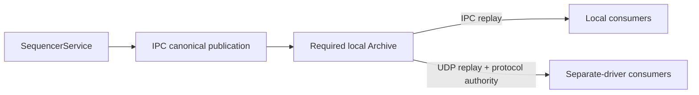
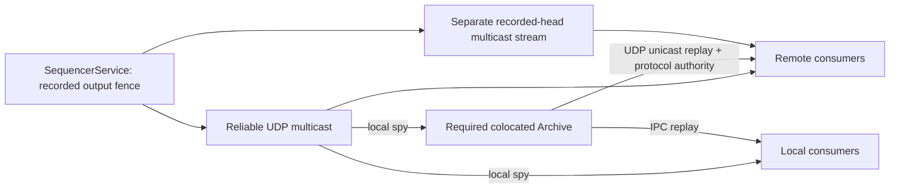

# Transport and recovery decisions

Contents: topology; multicast/flow control; Archive authority; proposed Spine increment; acceptance.
Archive protocol authority and separate-driver UDP replay are implemented in Spine. The cross-host multicast path
below remains proposed and needs distinct-host acceptance.

## Select transport by topology

| Path | Preferred starting point | Decision to verify |
|---|---|---|
| Same process, one agent handoff | Existing direct call; bounded Agrona queue/ring when ownership requires it | Avoid an unnecessary hop; preserve concurrency and overload semantics |
| Same host, independent processes | Aeron IPC | Shared-memory transport avoids UDP stack/NIC work |
| Same host consuming an outgoing UDP publication | Aeron spy subscription | Borrow local publication buffers instead of a network round trip; spies participate in backpressure |
| Cross-host canonical stream, many observers | Reliable Aeron UDP multicast where supported | Network fan-out, group/interface routing, loss repair and slow-reader policy |
| Cross-host unsupported multicast or selected destinations | UDP unicast/MDC | MDC sender replication is not native IP multicast |
| Historical catch-up to one consumer | IPC locally; reachable UDP unicast remotely | Independent pace/fence, bounded repair budget, actual remote Archive authority |
| Cluster ingress, consensus, replication and receipts | Framework topology appropriate to each link | Preserve member/session addressing; do not substitute multicast globally |

Aeron documents IPC as its fastest same-host communication mode. Native multicast can reduce sender/network
fan-out cost with many receivers; that does not prove it is fastest for one receiver or a particular NIC/network.
Compare actual p50/p99/p99.9, CPU, message sizes, loss and receiver counts. See
[channel configuration](https://github.com/aeron-io/aeron/wiki/Channel-Configuration) and
[the transport protocol](https://github.com/aeron-io/aeron/wiki/Transport-Protocol-Specification).

## Multicast configuration and receiver policy

Use an explicit multicast data group/port, interface, TTL, MTU and stream identity for the actual network. Aeron's
multicast uses an odd data group and the next even control group. Preserve reliable delivery/NAK repair; changing
to an unreliable channel changes the loss contract. Verify membership, control traffic and path MTU rather than
copying an 8 KiB throughput-demo MTU. Keep physical session IDs pinned when following a recording generation.

The pinned [channel-separation test](https://github.com/aeron-io/aeron/blob/af20315a6b6323783ae717b075ba4a70c9abbf0c/aeron-system-tests/src/test/java/io/aeron/MultipleMulticastsSubscriptionsTest.java)
shows distinct multicast groups sharing a port/stream without cross-delivery. It does not establish a deployment's
latency or routing.

Separate required recording from optional consumers. A minimum-flow-control group containing every research
consumer could let the slowest one stall live publication. Maximum/tagged strategies express different receiver
requirements; choose them from the intended reliability boundary, not a universal speed ranking. For local
consumers, tethering/untethering and Archive recovery also control lag. A recovering observer can miss live data
temporarily only if its recorded-history path preserves contiguous application.

Archive `SourceLocation.LOCAL` records an outgoing UDP publication through a spy. Spy subscriptions consume local
term buffers and affect publication backpressure. Spy connection simulation can permit recording when there are
no remote receivers; verify exact min/tagged/spy semantics with the pinned driver. Do not treat network receiver
connectivity as the only recorder-attachment proof. See
[Archive](https://github.com/aeron-io/aeron/wiki/Aeron-Archive) and the channel guide's spy/flow-control sections.

Keep canonical data and periodic recorded-head control on distinct streams. Heads help detect an idle missing
tail, while Archive repairs the data. Repair must not silently convert a control observation into a stronger
recorded or durability guarantee.

## Local versus remote Archive authority

Recording counters reside in a Media Driver's local mapped memory. A remote Archive control connection does not
expose that host's counters through the consumer's `aeron.countersReader()`.

Spine RecordingCatalog qualification obtains recording descriptors and start/active/stop positions through the
Archive protocol. Its separate-driver UDP replay test does not depend on the consumer having local RecordingPos
counters. SequencerService still fences its ordinary output recording against its colocated recorder's counters.
These same-host tests do not establish cross-host networking or multicast delivery.

Keep SequencerService colocated with its Cluster/Archive so the complete-output fence remains local.
For remote consumers, use Archive protocol requests for active/max recorded positions, stopped positions and
recording descriptors, with bounded request/lifecycle handling. Treat a catalog position as a scan fence, not a
retention lease. Validate identity and complete fragmented-message boundaries before deriving a logical head.

Pinned [PersistentSubscription](https://github.com/aeron-io/aeron/blob/af20315a6b6323783ae717b075ba4a70c9abbf0c/aeron-archive/src/main/java/io/aeron/archive/client/PersistentSubscription.java)
already has an asynchronous recorded-position path and separate live/replay subscriptions. Prefer adapting the
existing facility to inventing a merge engine. Current Spine bounded replay accepts configured channels but needs a
concrete reachable remote UDP replay endpoint; dynamic-port/response replay integration requires its own support.

## Proposed Spine transport increment

Current:

Proposed cross-host fan-out:

The service defaults to IPC and an exclusive recorded publication; consumers follow the Archive.
The multicast increment must retain log/session identity, local recorder fencing and the existing Archive protocol
authority, and qualify live/replay handover on distinct hosts. Live and replay channels remain independently selected. No
additional canonical encoding, sequencing authority or custom retransmitter is required solely for multicast.

The historical forced producer prepare/ACK cycle measured roughly 20.89 ms and is no longer on the default path.
Do not attribute that storage cost to UDP or use multicast as its proposed remedy.

Acceptance before claiming cross-host support:

- Run actual distinct-host driver/Archive clients on the declared network; same-host loopback is insufficient for
  cross-host latency, membership or remote-counter claims.
- Compare IPC/local spy, UDP unicast/MDC and native multicast for their applicable topologies under the same
  payload/rate/receiver/loss profile. Report sender cost, tails and complete recording separately.
- Prove recording continues with no remote readers, and required recorder loss fails explicitly.
- Pause/drop a remote observer, including the final idle event; detect lag via heads, replay through a complete
  fence and reconstruct identical bytes/state without stalling healthy optional consumers.
- Cover join/leave, backpressure, fragmented 64 KiB events, generation/session rollover, snapshot restart/repeated-output
  verification, remote Archive lifecycle loss and unavailable history. Preserve exact cursor identities.

Native three-member local failover is tested. Host-loss durability and external effects retain separate acceptance contracts.
