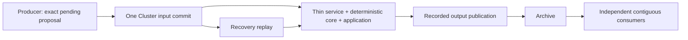

# Spine

Spine is a minimal Java/Aeron/Agrona/SBE runtime for deterministic state-machine applications.
This is release `1.0.0`; all Spine-owned schemas start at version 1.
One committed Cluster input enters a deterministic, single-writer memory core and produces canonical bytes through
an ordinary recorded publication. Replaying those inputs reproduces the same bytes. There is no canonical second
Cluster commit or continuously replaying output bridge.



Functional code is kept small; tests cover admission, byte-identical replay, snapshots, overlapping output histories,
fragmented delivery, failures and measured allocations. See [AGENTS.md](AGENTS.md) and the
[Aeron/Agrona guidance](.agents/skills/aeron-agrona/SKILL.md).

## Run

Select Java 25 with `JAVA_HOME`, then run:

```sh
./gradlew build :testkit:conformance
./gradlew :examples:run --args="--events 400 --payload-bytes 4096"
./gradlew :sequencer:stageOneAcceptance
./gradlew :sequencer:stageOneAcceptance -PaeronProfile=dedicated
```

The example uses a synthetic Archive recording and demonstrates independent consumer pause/catch-up and application
snapshot restoration, with two composed handlers sharing the eager consumer. Actual Cluster, direct output, lost receipts and replay overlap are exercised by sequencer
integration tests. Stage One retains immutable manifests, machine-readable reports and process logs beneath
`sequencer/build/reports/stage-one/`. Its fixed budgets are in the [acceptance contract](docs/stage-one-acceptance.md).
[Initial-release baseline reports](docs/evidence/1.0.0/README.md) are checked in; the
[composability increment](docs/composable-applications-result.md) records subsequent validation. Historical local run directories are not part of the repository.
A component test pass alone does not close that gate.

## Modules

| Module | Responsibility |
|---|---|
| `protocol` | Compact SBE wire, reusable flyweights, borrowed capture/provenance and validation |
| `sequencer` | Pure admission/snapshot core, injected `Application`, thin Cluster adapter and native Cluster test fixtures |
| `client` | One-slot producer; verified recording catalog; independent Archive follow and contiguous application |
| `feeds` | Bounded node-file and public WebSocket collectors; exact captured-input admission and local harness |
| `testkit` | Reusable application conformance, neutral counter and Archive/projection fixtures |
| `examples` | Runnable consumer recovery demonstration |
| `examples-binance` | Optional Binance book application, market SBE schema and replay/allocation fixtures |

Aeron 1.53.3, Agrona 2.6.1 and SBE 1.40.2 are pinned; Gradle 9.8.1 supports the Java 25 default.
Use `-PjavaVersion=21` or `-PjavaVersion=27` for an explicit comparison toolchain. See
[the measured version and startup comparison](docs/java-runtime-comparison.md). Generated codecs live in build directories.
`new SequencerCore()` and `new SequencerService()` use an immutable pass-through application: each admitted input
becomes one canonical event with its original payload. Inject an explicit `ApplicationIdentity` and an `Application` into either constructor for stateful
processing. Its four methods cover transition, snapshot, candidate restore and cached-result validation; see the
[application boundary](docs/application-contract.md#replicated-application-boundary).
An `ApplicationLimits` constructor overload declares producer count, result capacity and application snapshot capacity
before readiness. An application can encode an ordered batch in one SBE result while retaining one canonical event per input.

Feed adapters connect to Hyperliquid and Binance. Add `examples-binance` and inject `BinanceApplication.IDENTITY` with `new BinanceApplication()` to
run the existing bounded BTCUSDT L2 book with JSON/SBE reconciliation and qualified BBO inside the same deterministic
single writer. Generic protocol, client and sequencer artifacts do not depend on that module. See
[the market-state contract](docs/market-state-core.md).

## Contracts

- Schema **101/version 1** carries provisioned uint64 log/producer IDs and bounded uint64 sequences; schema **201/version 1** carries
  capture definitions and observations; optional market schema **401/version 1** carries book bindings, bootstrap chunks,
  qualified results and complete market state. Source/configuration/clock/subevent fields are uint32. IDs are never reused
  within their documented retained-history scopes. Sequence exhaustion fails before Java `Long.MAX_VALUE` wrap.
- Canonical order is committed observation order. It does not establish the physical order of external venue events.
  Sequencing time comes from the logged Cluster timestamp. Producer clock domains and original receive/complete/ready
  times are retained; `-1` means unavailable. Clock IDs alone do not prove synchronization.
- Initialization and complete SHA-256-protected snapshots bind the application ID, semantics version and configuration ID.
  Configure both native Cluster contexts with `service.configure(...)` before launch. Incompatible history fails closed.
- The admitted inner payload is a complete independently versioned SBE message, at most 64 KiB. An application may
  return it unchanged or write an SBE result prefix containing a fixed block, groups and variable data. Spine appends
  a uint32 original-input length and the entire original payload, and caches every result byte for exact retries.
  `ApplicationLimits.DEFAULT` retains 1,024 producers, 92 result bytes per producer and 2 MiB of application state.
  Explicit limits permit up to 2 MiB per result and 64 MiB of application state, with the maximum complete snapshot
  bounded to 128 MiB. Native IDs remain numeric
  where lossless or exact borrowed bytes otherwise. Raw-frame sequence is scoped to an immutable source session;
  distinct provider observations remain distinct events.
- Each producer owns one fixed pending proposal. Latest exact retry returns its original canonical receipt without
  emitting another event. Conflict, gap, expiration, log mismatch and bounded producer capacity reject explicitly.
- Pending memory survives reconnect, not process loss. A collector that requires pre-admission recovery must completely
  record exact proposals before offering and restore its latest complete captured proposal after restart. Application
  checkpoints contain state and cursor together. These boundaries belong to the collector/application.
- Every member and recovery replay may publish identical output suffixes. Cold catalog qualification verifies overlapping
  bytes using SHA-256, checks contiguous retained coverage after a trusted application checkpoint and selects one recording. Application advances only after
  its callback succeeds. A failed callback stops the consumer; restore application state before reopening.
- Consumers follow Archive recordings using fixed assembly storage. A stopped/new generation requires explicit cold
  `refresh()`. Qualification scans retained history with O(retained suffix) temporary hash storage. Idle polling
  does not rebuild catalogs. `LIVE` is cached delivery status, not current feed freshness or trading readiness.
- A publication offer is distinct from complete recording. Before accepting a compact core snapshot the service waits
  for its output recording fence, then sends the complete image in bounded publication messages. Restore validates
  the reassembled image before installation. Output and Cluster egress terms must fit the declared event/receipt
  sizes; see [capacity and transport sizing](docs/application-contract.md#capacity-and-transport-sizing).
  Retain the prior recorded prefix needed by consumers, or an earlier input baseline that can regenerate it;
  a compact snapshot cannot reconstruct earlier outputs by itself.
- Setup, restore, cold source definitions, catalog qualification and terminal failures have separate allocation budgets.
  Steady-state Spine processing uses preallocated memory; the allocation tests state their measured boundaries.
- Deployment tests cover single-host IPC, separate-driver UDP Archive replay and a native three-member local
  quorum, using page-cache recording (`fileSyncLevel=0`). Distinct-host networks, host/power loss, multicast fan-out
  and external-effect reconciliation need separate acceptance. This release is command-driven; native deadline/timer
  callbacks require a separate deterministic contract. Prefer IPC locally and reliable UDP multicast for cross-host
  fan-out on supporting networks.

See [architecture](docs/architecture.md), [core contract](docs/deterministic-core.md),
[collector/consumer contract](docs/application-contract.md), [client API](client/README.md) and
[performance evidence](docs/performance.md) and [release increment evidence](docs/release-readiness.md). Run the [real feed capture harness](feeds/README.md) for a retained
node order-level segment plus public L2, or explicit public-only mode.

## License and release

Spine is [MIT licensed](LICENSE). Run `./gradlew stagePublications` to stage library binaries, sources, Javadocs
and Maven metadata locally in `build/repository`; see [release validation](docs/releasing.md) and
[contributing](CONTRIBUTING.md). Publishing to a remote registry is a separate release action.
