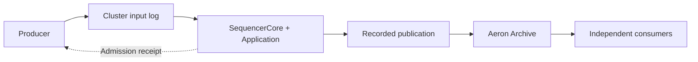

# Spine

Spine is a Java runtime for state machines that must reproduce exactly what they did. Aeron Cluster commits each
input once. A single writer applies it in memory using the logged time, then publishes the resulting bytes for
Aeron Archive to record. Replaying the same inputs from the same state reproduces the same output, byte for byte.

A producer can retry its latest proposal after losing a receipt. A consumer can pause, restore its own state and
cursor, and catch up independently. An application can be as small as a counter or as specific as an order book.



## Try it locally

Set `JAVA_HOME` to a JDK 25 installation and run the checked-in Gradle wrapper from the repository root.
The demo starts a local Archive, records 400 synthetic events, pauses one consumer, and restores a checkpoint.
It needs no feed credentials or running cluster.

```sh
./gradlew :examples:run
```

Look for the two `PASS` lines. The first confirms that the paused consumer caught up through event 400. The second
confirms that replay from checkpoint 20 produced the same final state. To exercise a replicated application, run
the counter conformance fixture. It checks exact receipts, output and snapshots at every restore point.

```sh
./gradlew :testkit:conformance
```

The fixture writes `testkit/build/reports/conformance/counter.json`. The full build runs the native Cluster and
Archive integration tests. Java 21 is also supported with `JAVA_HOME` set to JDK 21 and `-PjavaVersion=21`.
[Contributing](CONTRIBUTING.md) · [Test fixtures](testkit/README.md)

## Write an application

Supply an `ApplicationIdentity` and an `Application` to `SequencerCore` or `SequencerService`. The application
implements four operations. `apply` handles one admitted input. `snapshot` writes complete state. `restore` builds
a private candidate from that state, and `validateResult` checks its cached retry results before installation.
The default application passes each admitted payload through unchanged.

On the event path, one thread owns the application, codecs and preallocated buffers. Input slices and output buffers
are borrowed for the callback. Each admitted proposal produces one canonical event. An application can pack an
ordered batch into that event. Declare producer, result and snapshot bounds at startup with `ApplicationLimits`.
[Application contract and sizing](docs/application-contract.md#replicated-application-boundary) ·
[Counter implementation](testkit/src/testFixtures/java/spine/testkit/CounterApplication.java)

## Modules

| Module | Responsibility |
| --- | --- |
| `protocol` | SBE schemas, reusable codecs and message validation |
| `sequencer` | Admission, deterministic state transitions, snapshots and Cluster integration |
| `client` | One-slot producer, verified Archive replay and contiguous consumer delivery |
| `testkit` | Conformance fixtures, a neutral counter application and embedded Archive fixtures |
| `feeds` | File and WebSocket collectors with recorded ingress |
| `examples` | Runnable consumer checkpoint and recovery demo |
| `examples-binance` | Optional BTCUSDT order book that reconciles Binance JSON and SBE depth updates |

The generic libraries can be used independently of the feed adapters and market example.
[Client API](client/README.md) · [Feed harness](feeds/README.md) · [Binance application](examples-binance/README.md)

## Guarantees and deployment scope

- **Ordering and retries.** Canonical sequence follows committed input order. The latest byte-identical producer retry
  returns a `DUPLICATE` receipt carrying the original canonical event and sequencing time. Persist exact proposals
  before submission when capture must survive producer process loss.
- **Recording and recovery.** Before snapshotting, the service waits for Archive to record the complete published
  output. Recovery can republish a suffix. Consumers verify overlapping recordings, apply contiguous events, and
  checkpoint their application state together with the last applied sequence.
- **Allocation.** The tests measure warmed Spine-owned producer, core, output and consumer paths using allocation
  counters and a negative control. Startup, restore, cold catalog scans and user application code have separate budgets.
- **Tested topology.** The suite covers single-host IPC, separate-driver UDP replay and a local three-member quorum.
  The fixed load tests use page-cache recording. Distinct-host recovery, multicast fan-out and power-loss durability
  require additional qualification.

[Architecture](docs/architecture.md) · [Deterministic core](docs/deterministic-core.md) ·
[Stage One acceptance](docs/stage-one-acceptance.md) · [Verification results](docs/increments.md) ·
[Performance methodology](docs/performance.md)

## License and artifacts

Spine is MIT licensed. To consume version `1.0.0` from another Gradle project, stage the libraries with
`./gradlew stagePublications` and point the consumer at `build/repository`. The release guide includes the Maven
coordinates, required JVM options for consumers, and the independent build that verifies the staged artifacts.
[License](LICENSE) · [Release guide](docs/releasing.md)
