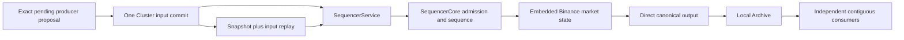
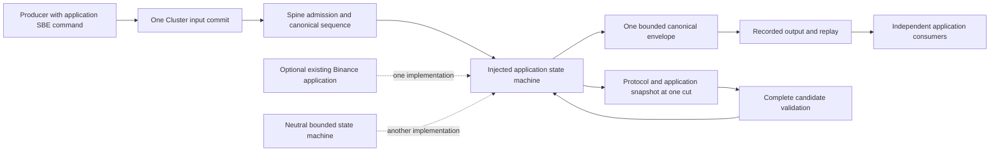

# Agora comparison and Spine completion plan

Historical comparison at the pre-release revisions below; its gaps and proposed increments describe that baseline,
not release `1.0.0`. The Spine commit labels predate the reset public history. See
[the application boundary result](application-boundary-result.md) for extraction and
[the initial release result](release-readiness.md) for completed identity, integrity, consumer recovery and packaging.
The later [composability increment](composable-applications-result.md) completes declared result/state bounds,
application-owned SBE batches and segmented snapshot publication; the gaps below remain a record of the compared baseline.

2026-11-16. Spine already has the essential deterministic Aeron architecture. Completing it as an open-source,
composable state-machine library primarily requires separating application state from infrastructure, binding recovery
to application identity, and making its correctness and operating limits independently reproducible.

Use Agora as the reference for lifecycle invariants and failure tests. Keep Spine's smaller direct data path, explicit
sequence exhaustion, exact retry contract, and output-recording fence. No exchange code needs to be imported.

## Compared revisions and verification

- Agora `main`: `43e99ae6415aee7853adf5882ac00bc2fefffc58`, dated 2026-11-12. A clean checkout was created at
  `<clean-reference-checkout>`; `git pull --ff-only origin main` succeeded and reported up to date.
  The original `Desktop/divine-agora` feature branch and substantial uncommitted work were left untouched.
- Spine: `d483386ce8e30f6eff6428195c6a6040aaf9817d`, branch `codex/in-memory-books`, initially clean.
- The earlier [core contract comparison](deterministic-core.md#local-reference-inspected) references Agora `79d803f`.
  Its observations remain historical; this review uses current `main`.
- Fresh Spine validation with Temurin 21 selected through `JAVA_HOME`: `./gradlew build -PjavaVersion=21 --no-daemon --rerun-tasks`.
  **150 tests passed, zero failures, errors or skips**: protocol 15, client 24, sequencer 85, feeds 24, testkit 2.
  Runtime was Temurin 21.0.11+10; all 31 Gradle actions executed. Reports are under each module's `build/test-results/test`.
- The default build failed before tests because Gradle did not discover Java 25 and no toolchain download resolver is configured.
  A subsequent filesystem check found the existing Java 25 installation under `~/.jdks`; this was a detection failure.
  An offline Java 21 attempt also lacked two Aeron jars; the successful run fetched the pinned dependencies.
  The Java 21 result does not establish a fresh Java 25 pass.
- Agora tests, Stage One, multi-member recovery and performance measurements were not rerun for this comparison.
  Agora test references below establish executable coverage in source, not a fresh pass on this machine.

Both repositories pin Aeron **1.53.3** and Agrona **2.6.1**. Agora uses Java 21, Gradle 8.10 and SBE 1.38.1 for its
exchange schemas; its separate FIX code generation uses SBE 1.40.2. Spine defaults to Java 25, Gradle 9.8.1 and
SBE 1.40.2. Dependency replacement is not the missing architectural work.

## What already matches and what remains

The completed Spine architecture is:

| Concern | Agora reference | Spine assessment and action |
|---|---|---|
| Pure deterministic processing | Owned logic graph, committed bytes and logged time; borrowed `EventSink` and shared `EventSequence` [A1] | Already present in `SequencerService:79–85` and `SequencerCore:55–124`. Preserve one input commit and direct output. |
| Application composition | Ordinary constructed components share sequence/sink ownership [A1] | Missing inside Spine's core. Service constructs its core; core constructs `MarketState`; schema 101 snapshots contain market fields [S1]. Consumer `EventHandler.andThen` is useful but does not make the replicated state machine composable. |
| Complete snapshots | Version/length checks, sections bound to one cut, integrity checks, exact EOF, private candidate installation [A2] | Spine already serializes complete market/retry state in canonical order and validates before installation. Generalize that property to application state; add application identity/version/configuration binding. Snapshots are not absent. |
| Snapshot transport bounds | Bounded restore; publication in 4,096-byte chunks [A3] | Spine offers one complete snapshot message. Declare maximum application/receipt image sizes and verify the actual publication maximum. Add chunking only if supported applications exceed it. |
| Output durability boundary | Direct output before best-effort session delivery [A4] | Already present. Spine additionally waits for complete output recording before snapshot acceptance, checking recording identity and registration [S2]. Keep this. Agora's snapshot callback has no equivalent wait; its graceful shutdown fence is best effort [A3]. |
| Application compatibility | Aeron `appVersion` set on both consensus and service contexts [A5] | Spine has exact SBE schema validation but no application/interpreter compatibility fence. A matching envelope cannot prove that changed code will interpret old commands identically. |
| Timers | Consensus-delivered timer callbacks; restored owner state without duplicate rearming [A3] | `SequencerService:130` is empty. Command-driven applications work today; deadline-based applications need an explicit timer contract using Aeron's existing scheduling. |
| Consumer recovery | Logical sequence checkpoints, source qualification from durable seed, Archive protocol positions and purge-race handling [A6] | Spine already verifies overlapping output bytes and applies exact-next sequences. Its catalog requires coverage from sequence 1, uses O(history) temporary hashes, reads local recording counters, and explicitly refreshes generations [S3]. Retention and remote authority remain separate additions. |
| Retained Cluster recovery | Protect oldest retained complete snapshot's input-log tail; native three-member fallback/catch-up tests [A7] | Spine's declared acceptance is single-node IPC/page-cache. Add comparable native failure tests; do not describe Agora's localhost tests as cross-host or power-loss proof. |
| Determinism evidence | Literal output/state fixtures, actual recorded output, every snapshot split, cross-environment CI [A8] | Spine already has repeated-run/all-cut and corruption tests. Package a neutral conformance harness usable by other applications; retain literal independent expected bytes, not just self-comparison. |
| Zero allocation | Owned flyweights/buffers and guarded allocation measurements | Spine's fresh suite includes its core, market, producer and consumer allocation tests. Preserve their measured boundaries and negative controls. Neither application's pure-core tests certify arbitrary user code, cold restore, networking, or the whole JVM. Agora's complete protected snapshot adapter explicitly makes no snapshot-allocation claim [A2]. |

Spine source evidence:

- [S1: SequencerCore](../sequencer/src/main/java/io/github/jstadeusiak/spine/sequencer/SequencerCore.java), lines 37,
  110, 145–159, 181–291; [protocol snapshot](../protocol/src/main/resources/spine-schema.xml), lines 74–86;
  [Wire bounds](../protocol/src/main/java/io/github/jstadeusiak/spine/protocol/Wire.java), lines 12–19.
- [S2: SequencerService](../sequencer/src/main/java/io/github/jstadeusiak/spine/sequencer/SequencerService.java),
  lines 24, 79–123 and 130.
- [S3: RecordingCatalog](../client/src/main/java/io/github/jstadeusiak/spine/client/RecordingCatalog.java),
  lines 32–48, 92 and 96–109; [CatalogSubscription](../client/src/main/java/io/github/jstadeusiak/spine/client/CatalogSubscription.java),
  lines 42–53, 64–73 and 92–100.
- [Core tests](../sequencer/src/test/java/io/github/jstadeusiak/spine/sequencer/SequencerCoreTest.java), lines 211–342;
  [market restore tests](../examples-binance/src/test/java/io/github/jstadeusiak/spine/examples/binance/MarketCoreTest.java),
  lines 187–231 and 367–425; [allocation accounting](../sequencer/src/test/java/io/github/jstadeusiak/spine/sequencer/SequencerCoreAllocationTest.java),
  lines 23–158.

## Minimal application boundary

The proposed architecture keeps application transitions inside the deterministic single writer. Moving market code
out of infrastructure does not move it into a downstream projection or discard the previously implemented book.

Inject one application owner with direct transition, snapshot-write and cold-restore responsibilities. Pass borrowed
buffers and logged time; preallocate declared bounds before readiness. Applications compose their own components
through ordinary constructors and explicit call order. Spine needs no plugin discovery, dynamic registry, dependency
container or generic collector framework. `Agrona Agent` remains the polling/lifecycle boundary outside the core.

Move `MarketState`, `BinanceBook`, `BinanceDepthDecoder` and market schema dependencies to an optional application
module. Retain their behavior, deterministic placement and existing tests. Keep generic protocol/admission, recording
and consumer recovery independently usable. A separate nonfinancial application must compile against the published
artifacts without editing Spine or depending on the market/feeds modules.

Two contracts must be settled before adding the callback:

1. **Output cardinality and exact retries.** Agora can emit zero or many frames per command. Spine currently maps
   one admitted proposal to one canonical event, and a latest exact retry returns the original result without
   repeating mutation. Preserve one envelope per input for the first increment; an application can place a bounded
   result or batch inside it. The current saved 92-byte market prefix is not enough for arbitrary application output.
   Retain bounded original result bytes with explicit per-producer and snapshot memory budgets. For example, 1,024
   producers with 64 KiB results require 64 MiB for those results alone; retain only generated bytes when the exact
   input reconstructs the rest. Do not recompute results against later state. Independent zero-to-many canonical
   events require a later cursor/receipt contract.
2. **Atomic recovery of the whole application.** Snapshot protocol state, retry results and all application components
   at the same logical cut. Validate identity, supported versions, configuration/domain binding, sizes, integrity and
   exact consumption before installing any component. Application semantics identity must also bind initialization
   and input replay without a snapshot; snapshot encoding version alone is insufficient. Reject an incompatible
   candidate while retaining the prior state. Preserve explicit unsigned identity handling and sequence-exhaustion checks; do not copy Agora's raw
   event-sequence wrap behavior. Prefer an explicit format break before public release to speculative compatibility code.

The identity/version fields bind declared semantics; they cannot prove arbitrary application code deterministic.
The application conformance harness supplies that behavioral evidence. Application ordinary rejections must be
deterministic and within declared capacities; a partially mutated application cannot be treated as if `ABORT` rolled
it back. Infrastructure failure after mutation remains fatal and recovers from authoritative input.

## Completion increments and acceptance

These are proposed increments, not changes already made. Show the current/proposed component diagrams and precise
gate before each runtime increment. Retain before/after handwritten production size and measured behavior; repeat
performance gates when runtime changes affect their path.

| Order | Small increment | Acceptance |
|---|---|---|
| 1 | Extract the application owner and move Binance code/schema to an optional module | Neutral bounded example and current market application use the same runtime. No market dependencies in generic artifacts. Lost receipt/exact retry never repeats application mutation. Existing byte/state oracles and allocation gates pass; account for generic result-storage capacity. |
| 2 | Version the complete application snapshot and wire application compatibility into Aeron | Every input cut matches uninterrupted state/output. Wrong application/version/configuration, invalid bounds, corruption, truncation, trailing bytes and mixed-cut components fail before install. Both native contexts use compatible app versions. Test the maximum snapshot against actual publication limits. |
| 3 | Publish a reusable conformance testkit and neutral replay example | Independent command/time corpus, expected output and snapshot bytes; pure and actual recorded paths agree. Every-cut restore, retries/rejections and maximum payloads pass. Allocation accounting fails when unavailable and detects escaping allocations. Example demonstrates grouped state-plus-cursor recovery and two independently paced consumers. |
| 4 | Close snapshot/output failure and multi-member recovery tests | Delay/stop recording during snapshot; fail output after mutation; lose receipts; change leader; restart follower; replay overlapping suffixes. Consumers remain contiguous and byte-identical. Explicit older-snapshot recovery retains its necessary input tail. Start with native three-member localhost tests, then separately qualify host failure/durability if claimed. |
| 5 | Add retention-relative consumer recovery, then remote Archive authority if included in release scope | Checkpoint S needs verified complete coverage from S+1, without trusting unverified overlaps or source-local offsets. Test old-prefix removal, stale hints, gaps/conflicts, purge between qualification/replay, recording rollover and unavailable history. Remote progress comes from Archive protocol authority; test endpoint ownership and remote restart. Keep cold allocation separately budgeted. |
| 6 | Add native deterministic timers when the public contract includes deadlines | Logged fire time/correlation IDs reproduce identical outputs. Test before/at/after deadline, cancellation, snapshot restart and leader changes, including pending timer state without double scheduling. No wall-clock decisions enter application state. |

Library release work can run alongside these increments:

- Align [CI's Java 21 setup](../.github/workflows/build.yml) with the selected default Java 25 toolchain, or explicitly
  test each supported version. Its current command supplies no override. This is an observable configuration mismatch,
  not evidence that hosted CI was run during this review.
- Add small deterministic fixture comparisons across supported environments, allocation gates and a deliberately
  selected native recovery/Stage One gate. `build` currently excludes `StageOneAcceptanceTest`; the separate task
  exists but the checked-in workflow does not invoke it.
- Choose and add the project license; add consumable library publication, sources/Javadocs, version policy and a
  neutral quick start. No repository license/notice or Maven publication setup was found in the compared tree.
- Expose the existing useful test fixtures to application authors. The real `ClusterFixture` currently resides in
  sequencer tests; `testkit` exposes synthetic Archive fixtures. The existing `FeedMain` launcher is a real local
  launcher but couples startup to collectors. Prefer a small neutral embedding example over a deployment framework.
- State allocation and durability scope in the public contract: warmed Spine-owned processing, separately budgeted
  startup/restore/catalog work, and an explicit application obligation. Current single-host IPC/page-cache acceptance
  cannot be advertised as host/power-loss durability or remote multicast readiness. Cached consumer `LIVE` is not a
  current source-freshness or readiness proof.

Remote multicast, a remote Archive authority, external-effect reconciliation and a production warmup/readiness gate
remain explicit capabilities to qualify. A first release may document a narrower supported envelope; it must not
imply those capabilities from Aeron dependency selection alone. No comparative latency claim follows from this review.

The transferable parts of Agora are its ownership rules, version fences, complete recovery checks and failure tests.
Leave exchange engines, accounts/ledgers, risk, settlement, funding, signed financial requests, exchange authentication,
gateways, JDBC projection stores, SQL indexes, offload daemons and deployment topology outside Spine.

## Production size and reference evidence

Handwritten production Java, lexically stripping comments while retaining strings, nonblank imports and braces:

| Module | Before comparison | After comparison |
|---|---:|---:|
| protocol | 267 | 267 |
| client | 561 | 561 |
| sequencer | 1,370 | 1,370 |
| feeds | 787 | 787 |
| Total runtime | **2,985** | **2,985** |

Generated code, tests and fixtures are excluded; the example is a separate 60 lines. This comparison changes
documentation only. Extraction should reduce generic infrastructure's domain coupling; moving lines between modules
must not be presented as a reduction in total maintained code.

Agora references below are pinned to the pulled revision. Domain-specific classes illustrate invariants to implement
minimally; they are not proposed dependencies or code to copy.

- **A1:** [EventSink](https://github.com/launchonsoar/divine-agora/blob/43e99ae6415aee7853adf5882ac00bc2fefffc58/core/src/main/java/com/trysoar/agora/core/EventSink.java#L5),
  [EventSequence](https://github.com/launchonsoar/divine-agora/blob/43e99ae6415aee7853adf5882ac00bc2fefffc58/core/src/main/java/com/trysoar/agora/core/EventSequence.java#L3),
  [logic routing](https://github.com/launchonsoar/divine-agora/blob/43e99ae6415aee7853adf5882ac00bc2fefffc58/core/src/main/java/com/trysoar/agora/core/SpineLogic.java#L598).
- **A2:** [complete image framing](https://github.com/launchonsoar/divine-agora/blob/43e99ae6415aee7853adf5882ac00bc2fefffc58/core/src/main/java/com/trysoar/agora/core/intent/ProtectedServiceImage.java#L82),
  [section integrity and cut binding](https://github.com/launchonsoar/divine-agora/blob/43e99ae6415aee7853adf5882ac00bc2fefffc58/core/src/main/java/com/trysoar/agora/core/intent/ProtectedOrderSnapshots.java#L196),
  [exact EOF](https://github.com/launchonsoar/divine-agora/blob/43e99ae6415aee7853adf5882ac00bc2fefffc58/core/src/main/java/com/trysoar/agora/core/intent/ProtectedOrderSnapshotStream.java#L50).
- **A3:** [restore and atomic install](https://github.com/launchonsoar/divine-agora/blob/43e99ae6415aee7853adf5882ac00bc2fefffc58/core/src/main/java/com/trysoar/agora/core/AgoraClusteredService.java#L724),
  [snapshot publication](https://github.com/launchonsoar/divine-agora/blob/43e99ae6415aee7853adf5882ac00bc2fefffc58/core/src/main/java/com/trysoar/agora/core/AgoraClusteredService.java#L960),
  [timer callback](https://github.com/launchonsoar/divine-agora/blob/43e99ae6415aee7853adf5882ac00bc2fefffc58/core/src/main/java/com/trysoar/agora/core/AgoraClusteredService.java#L1218),
  [shutdown fence](https://github.com/launchonsoar/divine-agora/blob/43e99ae6415aee7853adf5882ac00bc2fefffc58/core/src/main/java/com/trysoar/agora/core/AgoraClusteredService.java#L1405).
- **A4:** [egress publication](https://github.com/launchonsoar/divine-agora/blob/43e99ae6415aee7853adf5882ac00bc2fefffc58/core/src/main/java/com/trysoar/agora/core/EgressPublisher.java#L74).
- **A5:** [native application-version configuration](https://github.com/launchonsoar/divine-agora/blob/43e99ae6415aee7853adf5882ac00bc2fefffc58/core/src/main/java/com/trysoar/agora/core/ClusterConfig.java#L153).
- **A6:** [logical checkpoints](https://github.com/launchonsoar/divine-agora/blob/43e99ae6415aee7853adf5882ac00bc2fefffc58/edge/src/main/java/com/trysoar/agora/edge/consume/PositionCheckpoint.java#L3),
  [Archive authority](https://github.com/launchonsoar/divine-agora/blob/43e99ae6415aee7853adf5882ac00bc2fefffc58/edge/src/main/java/com/trysoar/agora/edge/consume/ArchiveControl.java#L14),
  [retention-relative source qualification](https://github.com/launchonsoar/divine-agora/blob/43e99ae6415aee7853adf5882ac00bc2fefffc58/edge/src/main/java/com/trysoar/agora/edge/consume/EgressSourceQualifier.java#L637),
  [replay lifecycle](https://github.com/launchonsoar/divine-agora/blob/43e99ae6415aee7853adf5882ac00bc2fefffc58/edge/src/main/java/com/trysoar/agora/edge/consume/ReplayFollowSource.java#L170).
- **A7:** [native retained-tail recovery tests](https://github.com/launchonsoar/divine-agora/blob/43e99ae6415aee7853adf5882ac00bc2fefffc58/edge/src/test/java/com/trysoar/agora/core/CommandLogFallbackRecoveryIT.java#L67).
  Newer snapshots are explicitly invalidated; this is not automatic corrupted-snapshot fallback.
- **A8:** [literal corpus and every-cut tests](https://github.com/launchonsoar/divine-agora/blob/43e99ae6415aee7853adf5882ac00bc2fefffc58/core/src/test/java/com/trysoar/agora/core/ActiveDeterminismCorpusTest.java#L32),
  [determinism CI](https://github.com/launchonsoar/divine-agora/blob/43e99ae6415aee7853adf5882ac00bc2fefffc58/.github/workflows/ci.yml#L205).
