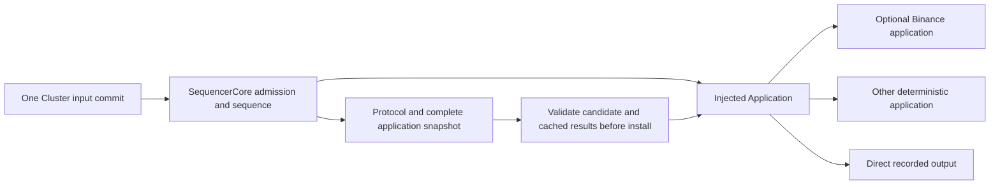

# Application boundary extraction

Historical result at extraction commit `16416d6`; see [release readiness](release-readiness.md) for the initial release
and [composability](composable-applications-result.md) for the later variable result and snapshot contract.
The commit IDs below predate the public history reset. Raw reports are local artifacts under `build/`, not files
published in this repository; their paths identify the original measurements.

2026-11-16. The first open-source increment extracts one four-method `Application` boundary and moves Binance
book logic, codecs/schema and market tests into optional `examples-binance`. The generic protocol, client and
sequencer artifacts contain no market classes or schema. Baseline: `d483386ce8e30f6eff6428195c6a6040aaf9817d`.



Default `SequencerCore` and `SequencerService` constructors use `Application.PASS_THROUGH`. For current usage, select
`new SequencerService(BinanceApplication.IDENTITY, new BinanceApplication())` or
`new SequencerCore(BinanceApplication.IDENTITY, new BinanceApplication())`; reopen Binance snapshots with the same identity
and application. The extraction preserved market transition behavior and binary output/snapshot layout.
See the [application contract](application-contract.md#replicated-application-boundary) and
[optional module](../examples-binance/README.md).

The boundary retains existing limits: 1,024 producers, 64 KiB input, an optional 8–92-byte fixed SBE result prefix,
and 2 MiB of application snapshot state. Spine appends the original input's uint32 length and exact bytes. It caches
only the prefix and reconstructs exact retries without invoking the application. Snapshot field names become generic;
field IDs, wire sizes and schema version stayed unchanged at extraction. Application identity/version admission was
completed in the later release; timer and transport extensions retain their separate acceptance gates.

Restore creates a private application candidate and validates all protocol receipts and application result prefixes
before installation. A new producer's cache row is cleared, including after restoring an earlier snapshot into a
used core; this prevents short/empty results from retaining discarded state. Existing producers retain their stored
padding, preserving historical snapshot bytes. The output-recording fence remains unchanged.

## Behavior and allocation evidence

All validation used **Temurin 21.0.11+10**, with the documented `-PjavaVersion=21` override. Java 25 remains the
declared default and was not detected by that Gradle invocation. A later filesystem check found the existing
installation under `~/.jdks`; those extraction measurements remain Java 21 results. Dependencies and JVM defaults were not changed.

- **161 tests pass**, zero failures/errors/skips: protocol 16, client 25, sequencer 52, feeds 24, testkit 2,
  optional Binance 42. The fresh full suite and subsequent cache-regression verification are retained in
  test counts (local artifact: `build/reports/application-boundary-20261116/tests.json`) and
  final build log (local artifact: `build/reports/application-boundary-20261116/final-build-shared.log`).
- Neutral application tests cover prefixes 0/8/16/92, exact input preservation, retries after other producers mutate
  state, every-cut restore, invalid candidate/result rejection without replacing live state, and in-place earlier
  snapshot restore versus fresh restore. A native Cluster test covers application injection, snapshot restart,
  committed suffix replay, lost receipts and subsequent state progression.
- Existing Binance book, decoder, market snapshot and native recorded-path tests moved with the optional module.
  The shared native Cluster fixture moved to sequencer test fixtures, without duplication; the existing smoke
  bundle still packages it.
- Strict warmed allocation gates pass for generic and Binance core paths, snapshots, producer/consumer paths,
  ordinary retry/rejection and maximum input/result sizes. Neutral tests use two exact-zero measurement windows,
  supported/enabled/nonnegative accounting and an escaping-allocation negative control. Setup, candidate restore,
  cold catalogs, test observers and arbitrary application code are outside these measured steady-state claims.

Independent byte comparison (local artifact: `build/reports/application-boundary-20261116/byte-equivalence.json`) ran frozen
baseline classes and the extracted runtime against the same retained corpus. It compared actual decompressed bytes:

| Stream | Records | Result |
|---|---:|---|
| Command bytes and logged time | 1,441 | Identical |
| Canonical events | 1,441 | Identical |
| Admission receipts including initialization | 1,442 | Identical |
| Exact duplicate receipts at changed retry times | 1,441 | Identical |
| Snapshots at every input boundary | 1,442 | Identical; 245,306,440 bytes compared |

The final-code witness (local artifact: `build/reports/application-boundary-20261116/byte-equivalence-final-code.json`) records
source/class hashes before and after export. Exporter source, invocations and both byte streams are retained beside it.

## Fixed acceptance and timing

Both unchanged Stage One profiles pass: 1,000 inputs scheduled at 100/s, the 256 × 64 KiB burst, captured producer
crash/retry, consumer catch-up, snapshot/input-suffix replay and exact repeated-output qualification. These are
single-host, single-node IPC/page-cache runs; they do not establish host/power-loss or remote transport guarantees.

| Final run | Admission p99 | Recorded p99 | Applied p99 | Maximum schedule lateness | Live catch-up |
|---|---:|---:|---:|---:|---:|
| Shared | 14.648 ms | 7.458 ms | 7.563 ms | 6.642 ms | 9.330 ms |
| Dedicated | 11.420 ms | 0.956 ms | 1.144 ms | 3.069 ms | 9.469 ms |

Local reports are under `sequencer/build/reports/stage-one/`:
`run-7bd301ed-10eb-4b5e-b5db-95a0f0d86dd4/report.json` (shared) and
`run-caa74bac-0ffb-4ebf-9713-4771d31d446a/report.json` (dedicated).

Admission is producer-local elapsed time; recording/application are parent-observed signals with control I/O.
These columns are distinct measured boundaries and must not be subtracted as sequential phases. Both runs sampled
at most one event of Archive-delivery lag; the full reports retain heap, CPU and recovery observations. No CPU gate
or affinity was enabled, and storage used `fileSyncLevel=0`.

Three alternating baseline/extracted core pairs (local artifact: `build/reports/application-boundary-20261116/paired-core/summary.json`)
used the same retained corpus and macOS aarch64 host (16 logical processors), Java 21, 512 MiB heap, 40 warmup
replays and 400 measured replays: 572,800 observations per run. Values are independent-run ranges, not pooled percentiles. The boundary is preencoded proposal through
core processing and borrowed result; transport, setup/restore and cold oracle hashing are excluded.

| Runtime | p50 | p99 | p99.9 | Maximum |
|---|---:|---:|---:|---:|
| Frozen baseline | 0.458 µs | 4.458–4.708 µs | 18.125–18.916 µs | 53.542–185.667 µs |
| Extracted Binance application | 0.417–0.458 µs | 4.292–4.542 µs | 17.583–19.375 µs | 53.083–319.083 µs |

The percentile ranges overlap and the extracted run includes a larger maximum. These samples establish no speed
improvement or hard tail bound. All run profiles and invocations, including the initial baseline diagnostic, remain
under `build/reports/application-boundary-20261116/`.

## Handwritten production size

NCLOC excludes generated code, tests/fixtures, comments and blank lines; imports and braces count.

| Module | Before | After |
|---|---:|---:|
| protocol | 267 | 271 |
| client | 561 | 557 |
| sequencer | 1,370 | 416 |
| optional examples-binance | 0 | 1,001 |
| feeds | 787 | 787 |
| **Total maintained runtime** | **2,985** | **3,032** |

**Net +47 lines.** Generic protocol/client/sequencer now total 1,244 lines. Moving market code is not counted as a
reduction in total maintained runtime. The separate existing demo stays at 60 lines.
Count details (local artifact: `build/reports/application-boundary-20261116/production-ncloc.json`) and
generic JAR inspection (local artifact: `build/reports/application-boundary-20261116/generic-artifacts.json`) are retained.

Reproduce the behavioral gates with the supported JDK installed:

```sh
./gradlew build -PjavaVersion=21 --no-daemon
./gradlew :sequencer:stageOneAcceptance -PjavaVersion=21 -PaeronProfile=shared
./gradlew :sequencer:stageOneAcceptance -PjavaVersion=21 -PaeronProfile=dedicated
./gradlew :sequencer:binanceSmokeBundle -PjavaVersion=21
```
