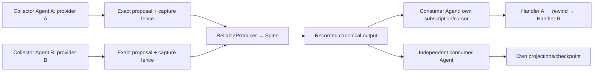

# Collector and consumer contract

Spine applications compose existing Agrona `Agent` owners, `ReliableProducer` admission and `EventHandler`
transitions. This contract standardizes those boundaries. There is no collector base class, generic event object,
router, plugin loader or new sequencing service. Feed connections, capture recording and independent consumer state
belong to their application owners. The replicated `Application` boundary below supplies stateful core behavior;
it is separate from downstream `EventHandler` composition. The user's 2026-10-08 [market-state extension](market-state-core.md)
still executes venue books and reconciliation inside the pure core, now through optional `examples-binance`.



## Replicated application boundary

Inject an `ApplicationIdentity` and an `Application` into `new SequencerCore(identity, application)` or
`new SequencerService(identity, application)`. Both default constructors use `Application.PASS_THROUGH`, which
retains the original input and has no application state. The optional `examples-binance` module supplies
`BinanceApplication.IDENTITY` and `new BinanceApplication()`; generic artifacts have no dependency on it.

| Method | Responsibility |
|---|---|
| `apply` | Mutate once per admitted input using borrowed bytes/proposal metadata and logged nanoseconds; write an optional bounded result prefix. Exact retries never call it. |
| `snapshot` | Write complete canonical application state within the declared `stateBytes` bound into borrowed output without allocation. |
| `restore` | At a cold boundary, return a fully validated private candidate for the supplied snapshot and canonical sequence; leave the existing owner unchanged. |
| `validateResult` | Validate a restored cached prefix, including empty pass-through results, without changing the candidate's state. |

A zero-length prefix leaves the original inner SBE message unchanged. Otherwise, the result prefix contains an SBE
header and fixed block, optionally followed by groups and variable data within the declared `resultBytes` bound.
The application can encode several ordered outputs in this one result. Spine appends a little-endian uint32 length and the complete original
input. The canonical payload therefore remains an application SBE message with the original input as its final
variable-data field. The application owns its batch framing, decoding and full `validateResult` checks; generic wire
validation checks only the outer SBE framing. The core caches all prefix bytes for each producer's latest exact retry;
no transition or derived result is recomputed against later state. Every admitted input produces one canonical envelope.

Compose application components with ordinary constructors and explicit call order. All mutable state, codecs and
scratch belong to the core owner and are preallocated before readiness. Do not retain callback buffer views or
rewrap the borrowed proposal decoder; do not use live clocks, I/O, randomness or external effects. Ordinary domain
rejections are deterministic application results. A contract failure after mutation is fatal and requires recovery;
it cannot be rolled back by transport polling.

Restore validates the whole application candidate and every producer's cached result before replacing application
or protocol state. Components must not install themselves incrementally. The application owner returned by
`core.application()` is borrowed and is replaced after successful restore. Restart with the same application and
interpreter. Construct stateful cores/services with an explicit immutable `ApplicationIdentity(id, version,
configurationId)`. Provision non-reused IDs: a changed interpretation or snapshot format needs a new version; a
changed immutable configuration needs a new configuration ID. Default pass-through uses `(1, 1, 1)`.

Schema 101/version 1 initializes the log with that identity. A mismatched committed initialization terminates the
service before mutation, including input replay without a snapshot. Snapshots bind the same identity, sequence,
complete retry cache and application bytes with SHA-256 (all bytes except the digest field itself). This detects
accidental corruption and mixed cuts; it is not authentication against a party able to replace the image and digest.
An incompatible or corrupt snapshot fails before `Application.restore` is called.

Call `service.configure(consensusContext, serviceContext)` before launching either native Cluster component. It
sets the application version and exact version validator on both contexts. The service also checks the configured
version at startup. This release supports command-driven transitions and logged command time. It does not expose
Aeron timer scheduling or deadline callbacks; adding them requires a separate deterministic timer/output contract.

The initial release uses version 1 for each Spine-owned schema.

### Capacity and transport sizing

`ApplicationLimits(producers, resultBytes, stateBytes)` is immutable setup configuration. Pass it to
`new SequencerCore(identity, application, limits)` or
`new SequencerService(identity, application, limits, outputChannel, outputStream)`.
The existing constructors use `ApplicationLimits.DEFAULT`:

| Bound | Default | Allowed declaration |
|---|---:|---:|
| Producer slots | 1,024 | 1–1,024 |
| Result prefix bytes per producer | 92 | 8–2,097,152 |
| Application snapshot bytes | 2,097,152 | 0–67,108,864 |

The maximum complete snapshot is `72 + producers * (68 + resultBytes) + 4 + stateBytes` bytes and must not exceed
128 MiB. Invalid declarations fail before allocation. The core preallocates the flat result cache and output/snapshot
storage from these bounds before readiness; choose only the producer count the application needs. Changing the
declaration requires a new provisioned application configuration ID. Pass-through may return zero bytes even though
the minimum declared result capacity is eight.

Snapshots write each receipt's 64 bytes of metadata, a uint32 result length and only the used result bytes, followed
by the application-state length and bytes. Unused capacity is not serialized. Restore rejects a snapshot that exceeds
the local declaration, then validates the digest, all receipts and the private application candidate before installation.
The service waits for its output recording fence and splits the snapshot image across messages no larger than the
snapshot publication's `maxMessageLength()`. Cold restore accumulates the bounded stream and validates the complete image.

`limits.eventBytes()` is the maximum canonical event size: `72 + resultBytes + 4 + 65,536`.
The service refuses startup if its canonical output publication cannot carry this size. Configure the client egress
channel for a receipt payload of at least `Wire.RESULT_OVERHEAD + limits.eventBytes()` bytes, plus
`AeronCluster.SESSION_HEADER_LENGTH` in the publication message. This egress sizing is the embedding application's
responsibility. At the hard 2 MiB result bound, 32 MiB terms provide a 4 MiB maximum message and fit both paths.
Snapshot chunks do not require the complete snapshot to fit one publication message.

## Ownership and lifecycle

Use Agrona `Agent` (`onStart`, `doWork`, `onClose`, `roleName`) for a polling component. `doWork` performs bounded
work without blocking and returns actual work done. Bind callbacks, codecs, fixed buffers and handlers during setup.
One owner operates each source connection, publication, producer, subscription and mutable projection. A composite
consumer owns all of its handlers. Each runner owns its idle strategy; Agrona `CompositeAgent` may share an owner
when the components have a compatible bounded execution budget.

Run the producer's egress/keepalive polling even while input capture is incomplete. Explicit startup/recovery may
connect, replay, rebuild a catalog or allocate; ordinary `doWork` must not turn idle polls into cold operations.
Stop explicitly on terminal failure. `onClose` closes owned resources; injected/shared Archive or Aeron resources
remain with their declared owner. No hot locks, hidden growing queues or per-event domain objects are required.

## Collector records

A collector publishes schema 201 `SourceDefinition` and `CaptureObservation` inside the standard schema 101
proposal. The outer `(sourceId, sourceConfigVersion, clockId)` binds one immutable definition in its log. Publish
and obtain admission for that definition before observations referencing it. If the meaning changes, publish a new
configuration revision; never redefine an existing binding. ID provisioning remains application configuration.
Definitions and producer recovery must survive the same declared loss boundary as observations.

Provider labels identify the actual upstream feed/provider, separately from the venue. Two feeds reporting the same
venue event have distinct source IDs and remain distinct canonical observations. Native event identity is a match
candidate within a declared venue namespace; matching also needs product/channel/session or epoch where applicable.
Missing identity is never evidence that two observations are the same event. Preserve lossless numeric IDs or exact
native bytes; do not truncate or hash an identity into a smaller identity. SBE reserves uint64 all-ones as null;
a real native ID of 18,446,744,073,709,551,615 must use exact bytes in its declared encoding.

For the first collector profile, capture **one complete application message per observation**, with subevent index
zero. The definition's product label is its immutable subscription/product scope, including an explicit multiplexed
scope when applicable; normalized children carry their actual products. Declare the raw boundary and any transport
decoding/decompression; retain those bytes exactly. Number every
message at that boundary, including control and malformed messages, with a positive, increasing raw-frame sequence.
This sequence is scoped to the declared source session. A frame containing several products/events has one capture;
interpreters assign deterministic child indexes in wire order. A single native ID is unavailable when the
frame has no unambiguous single identity. The wire can carry other subevent layouts, but those need a new explicit
profile rather than an implicit change to this one.

The complete inner payload limit is 65,536 bytes. A capture observation leaves **65,500 minus native-ID byte length**
bytes for the raw message; native bytes have their own 4,096-byte bound. Do not truncate oversized input or silently
drop it. Configure a bounded source-specific failure/resumption policy and test it before claiming complete capture.
Source-level gaps, reconnects and overload are observable operational failures, not evidence of continuous input.

## Cold source profile v1

Use UTF-8 JSON in the existing `SourceDefinition.configuration` field, at most 4,096 bytes. The profile marker is
`spine.capture.v1`. This is a cold application convention: Spine's wire validation checks the definition's UTF-8
and size, but does not parse JSON, load parsers or enforce this profile. Applications claiming this contract validate
it before accepting observations. Reject duplicate keys, missing/unknown interpretation fields and unsupported
profile versions. Keep the exact recorded configuration bytes immutable; JSON canonicalization is unnecessary.

Required fields are:

| Field | Meaning |
|---|---|
| `profile` | Exact version marker `spine.capture.v1` |
| `venue`, `channel` | Venue namespace and feed channel/event family; product scope remains in the product label |
| `parser.artifact`, `parser.sha256`, `parser.entrypoint`, `parser.parameters` | Retained collector/extraction parser bundle, SHA-256 of its exact bytes, entry point and complete interpretation parameters |
| `raw.boundary`, `raw.representation`, `raw.transformation` | Complete-message boundary, byte encoding and exact transport transformations before capture |
| `native.namespace`, `native.representation` | Native identity scope/epoch rules and numeric/exact-byte/missing encoding rules |
| `clock.domain`, `clock.origin`, `clock.resolutionNanos` | Time domain, retained origin/calibration reference and positive nominal resolution |
| `clock.receive`, `clock.complete`, `clock.ready` | Exact observation points, including explicit unavailable values |

The parser bundle must retain the executable and dependency versions needed to reproduce extraction, not merely
an unpinned URL or Git branch. `parameters` is an object, including an empty object when there are no parameters.
The SHA-256 is 64 lowercase hexadecimal characters. All other fields except the positive integer resolution are
nonempty strings. Existing provider/product/session/collector/clock labels and synchronization uncertainty are not
duplicated into JSON. Deployment endpoints, credentials, Archive IDs and recorder fences belong in run configuration.

Illustrative configuration; substitute the retained bundle and its digest before publishing:

```json
{
  "profile": "spine.capture.v1",
  "venue": "example-venue",
  "channel": "l2",
  "parser": {
    "artifact": "retained:example-feed-parser-v1.bundle",
    "sha256": "<sha256-of-retained-parser-bundle>",
    "entrypoint": "example.feed.Parser",
    "parameters": {}
  },
  "raw": {
    "boundary": "one complete WebSocket application message, including control messages exposed by the client",
    "representation": "UTF-8 bytes",
    "transformation": "WebSocket reassembly; compression disabled"
  },
  "native": {
    "namespace": "venue + product + channel + venue session epoch",
    "representation": "lossless uint64 when single-valued; otherwise exact bytes; absent for multi-event frames"
  },
  "clock": {
    "domain": "collector monotonic relative nanoseconds",
    "origin": "retained origin for this collector process incarnation",
    "resolutionNanos": 1,
    "receive": "first fragment observed by collector callback; -1 when unavailable",
    "complete": "last fragment assembled into complete application message",
    "ready": "capture proposal ready after identity extraction"
  }
}
```

The clock ID refers to an actual domain and origin, not just a clock function's name. `System.nanoTime()` may be
negative and its origin is unspecified: use a declared nonnegative relative origin or a measured epoch clock.
Provision a new clock binding when the origin changes. Same-host or cross-process comparability requires a shared
origin/calibration contract, and cross-host comparisons require synchronization evidence and uncertainty. All
timestamps use nanoseconds; `-1` means unavailable. Venue timestamps remain in raw/native data. Sequenced time is
logged Cluster time, not a substitute for receive time or a clock synchronization proof.

## Capture and admission

The collector's admission loop follows this order:

1. Finish a frame, assign lineage/times and encode its capture observation in a reused buffer.
2. `submit` it to the producer's one slot. Once accepted locally, retain that exact pending proposal.
3. Offer `pendingBuffer()/pendingLength()` to the application-owned capture publication and retain its positive
   end position. Keep calling `producer.poll(false)` while complete recording is pending.
4. Confirm the entire proposal is recorded, including its last fragment. For a local recording counter, pin its
   recording ID **and counter registration**, check both before and after reading its value, and require the value
   to reach that proposal's end position. A remote recorder needs a separate authority protocol.
5. Call `producer.poll(true)` to allow offers/retries. Capture once; every retry uses the exact pending bytes.
6. Only an accepted/duplicate correlated receipt clears the slot. An ordinary rejection retains it and pauses
   offers; resolve its cause before an explicit `retryPending`. Do not overwrite an unacknowledged proposal.

`poll(false)` does not undo a prior offer or admission; it still consumes receipts. `poll()` retains its existing
meaning of `poll(true)`. The gate is caller-supplied authority, not an internal durability assertion. Publication,
complete recording, admission, canonical output recording and application remain separate progress points. Archive
file synchronization and process/host/power-loss guarantees require a declared, tested deployment policy.

One slot bounds throughput to this cycle. Pause/backpressure the source or use a declared, preallocated bounded
buffer; when the source cannot pause, specify and test overload/resumption. Do not promise lossless capture of an
unbounded source by adding an undocumented queue.

On process restart, replay the latest complete captured proposal for the same retained producer incarnation,
construct the producer at that exact producer sequence, and `restoreExact` before connecting. Reoffer it unchanged;
one outstanding proposal makes it either pending or the latest admitted proposal. A valid contiguous pending
proposal can be accepted or return its original duplicate receipt; ordinary rejections remain explicit and retained.
Restore the raw-frame allocator
for the same source session, or declare a new session/configuration before new frames. A terminal incomplete capture
frame may be discarded only under the capture-before-admission contract proving it was never offered. Malformed
complete history and earlier discontinuities must fail. Recovering a prior checkpoint alone is insufficient.
Loss before complete capture requires upstream source resumption or an explicit gap; Spine cannot recreate bytes
that were never captured. The Stage One worker is a fault fixture, not a general collector recovery library.

## Consumer transitions and composition

`EventHandler` is the application transition signature. Its buffer and decoder are borrowed until return; reuse
your own inner SBE decoders and scratch. Use numeric source/schema/template/version dispatch. Resolve definitions
and parser artifacts during startup or an explicit definition transition, not with per-observation String lookup.

`left.andThen(right)` is created once during setup and invokes handlers in order. It rewinds the outer SBE decoder
before each handler so both can consume its variable payload. Nested chains behave the same way. Handlers must not
rewrap the shared outer decoder to different bytes; inner decoders are owned by the application. Handler order is
part of the interpreter. An exception prevents later callbacks; it cannot roll back earlier handler state.

One chain shares one `CatalogSubscription` cursor. Checkpoint **all** grouped state and that global cursor together,
with interpreter/parser/profile versions and the retained definition bindings needed after that cursor. Reopening
from a cursor does not redeliver earlier definitions; restore those bindings or explicitly preload them. Restore
the whole group after a failure. A projection that needs its own
recovery, pace or failure domain uses its own subscription and checkpoint. Separate services remain independent
consumers; one slow optional consumer does not become another application's admission requirement.

Every callback observes the global sequence, including definitions and intentionally ignored known messages.
Advance the global cursor only after successful application; filtering a known irrelevant event still completes
that transition. Missing definitions and unsupported relevant schemas/versions fail explicitly. A research consumer
may interpret preserved raw bytes with a different parser; record that immutable interpreter in its run manifest
and checkpoint rather than changing the collector's definition.

The optional Binance application owns authoritative venue-book materializations, native reconciliation and BBO
evaluation inside the core. Further pricing applications follow the same deterministic boundary. Independent consumers may maintain research or strategy
projections with their own grouped checkpoints. Preserve raw observations for alternate interpretation and audits.
The [market-state contract](market-state-core.md) supersedes the earlier exclusion of market logic from the core;
external orders and other effects still need replay-safe reconciliation outside it.

## Conformance gate

Every concrete collector/application supplies retained golden inputs, expected encoded metadata/bytes and deterministic
projection/checkpoint results. Run the same fixtures for each provider adapter against this contract.

| Boundary | Required evidence |
|---|---|
| Definition and identity | Immutable binding precedes use; provider separation; numeric, byte, absent and scoped native IDs |
| Frame interpretation | Exact raw bytes; multi-event/product ordering; control/malformed input; version/artifact binding |
| Clocks | Fixed observation points, missing times, resolution/origin change and stated uncertainty |
| Capacity and loss | Maximum raw/native payload; oversize, full slot, overload, reconnect and upstream gap policy |
| Capture/admission | No offer before complete capture; heartbeats/receipts progress while gated; exact retries and restart suffix |
| Consumer | Full replay equals checkpoint plus suffix; filtered global cursor; grouped/independent failure recovery |
| Allocation/performance | Actual adapter/owner paths with supported accounting, escaping negative control and fixed workload |

Collector/consumer composition evidence: `CollectorAdmissionTest` uses a real Cluster and maximum fragmented capture with a
registration-pinned fence; `TransportAllocationTest` measures connected gated polling; `EventHandlerTest` covers
payload-consuming composition, failures and strict warmed allocation. `RecoveryDemo` demonstrates grouped handlers
alongside an independent consumer and checkpoint restoration. These prove the common API behavior; real feed parsing,
resumption and comparative latency still need their own conformance fixtures and workload measurements.

The next increment supplies [bounded raw feed adapters](../feeds/README.md). `FeedIntegrationTest` uses real node-file
capture, a retained public-message fixture, two producer/source identities, maximum fragmented input, exact restart,
new configuration/clock binding and corrupt-prefix rejection. `CapturedIngressRecoveryTest` covers repeated restart
after a terminal incomplete tail, earlier incomplete generations, invalid full proposals and active capture ownership.
Node file/capture polling and owned WebSocket UTF-8 assembly have separate strict allocation gates. Live public
WebSocket capture is exercised by the retained bundle harness; live node access, snapshot bootstrap and equivalent-book
comparison remain outstanding. The adapters do not change the core/schema or establish source continuity across gaps.
