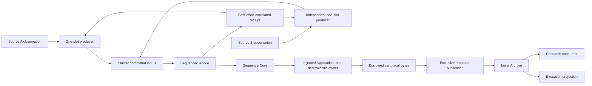
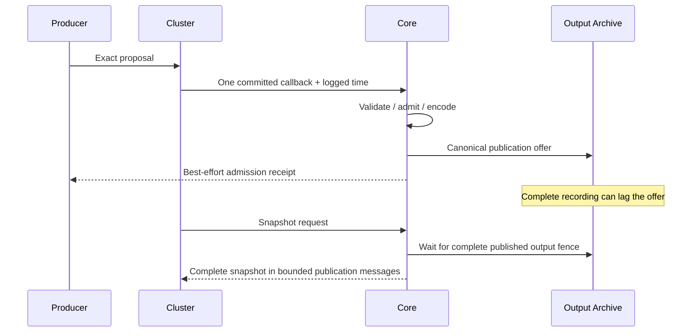
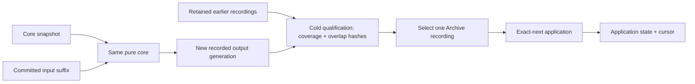

# Implemented architecture

The Cluster input log is the sequencing authority. One committed initialization or proposal enters a thin
`SequencerService` adapter and a pure `SequencerCore`. The core owns bounded primitive state, reusable SBE codecs,
SHA-256 workspace and one output/snapshot buffer. An injected `Application` owns deterministic domain state on the
same thread. The default application passes inputs through unchanged. Neither core nor application owns a live
clock, files, transport or replay scheduler.

A flat proposal contains expected log ID, producer incarnation/sequence, source/configuration/clock references,
original timestamps and a complete inner SBE payload. The core accepts contiguous producer sequences, assigns one
canonical sequence and encodes the canonical event. It retains the latest producer sequence, canonical sequence,
sequencing time and exact-input SHA-256 digest, plus every original application-result byte. The result prefix is
either empty or a bounded SBE message prefix with optional groups and variable data. It may pack several ordered
application outputs. Spine appends a uint32 original-input length and the exact input bytes
for a nonempty prefix. A latest exact retry recreates the original receipt without invoking the application,
emitting a new canonical event or consulting wall time. Ordinary malformed/rejected proposals do not mutate admission state.

The adapter consumes borrowed output synchronously. It offers accepted canonical bytes to its ordinary recorded
publication before attempting a best-effort receipt. Transport failure after mutation is fatal; retained Cluster
input drives recovery. The same core runs on every member and during input replay, so outputs may overlap.
The setup Archive control session closes as soon as the output recording attaches. The service retains the
publication and local recording counters through termination; it has no idle, unpolled Archive control session.
Cold `ApplicationLimits` size the producer slots, flat result cache and snapshot storage. Canonical output must fit
`limits.eventBytes()`; Cluster egress must fit the larger receipt and session header. See
[capacity and transport sizing](application-contract.md#capacity-and-transport-sizing).

## Capture and application boundaries

Provision nonzero uint64 log and producer IDs before traffic. Sources use uint32 references into immutable cold
source-definition records. A source definition binds provider, product/subscription scope, session, collector, configuration, clock
meaning and uncertainty. Changing the session/interpretation requires a new revision. Observations keep native
numeric identity or exact bytes, local raw-frame sequence, subevent and exact original bytes. Both redundant feed
observations remain present. The optional `examples-binance` module supplies `BinanceApplication`, which owns one
bounded BTCUSDT L2 book, reconciles redundant JSON/SBE depth ranges and emits qualified BBO with the original input.
It executes inside the core's deterministic owner; the generic runtime contains no market logic. This supersedes
the embedded market ownership from 2026-10-08 while preserving the [market-state contract](market-state-core.md).
Other source families remain uninterpreted by that application. Source latency audits still retain each observation separately.
The [application profile v1](application-contract.md) captures one complete raw application message at subevent zero;
its immutable product label may name a multiplexed subscription scope. Downstream normalized children identify
their actual products. Other per-product/subevent capture layouts require an explicitly declared profile.

The producer retains one exact proposal in memory through reconnect. A collector requiring process-restart recovery
must record that proposal completely before admission. The acceptance collector demonstrates this with an external
Archive journal. It does not move files/locks into the sequencing core or claim memory alone is durable.

Application state and its cursor form one application-owned checkpoint. A cursor is `(logId, canonicalSequence)`;
recording/session IDs and byte positions are physical delivery coordinates. A callback failure may have partially
mutated application state; the consumer stops without advancing its cursor and requires application recovery.

## Recovery

The four-method [application boundary](application-contract.md#replicated-application-boundary) covers transitions,
snapshot writing, private candidate restoration and cached-result validation. Snapshots contain protocol/retry state
and application state within its declared bound: 2 MiB by default, up to 64 MiB. The complete image is bounded to
128 MiB, including variable-length cached results, and bound to the application ID, semantics version and configuration
ID. SHA-256 covers the entire image except its digest field. The core installs the application and protocol state only after the entire
candidate and every cached result validate. Callbacks borrow input/output buffers and run on one owner; applications
compose their own components directly.
The service splits the image across bounded snapshot publication messages. Cold restore accumulates the image in
storage sized by the declaration before the core validates and installs it; unused cache capacity is never serialized.

Snapshot plus exact committed suffix under the same application regenerates identical suffix output. Snapshot acceptance waits for the current
output publication's complete recording fence. Earlier output must remain retained, or an earlier input baseline
must remain available for regeneration. Losing both is unavailable history, not a problem a compact snapshot solves.

Cold catalog rebuilding scans complete retained messages, verifies every overlapping output hash after the trusted
application checkpoint S, rejects missing S+1-through-head coverage and conflicting bytes, and selects one source
at a time. Recording/start/stop positions come from the Archive protocol, including on a separate media driver. Archive replay follows recording progress at each
consumer's independent pace. Recent duplicate delivery is checked in a fixed digest window; older skipped prefixes
must be covered by the trusted checkpoint or have passed cold qualification. New/stopped generations are explicitly requalified with `refresh()`.

Current output is local IPC and Archive-follow delivery; multicast/live fan-out and production periodic recorded-head
observers are separate work. `LIVE` is a cached status and has no current external freshness guarantee. Tests use
page-cache recording and cover single-node IPC, separate-driver UDP replay and native three-member local failover.
They do not establish distinct-host networking or host/power-loss durability. See [release evidence](release-readiness.md).
