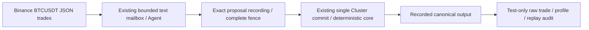
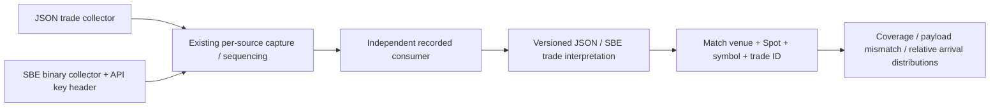
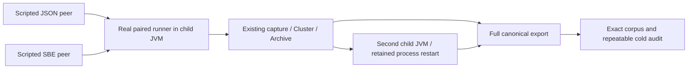

# Binance public feed testing

Anonymous Spot JSON trades exercise the existing text collector, exact capture fence and deterministic sequencer.
This is a functional live capture/restart test. It does not measure provider latency, prove upstream completeness
or supply L3 data. Binance's public depth streams contain aggregated price levels.



## Reproduce capture and recovery

Use Java 21 and a dedicated retained directory. Build the test-only executable, capture, restart against the same
directory, then validate trade payloads and the unchanged exported prefix:

```sh
./gradlew :sequencer:binanceSmokeBundle
./gradlew :sequencer:binanceJsonSmoke --args="/absolute/path/to/binance-run 60"
./gradlew :sequencer:binanceJsonSmoke --args="/absolute/path/to/binance-run 30"
python3 sequencer/src/test/python/binance_json_audit.py /absolute/path/to/binance-run
```

The launcher subscribes to `btcusdt@trade` at `wss://data-stream.binance.vision/ws?timeUnit=MICROSECOND`.
Application JSON heartbeats are disabled; the JDK WebSocket implementation responds to RFC ping frames. Each submitted
complete application text message is captured, including subscription acknowledgements. At timed stop, partial messages
and complete mailbox messages not yet submitted are outside the capture guarantee. Trade identity remains in raw JSON
field `t`; the outer observation's numeric native ID is unavailable. The audit parses it in the cold test path.
See the [market-data-only endpoint](https://github.com/binance/binance-spot-api-docs/blob/master/faqs/market_data_only.md)
and [trade stream contract](https://github.com/binance/binance-spot-api-docs/blob/master/web-socket-streams.md#trade-streams).

The retained bundle is copied to `artifacts/<sha256>.jar` before source definition admission. Each restart uses a new
source session/configuration and clock origin, then exports the entire canonical history. Preserve the directory;
it contains capture/Cluster/output recordings, executable artifacts, profiles and exports. Never run two owners
against it. The local fixture uses single-node Cluster, IPC and page-cache recording; host/power loss and the missed
upstream interval during restart are outside this test. JDK networking can allocate.

On 2026-10-05, a 60-second run captured 7,131 trades and one acknowledgement (canonical head 7,133). A 30-second
process/Cluster restart appended 1,702 trades and one acknowledgement. Cumulative history contains 8,833 trades,
two acknowledgements, two source definitions and 1,241,012 raw bytes (canonical head 8,837). The first export is a
byte-for-byte prefix of the second, including original observation and sequenced timestamps. Sequence/binding and
timestamp-order audits passed. Bundle SHA-256:
`c79926990394e4caf4e08a2e13e1b0115197c35cbd52548c46fb336b5100704c`.

## Paired JSON/SBE runner



SBE access requires a Binance account and Ed25519 API key. [API Management](https://www.binance.com/en/my/settings/api-management)
requires completed KYC. Choose **Create API → Self-generated**, register an Ed25519 public key, and keep its private
key local. [Official setup guide](https://www.binance.com/en/support/faq/detail/6b9a63f1e3384cf48a2eedb82767a69a).
The market-data handshake sends the issued API key in `X-MBX-APIKEY`; it needs no signature or extra trading
permissions. [SBE requirements](https://github.com/binance/binance-spot-api-docs/blob/master/sbe-market-data-streams.md).
Configure `BINANCE_SBE_API_KEY` locally; the runner reads it from the environment. It sends no private key or
signature. Missing/blank keys fail before creating a retained directory or opening resources. Network errors expose
only a safe HTTP status where available; key values are excluded from arguments, recorded definitions and reports.

The same bounded collector now supports binary frames and cold HTTP headers. Its tagged mode preserves one complete
application message per observation: a leading uint8 `0` means UTF-8 text, `1` means binary; exact payload bytes follow.
This makes JSON controls distinguishable from SBE data on one socket. The total raw bound remains 65,500 bytes;
the tag leaves 65,499 bytes for an application payload. Oversized input fails explicitly. Existing JSON/Hyperliquid
collectors retain their untagged framing.

The outer Spine SBE envelope carries log/producer/source/configuration/clock IDs and observation times. The sequenced
output adds its global sequence and logged time. Venue/provider interpretation is bound by the source definition;
there is currently no independent inline `venueId` field. The transport tag has a different purpose from source identity.

The test-only runner opens JSON and SBE `btcusdt@trade` sockets with separate source/producer/capture bindings and one
shared process clock origin. It retains its exact executable bundle, pinned stream XML and cold audit code. Its local
Cluster session timeout is 120 seconds to cover bounded cold WebSocket setup; other acceptance fixtures keep their
original settings. Startup snapshots and termination fence complete output before reading the actual recorded head.
They are cold harness operations; each admitted observation still uses one Cluster input commit.

With the key already configured in the process environment, run:

```sh
./gradlew :sequencer:binancePairSmoke --args="/absolute/path/to/binance-pair-run 60"
python3 sequencer/src/test/python/binance_pair_audit.py /absolute/path/to/binance-pair-run
./gradlew :sequencer:binancePairSmoke --args="/absolute/path/to/binance-pair-run 30"
python3 sequencer/src/test/python/binance_pair_audit.py /absolute/path/to/binance-pair-run
```

Use a dedicated paired directory rather than the earlier JSON-only one. Exported JSON observations retain raw text;
tagged SBE observations use `rawBase64` solely for the cold report. Canonical recording contains the original binary
capture payload. Pending captured proposals are drained at stop; unsubmitted mailbox/partial messages and reconnect
gaps remain outside the capture guarantee.

The SBE repeating trades group can contain several trades, so normalized children follow wire order. Match JSON `t`
against SBE trade `id`, with exact decimal price/quantity, maker side and transaction time. Envelope publication
times need not match. The [reviewed stream schema](https://github.com/binance/binance-spot-api-docs/blob/bed5d358dbe98bfa4722b6c00c27be1e8f0ba40b/sbe/schemas/stream_1_0.xml)
is schema 1/version 0, trades template 10000; retain the actual decoder artifact/profile when implemented.

The shared origin allows signed first-callback arrival differences. The cold audit reports overlap coverage,
unmatched/late/duplicate trades, payload mismatches and p50/p99/p99.9 differences; frame counts are not trade counts.
These differences include network/client queues, frame batching and collector backpressure; they are not pure venue
latency. No first live SBE result is claimed before the key-backed run. An order-level source and retained bootstrap
still gate L3 research.

Offline readiness passes 101 Java tests and 19 Python tests. The local real WebSocket peer verifies the authentication
header, automatic pong payload, maximum fragmented binary capture and exact recorded replay. Cold fixtures cover
multi-trade SBE groups, exact decimals, malformed headers/lengths, profile/artifact validation, duplicate/unmatched
trades, per-run overlap acceptance and unchanged restart prefixes. Timestamp plausibility uses retained Cluster time,
so repeated audits of the same bytes return the same result. The binary assembly/capture allocation gate measures
the owned path separately from JDK networking. Runtime size is 1,911 → 1,936 NCLOC (+25).

## Key-independent paired acceptance



This test runs the same paired launcher against two actual loopback WebSockets using a test-only dummy key. It sends
schema-valid batched SBE trades and equivalent JSON trades, subscription acknowledgements, fragmented messages and
RFC ping frames. Traffic starts only after both subscriptions and the real recorded completion consumer are ready.
Expected frame counts, rather than a short sleep, determine when local capture has completed.

Build the retained bundle, then launch with a fresh absolute data path and the absolute bundle path:

```sh
./gradlew :sequencer:binanceSmokeBundle
./gradlew :sequencer:binancePairLocalSmoke --args="/absolute/path/to/local-pair /absolute/path/to/spine/sequencer/build/libs/sequencer-1.0.0-binance-smoke.jar"
python3 sequencer/src/test/python/binance_pair_audit.py --local-synthetic /absolute/path/to/local-pair
```

The helper launches two separate JVMs against the same retained state, preserving each attempt's logs. Its manifest
binds the exact complete raw frames, native trade order and expected unique matches to both runs. Acceptance requires
correct source/configuration/shared-clock bindings, new restart origins, unchanged first-export bytes, complete raw
and trade coverage, zero payload mismatches and identical repeated audit reports.

Local captures carry explicit synthetic provenance in source definitions and reports. Their audit requires the
`--local-synthetic` option and returns `passed-local-synthetic`, `synthetic=true`, `venueData=false`. The default live
audit rejects them. This gate proves the collector/capture/restart/comparison integration; it does not provide a live
Binance SBE result. All additions are in test code; production size remains 1,936 NCLOC.

After this gate passes, the [fixed local ingestion diagnostic](collector-ingest-profile.md) measures owner wait and
the capture/admission/recorded-consumer path before making any runtime tuning change.

On 2026-10-05 the local gate passed through canonical head 44: two runs, each with 12 exact equivalent trades per
source, 13 JSON frames and seven tagged SBE frames, plus two definitions. All raw bytes and decoded child trade order
matched the expected corpus; the first export remained an exact prefix after process/Cluster restart. Both clocks
had nine matched trades inside the common callback window (12 equivalent trades across the full corpus). Repeated
cold reports were byte-identical. Missing and blank key guards created no data directories; the dummy credential was
absent from retained files and decompressed artifact entries. Results live in
`feeds/build/reports/key-wait-20261005/local-pair/`; the first keyed live SBE test was pending at that stage.

## Live access check, 2026-10-08

The production SBE endpoint returned HTTP **451** to an unauthenticated HTTPS access check, with Binance's
restricted-location eligibility explanation. The preceding Python TLS attempt failed certificate verification
before sending the API-key header; system curl verified TLS and obtained the restriction response. Authentication
was not tested, no secret was used and no paired capture started. Credential values are absent from retained
results. Safe check metadata is retained under `feeds/build/reports/binance-key-test-20261008/`.

At that stage, the initial supplied key's registration environment and type were unconfirmed. Current official
[production SBE requirements](https://github.com/binance/binance-spot-api-docs/blob/master/sbe-market-data-streams.md)
allow only Ed25519 API keys, sent in `X-MBX-APIKEY`, without a secret or signature. Production endpoint access and
the correct key type/environment must be established before the live paired acceptance can proceed. The existing
runner and audit use production endpoints; a Testnet capture needs explicit matching environment/provenance support.
No production or test source changed, and no live SBE result was claimed for that attempt.

The key-backed opening-handshake test used a Tokyo recording host in `ap-northeast-1`.
A credential-free remote check verified its outbound address and endpoint reachability. Two valid WebSocket opening requests with the initial supplied API key then
received HTTP **400**, with verified Binance TLS and no structured Binance error code. No WebSocket opened.
HTTP 400 alone does not establish the key type, registration environment or IP/permission failure cause.

The check used AWS remote-host port forwarding with end-to-end Binance TLS. The API key stayed out of SSM
commands, parameters and retained results; no secret or signature was used. The tunnel was terminated after
the check. This proves a rejected opening request through Tokyo egress, not live capture, market-data readiness
or Tokyo ingestion latency. Host services and Spine runtime code were unchanged (1,936 NCLOC).

To reproduce the check, use a production Ed25519 API key for your runner. If API IP
restrictions are enabled, allowlist that runner's own outbound address. The private key remains local. The keyed paired capture/restart acceptance was pending at
that stage.

The second user-supplied key passed the Tokyo connection check on 2026-10-08: verified TLS, HTTP **101** and a
validated WebSocket acceptance response. A separate bounded readiness connection received the `btcusdt@trade`
subscription acknowledgement and one live binary message containing one trade. The existing cold decoder validated
the pinned schema 1/version 0, template 10000, exact `BTCUSDT` symbol, trade fields and message boundaries.

The same Tokyo host/public IP was reconfirmed, and its temporary tunnel was closed afterward. No credential
values, raw response headers or messages were written to the retained reports. This establishes authenticated live
SBE readiness; the full Spine paired capture/restart and latency acceptance were pending at that stage. Runtime size remains
1,936 NCLOC. Credential-free helpers, exact decoder/schema digests and result metadata are retained alongside the
earlier rejected checks.

## Live paired Tokyo acceptance, 2026-10-08

For this historical run, the issued API key was saved as version 1 of an AWS Parameter Store
**SecureString** in `ap-northeast-1`, encrypted with `alias/aws/ssm`. The recording host
retrieved that version into memory and supplied only the paired JVM's `BINANCE_SBE_API_KEY` environment variable.
Commands/profiles/reports contain its name, never its value. The matching CloudTrail save event masks the value;
a byte scan of all 65 retained files and 3,252 decompressed JAR entries found no plaintext key. No signing secret
or private key is stored.

The existing frozen bundle ran directly on the Tokyo recording host:
two ARM64 CPUs, Corretto 21.0.12.1, SHARED driver, normal idle defaults and a 128–512 MiB Java heap. No BusySpin
override was used. Both venue sockets and Spine processing ran on-host; this capture did not use the earlier
local-to-Tokyo port-forward tunnel. Local IPC, one Cluster commit, complete capture/output recording fences and
Archive file-sync level zero remained unchanged. Existing host services and IAM policies were unchanged.

The 60-second capture and separate 30-second JVM/Cluster restart passed against the same retained directory:

| Run | Matched trades | JSON / SBE application frames | Canonical head |
|---|---:|---:|---:|
| 60 seconds | 308 | 309 / 80 | 391 |
| 30-second restart | 538 | 539 / 109 | 1,041 |

All **846 observed trade IDs** matched exact price, quantity, maker side and transaction time. Within each session
there were zero unmatched trades, duplicates, payload mismatches or native-ID gaps. Final history has four source
definitions and 148,101 captured raw bytes: 119,238 JSON and 28,863 tagged SBE. SBE contained 846 trades in 187
binary data frames; the remaining two SBE frames were subscription acknowledgements. JSON had one trade per
data frame and two acknowledgements. Frame counts are not trade counts.

The first 209,590-byte export is an exact prefix of the second. The remote audit and two independent local audit
executions produced byte-identical reports. All source/configuration/shared-clock bindings, contiguous canonical
sequences, raw boundaries, original timestamp ordering, pinned schema and executable digests passed. Both JVMs
exited zero; the closed recordings, exports, logs, runtime provenance and CPU/RSS samples are retained locally and
in the existing S3 recording prefix.

The signed first-callback **SBE minus JSON** arrival distribution uses 826 matched pairs in their common observation
windows. Twenty other fully matched pairs fall only at window boundaries and are excluded from this distribution.

| Quantile | Signed arrival difference |
|---|---:|
| p50 | −11.611535 ms |
| p99 | +0.627837 ms |
| p99.9 | +0.837683 ms |

Negative means SBE arrived earlier. This compares feed arrival and includes network routing, provider/client
queues, SBE batching and collector backpressure; it does not measure pure venue or Spine internal latency.
Nearest-rank p99.9 equals the observed maximum for this 826-pair sample. Approximate sampled average CPU was
0.168 / 0.219 logical CPUs, and peak sampled RSS was 182.6 / 179.6 MiB for the two JVMs. These samples include
cold startup/JVM warming and exclude the final unsampled interval.

Both feeds lack eight IDs (`6749585305`–`6749585312`) across the planned reconnect, with a 2.910-second gap between
measurement windows. This proves retained-prefix recovery of captured history, not uninterrupted upstream
completeness or recovery of unobserved trades. Production code remains **1,936 → 1,936 NCLOC**.

Evidence: `feeds/build/reports/binance-pair-tokyo-20261008/binance-pair-tokyo-20261008-78266ca4/`.
The SSM execution passed in 99.358 seconds. Bundle SHA-256:
`5a134aa414035b31dee2efffc799ee3a3397ff5e4c1af7341e03ba5ca630965c`.
Closed capture SHA-256: `40dfeacb1248dff9e5b09c24cfb7c0707a97dc4195757463f75fc09b7f3168ba`.
The closed capture archive is retained in private artifact storage as
`binance-pair-tokyo-20261008-78266ca4/capture.tgz`. Public documentation omits host addresses,
instance/account identifiers, credential-storage locations and remote execution IDs.
Hardware, measurements and artifact hashes above are unchanged.

## In-core depth book — 2026-10-08

The completed depth increment captured BTCUSDT JSON/SBE diff-depth plus a full 5,000-level-per-side REST bootstrap from the
same existing Tokyo host. A 30-second retained corpus has 300 JSON and 1,130 SBE depth updates; independent exact
books agree at 299 common native frontiers with zero gaps. Those bytes now replay through the deterministic
in-memory core, matching covered state after every proposal and recovering identical outputs from snapshots.
The core preserves both observations while applying native advancement once and emits qualified BBO.

See [implementation evidence](market-state-result.md) and the [book/wire contract](market-state-core.md). This is
covered L2 state with explicit bounds; unchanged deeper levels remain unknown. The new runtime measurement is
local and is separate from Tokyo network timing and from the historical trade-only bundle above.
