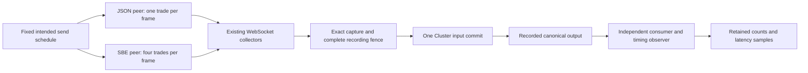
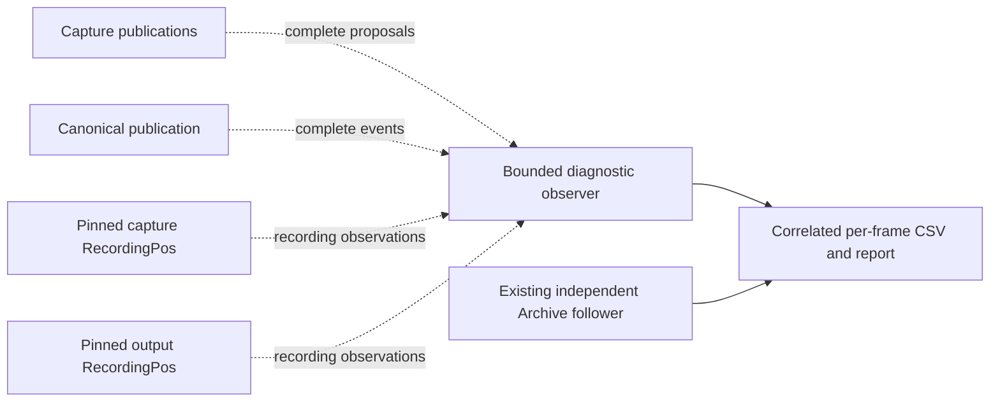
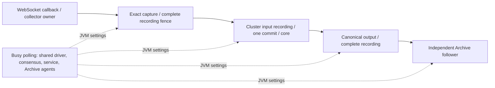

# Local collector ingestion diagnostic

Historical measurements; see [release readiness](release-readiness.md) for current release validation. Raw reports
and frozen bundles under `build/` directories are local artifacts, not files published in this repository.

This test-only workload measures the existing collector, capture fence, single Cluster commit and recorded-consumer
path on one host. It uses scripted loopback WebSockets and synthetic Binance-shaped trades. It is not a venue latency
comparison, L3 validation or a replacement for the fixed Stage One acceptance budgets.



## Method

Run after the paired local capture/restart acceptance test has passed:

```sh
./gradlew :sequencer:collectorIngestProfile --args="/absolute/path/to/profile-reports"
```

Each invocation creates a fresh retained run beneath the report directory. Keep failed attempts as well as successful
ones. The executable and workload manifest belong with the measurements. The task fixes initial/maximum heap at 512 MiB.

Both sources schedule 150 trades/second. JSON sends one trade per application frame; SBE batches four trades, so its
frame rate is 37.5/second. There are two seconds of warm-up, four seconds of measured baseline and a simultaneous
128-trade burst per source. Warm-up is a declared diagnostic budget, not proof of complete JVM stabilization.
Expected totals are 1,028 trades per source, 1,028 JSON trade frames and 257 SBE trade frames, plus acknowledgements
and source definitions. The final drain has a fixed deadline. Counts must reconcile through complete captured
proposals and canonical output; missing input cannot disappear from the latency report.

Intended times are fixed before sending. Slow sends retain their original due time, exposing accumulated lateness
rather than lowering the offered rate. Callback receive/complete/ready times share one monotonic process origin.
The consumer observes output using that same origin. Never subtract elapsed callback times directly from logged
Cluster epoch timestamps.

- Send lateness includes local peer scheduling and socket writes.
- Complete-to-ready measures the completed mailbox's wait until capture submission, including the prior proposal's
  recording/admission cycle and collector-owner scheduling.
- Ready-to-consumer includes exact capture recording, admission, sequencing, output recording and consumer polling.

The JSON/SBE workloads have different frame rates and batching. Their tails help identify pressure in this particular
pipeline; they do not establish which encoding or provider is faster. Networking, observer and test code can allocate.
Existing strict zero-allocation tests retain their separate owned-path scope.

## Boundary observer

The optional test-only observer attaches to both capture publications and the canonical publication before source
definitions are submitted. Each subscription pins one image and its Archive recording ID, session and counter
registration. Complete-message callbacks use the final aligned `Header.position()`; a validated RecordingPos value
must cover that position before recording is observed. Counter identity/activity is checked before and after each
read. No production hook, admission rule, recording fence or runtime setting changes.



The existing profile owner polls the observer between collector work and Archive follower delivery. Fixed arrays
retain capture publication observation, capture recording observation, canonical publication observation and output
recording observation in the same elapsed monotonic domain as callback/submission/follower times. Canonical events
do not contain producer identity: this fresh fixture joins their source binding and raw-frame identity to the capture
proposal's producer identity/sequence, verifying raw bytes and original observation times.

These timestamps are upper bounds on when the observer discovers each boundary. Where a preceding counter read was
below a message's final position, the CSV also retains that read's start as a lower bound on the counter crossing;
`-1` means no such lower bound was observed. Reading an already-complete counter cannot recover the actual recording
time. Signed differences between independently observed boundaries are retained, including negative values caused
by polling order. The intervals do not isolate pure core or consensus latency. File-sync level remains zero, so a
complete recording observation does not establish power-loss durability.
Subtracting independently delayed upper observations does not yield a guaranteed upper or lower bound on the actual
processing duration.

Run the same fixed workload with `boundaries` (the default) or `off` as the second argument. Retain both modes from
the same executable, preferably in OFF/ON then ON/OFF order. The added subscriptions participate in IPC flow control;
observer poll duration and cadence measure only direct owner cost. Changes in submission-to-follower tails and send
lateness across runs also include scheduling/JIT effects and subscription costs, so paired differences are descriptive
diagnostics rather than a guaranteed causal overhead estimate. Counts, raw-byte/time verification and complete final
drain remain mandatory in both modes; enabled runs additionally require every command and recording fence observed.

The retained `commands.csv` includes definitions, acknowledgements and data. `frames.csv` includes the fixed data
schedule. Recalculate accounting and nearest-rank statistics independently, comparing adjacent OFF/ON and ON/OFF
pairs with:

```sh
python3 sequencer/src/test/python/collector_ingest_audit.py OFF_DIRECTORY ON_DIRECTORY ON_DIRECTORY_2 OFF_DIRECTORY_2 --compare
```

The cold verifier checks the retained executable digest, fixed source/producer bindings, every command and canonical
sequence, aligned increasing positions, available fence brackets and report quantiles. Per-frame signed intervals
telescope to submission-to-follower time; their independently computed quantiles do not add to its p99.

## Results

The 2026-10-05 local run passed all send/capture/canonical accounting checks: 1,028 trades per source (2,056 total),
1,285 data frames, two acknowledgements and two definitions, through complete canonical head 1,289. Captured command
counts were 1,030 for JSON and 259 for SBE. Receipt drain and snapshot/output recording fences completed. Independent
CSV recomputation matched the report's nearest-rank quantiles.

Baseline frame measurements, in milliseconds:

| Source | Samples | Send lateness p99 | Intended send → callback p99 | Complete → submission p50 / p99 | Submission → recorded consumer p50 / p99 |
|---|---:|---:|---:|---:|---:|
| JSON, one trade/frame | 600 | 0.034 | 0.213 | 0.062 / 0.129 | 3.493 / 6.647 |
| SBE, four trades/frame | 150 | 0.030 | 0.206 | 0.055 / 0.131 | 3.366 / 5.938 |

For the immediate burst, intended-send-to-callback p99 was 9.995 ms over 128 JSON frames and 6.911 ms over 32 SBE
frames. Send-attempt lateness peaked below 0.36 ms relative to the original intended times. Thus queued traffic
before application callbacks is visible even though the completed-mailbox wait can be short. JDK demand, kernel
queues and local scheduling belong to that interval; these measurements do not isolate them individually.

The baseline's largest measured interval follows submission. It includes capture recording, admission, sequencing,
output recording and consumer polling. It does not identify the core or any one fence as the cause. The next useful
diagnostic is to observe these intermediate boundaries while preserving the same workload and recording contract.
No runtime setting, fence or performance budget changed in this increment.

Environment: Mac16,6 / arm64, 16 reported physical/logical CPUs, 64 GiB RAM, macOS 26.5.1, Temurin 21.0.5+11,
512 MiB heap, shared Media Driver, 1 MiB terms, 1,024-byte IPC MTU, one local Cluster member, Archive file-sync level 0,
owner `Backoff(100,10,1000,100000)`, no affinity/exclusive CPUs. The four-second baseline and small burst are diagnostic
samples; they establish no production tail guarantee. p99.9 is retained in the report and is effectively the maximum
at these sample counts.

Run: `feeds/build/reports/key-wait-20261005/ingest/run-023a6608-6f16-4e46-b6fb-cb536e5d6541/`.
Executable SHA-256: `dd48e02bb0f75f9ecfa5c9ced0ec0f3ba3af65d6a9d8c9662ec9e7e3f53a634b`.
The manifest, per-frame CSV, raw recordings and report are retained there. Runtime remains 1,936 NCLOC.

## Boundary results, 2026-10-06

Four runs from one retained executable, in OFF/ON then ON/OFF order, passed the unchanged schedule and full raw-byte,
observation-time, receipt and recording accounting. Each retained all 2,056 trades, 1,285 data frames, two definitions
and two acknowledgements through canonical head 1,289. Both enabled runs observed all 1,030 JSON capture commands,
259 SBE capture commands and 1,289 canonical publication/recording boundaries, including fragmented definitions.

Baseline p99 observations in milliseconds (600 JSON / 150 SBE frames per run):

| Enabled run / source | Submission → capture fence | Capture fence → canonical publication | Canonical publication → output fence | Output fence → Archive follower | Submission → Archive follower |
|---|---:|---:|---:|---:|---:|
| A / JSON | 1.278 | 4.489 | 1.248 | 1.273 | 6.417 |
| A / SBE | 1.271 | 4.431 | 1.254 | 1.270 | 6.654 |
| B / JSON | 1.277 | 4.566 | 1.273 | 1.271 | 7.068 |
| B / SBE | 1.276 | 3.972 | 1.290 | 1.277 | 6.489 |

The largest observed interval lies between capture-fence discovery and canonical-publication discovery. It includes
producer-owner scheduling, admission/Cluster commitment, service/output work and observer polling; these samples do
not isolate any one of them. Recording and follower intervals also contribute. All data frames had preceding
below-target counter reads: baseline p99 crossing-bracket widths were 0.137–0.150 ms. Maximum owner-loop gaps were
2.538 ms (A) and 1.797 ms (B). Two burst frames in A had follower observations 8.042 / 7.167 microseconds before the
observer discovered their output fences; the signed differences are retained. This is observation lag, not a
violation of complete recording before Archive delivery.

Direct observer polling accumulated 87.318 ms across 563,962 polls in A and 86.960 ms across 562,510 polls in B;
individual maximum polls were 0.412 / 0.340 ms. This scope includes startup through final drain and excludes cold
pinning, close and reporting. These are elapsed owner times, including possible descheduling, rather than CPU
measurements. The extra subscribers also participate in IPC flow control. Enabled-minus-adjacent-OFF
baseline submission-to-follower p99 differences were +0.310 / +0.291 ms (A JSON/SBE) and +0.467 / +0.303 ms (B).
Corresponding median differences were +0.001 / +0.123 ms and −0.041 / −0.406 ms. Baseline p99 send-lateness differences
were +0.001 / +0.000459 ms and −0.022 / −0.001834 ms. Final drain completion differences were −14.031 / −1.402 ms.
These mixed changes are retained as descriptive instrumentation/run variation, without a fixed causal overhead or
production tail claim. No runtime tuning or Stage One budget changed.

All 106 Java tests and 42 Python tests pass. Five new real IPC/Archive observer cases cover maximum fragmented
position/fence equality, a fully recorded incomplete tail with no complete sample, nested-fragment failure,
latched wrong-producer failure, stopped recording and a mismatched pinned registration (the latter two are separate
parameter cases). The registration case changes the test observer's pin; it does not claim an actual driver-counter
recycling event. Independent cold recomputation and review matched both enabled reports and comparisons.

Evidence root: `feeds/build/reports/ingest-boundaries-20261006/`. `invocations.json` retains executable arguments and
run order; `audit-comparison.json` retains full independent results. OFF runs are
`run-a70ac38d-d171-4c13-842b-34438c91bb41` and `run-3a24e445-0489-4edc-bbd8-608941c6d040`; enabled A/B are
`run-3d6048c4-7314-492c-b3ff-f5a7e80875ef` and `run-d4811b61-e253-4629-aa5b-f14e5977b52b`.
The preceding Gradle-entrypoint OFF smoke (`run-0a54bbbe-0d02-40e7-8cc7-88d2bcd4f852`) remains retained with its earlier
audit bundle and is excluded from the same-executable comparison. Final executable SHA-256:
`5a134aa414035b31dee2efffc799ee3a3397ff5e4c1af7341e03ba5ca630965c`.
Hardware and runtime settings match the environment above. Production size remains **1,936 → 1,936 NCLOC (+0)**.

## Idle-strategy comparison, 2026-10-06

The millisecond observations above used Aeron 1.53.0's default infrastructure idle strategies. The shared Media Driver,
ConsensusModule, service and Archive conductor/recorder/replayer use backoff with a maximum requested park of 1 ms.
Several separately scheduled agents lie along each event's path. The Archive is already DEDICATED; changing its
threading mode is unnecessary for this comparison.

One unchanged retained executable ran DEFAULT/SPIN/SPIN/DEFAULT, with the boundary observer enabled throughout.
Only five JVM properties changed. SPIN selects Agrona's existing BusySpinIdleStrategy for those six infrastructure
agents. The SHARED Media Driver, collector owner `Backoff(100,10,1000,100000)`, workload, recording/admission fences,
single Cluster commit, term/MTU sizes, file-sync level and heap remain unchanged. No production or test code changed.



All four runs passed exact byte/time, receipt, command, canonical sequence and complete recording accounting:
2,056 trades, 1,285 data frames, 1,030 JSON / 259 SBE capture commands and canonical head 1,289 each. Independent
cold auditing matched every report and executable digest. Baseline results, in microseconds:

| Run / setting | JSON ready → follower p50 / p99 | SBE ready → follower p50 / p99 | JSON scheduled send → follower p50 / p99 | SBE scheduled send → follower p50 / p99 |
|---|---:|---:|---:|---:|
| 1 / DEFAULT | 3,475.500 / 6,613.958 | 3,483.042 / 6,613.584 | 3,655.708 / 6,837.250 | 3,656.126 / 6,792.542 |
| 2 / SPIN | 36.834 / 86.334 | 39.333 / 114.125 | 213.625 / 371.084 | 237.792 / 458.126 |
| 3 / SPIN | 33.375 / 65.750 | 36.333 / 82.667 | 204.501 / 315.209 | 231.542 / 389.084 |
| 4 / DEFAULT | 3,534.959 / 7,232.584 | 3,527.667 / 6,802.209 | 3,726.125 / 7,371.583 | 3,745.750 / 7,060.542 |

The return to default settings restores the millisecond tail. This comparison supports infrastructure polling as
a large source of the previous delay; it does not assign that improvement to any individual agent. Ready is sampled
before proposal encoding/submission. The follower timestamp is its handler entry after Archive delivery and consumer
wire/order validation, before application audit work. Scheduled-send latency also includes sender lateness, local
WebSocket delivery, frame completion and collector-owner scheduling. These boundaries must remain explicit.

Run 2 baseline breakdown, in microseconds (600 JSON / 150 SBE samples):

| Observed interval | JSON p50 / p99 | SBE p50 / p99 |
|---|---:|---:|
| Scheduled send → send attempt | 15.417 / 33.292 | 15.500 / 33.042 |
| Send attempt → first application callback | 103.167 / 183.958 | 117.375 / 218.000 |
| First callback → complete frame | 0.625 / 4.292 | 3.458 / 14.083 |
| Complete frame → ready | 49.500 / 132.333 | 50.666 / 132.833 |
| Ready → observed capture publication | 9.250 / 27.333 | 8.542 / 20.584 |
| Capture publication → observed capture recording fence | 5.584 / 24.666 | 7.584 / 28.458 |
| Capture fence → observed canonical publication | 11.708 / 40.208 | 11.875 / 59.334 |
| Canonical publication → observed output recording fence | 1.083 / 18.333 | 2.833 / 32.084 |
| Output fence → recorded follower | 5.625 / 27.791 | 4.208 / 23.917 |

These independently ranked quantiles cannot be added. Signed observation differences still matter at microsecond
scale: for example, run 2 SBE baseline frame 119 is its ready-to-follower p99 sample (114.125 µs), with an
output-fence-to-follower difference of −6.625 µs. Its recording-counter observation occurred after Archive delivery.
Every baseline frame has preceding below-target reads; baseline p99 capture bracket widths in the two SPIN runs are
11.250–18.458 µs, and output bracket widths are 12.208–43.375 µs. Run 3 JSON warmup frame 91 has no observed output
lower bound (`-1`) and is excluded from bracket-width statistics. The combined capture-fence-to-canonical interval
still includes producer polling, Cluster input recording/commit, service/core/output and observation lag.

SPIN burst ready-to-follower p99 is 81.417 / 43.708 µs for JSON and 98.250 / 78.250 µs for SBE (runs 2 / 3).
Full scheduled-send-to-follower burst p99 remains 3.585 / 2.949 ms JSON and 1.326 / 1.151 ms SBE: queued local
WebSocket delivery remains visible. SPIN baseline ready-to-follower maxima are 281.416 / 337.417 µs JSON and
201.375 / 185.583 µs SBE. The short run, two-second warmup, low baseline frame rates and small burst retain their
diagnostic scope; neither a production tail guarantee nor high-rate throughput follows from them.

Process CPU time sampled with `ps` every approximately 0.5 seconds increased from 0.452 / 0.463 average logical CPUs
in DEFAULT runs to 6.256 / 6.256 in SPIN runs. The first-to-last sampling windows are 7.053 / 6.562 seconds DEFAULT
and 6.577 / 6.580 seconds SPIN. They include JVM/setup/warmup/traffic/drain/teardown within each window and exclude
the final unsampled tail. These are approximate process-wide CPU costs, not isolated steady-state or per-stage costs.
The six busy infrastructure threads account for the resource tradeoff; no affinity or exclusive CPU reservation was used.

To reproduce the historical SPIN comparison, supply the same frozen bundle and select Java 21.0.5+11 with
`JAVA_HOME`. Run from the repository root and retain the actual launch arguments alongside the report:

```sh
BUNDLE=feeds/build/reports/ingest-boundaries-20261006/measurement-5a134aa414035b31dee2efffc799ee3a3397ff5e4c1af7341e03ba5ca630965c.jar
"$JAVA_HOME/bin/java" -Xms512m -Xmx512m \
  --add-opens java.base/jdk.internal.misc=ALL-UNNAMED \
  --add-opens java.base/java.util.zip=ALL-UNNAMED \
  -Daeron.shared.idle.strategy=org.agrona.concurrent.BusySpinIdleStrategy \
  -Daeron.cluster.idle.strategy=org.agrona.concurrent.BusySpinIdleStrategy \
  -Daeron.archive.idle.strategy=org.agrona.concurrent.BusySpinIdleStrategy \
  -Daeron.archive.recorder.idle.strategy=org.agrona.concurrent.BusySpinIdleStrategy \
  -Daeron.archive.replayer.idle.strategy=org.agrona.concurrent.BusySpinIdleStrategy \
  -cp "$BUNDLE" io.github.jstadeusiak.spine.sequencer.CollectorIngestProfile \
  /absolute/path/to/new-report-root boundaries
```

The cluster property selects both ConsensusModule and service idle suppliers. The shared-driver property applies
to this SHARED driver; a DEDICATED deployment needs its conductor/sender/receiver settings separately. The existing
local FeedMain composition also leaves these suppliers at Aeron's defaults and can use the same properties; this
comparison measures the fixed diagnostic, not live venue latency. Default launches omit these five properties.

Evidence root: `feeds/build/reports/idle-comparison-20261006/`. `invocations.json` and numbered `*-launch.json` retain
the actual JVM properties and CPU samples; the older run-manifest format does not capture idle properties and must
not identify a treatment on its own. `audit-results.json`, `granular-latencies.json` and `verification.json` retain
cold verification, every phase/stage statistic and selected p99 frames. Runs 1–4 are respectively
`run-38fbf5e0-7f6b-47d8-8675-31083c4da004`, `run-6c0b9d86-8084-43a3-95c1-238874208e6b`,
`run-8a7b1295-83cf-403b-aa8e-1482c126b93b`, `run-d86e7245-02d7-4b55-b6a9-bdcb737a69ca`.
Executable SHA-256 remains `5a134aa414035b31dee2efffc799ee3a3397ff5e4c1af7341e03ba5ca630965c`.
Production size remains **1,936 → 1,936 NCLOC (+0)**. No default launch policy or Stage One budget changed.
