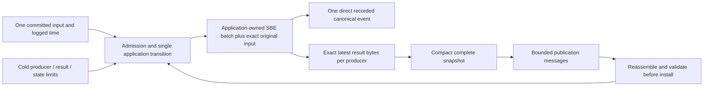

# Composable application results

2026-11-16. Applications can now encode a bounded ordered batch in one canonical SBE result. This increment keeps
the four-method `Application` boundary, one Cluster input commit and one canonical event per admitted input.
The generic runtime contains no trading logic. See the [application contract](application-contract.md#replicated-application-boundary)
for the API, ownership and exact capacity formulas.

Previously, a result prefix was an 8–92-byte SBE header and fixed block. It can now include groups and variable
data, followed by Spine's final original-input field. `ApplicationLimits` declares producer slots, result bytes
per slot and application-state bytes before readiness. Defaults remain 1,024/92/2 MiB. Hard caps are 1,024 producers,
2 MiB per result and 64 MiB application state; the declared maximum complete snapshot must fit 128 MiB.
Large results therefore use an explicitly chosen producer count instead of multiplying every global maximum.

Exact retries reuse all cached result bytes with the original canonical sequence/time and the matching retried input.
Other producers' transitions cannot change that receipt. Snapshots store only each result's used bytes. Restore
checks the complete digest, local bounds, receipt identities/cursors and private application candidate before
installation. Native snapshot transport splits the same image into bounded publication messages and reconstructs
it at the cold restore boundary. Schema versions remain 1 for the fresh release; there is no old snapshot-layout reader.

Canonical output startup checks `limits.eventBytes()` against the publication maximum. The embedding application
must also size Cluster egress for `Wire.RESULT_OVERHEAD + limits.eventBytes()` plus the Aeron session header.
The native large-result test uses 32 MiB terms on both paths. Snapshot terms need only carry each bounded chunk.
The service closes its setup-only Archive control session after recording attachment while retaining the output
publication and local recording counters. This prevents an unpolled control session from timing out during normal operation.

## Verification scope

The final Java 21 and 25 suites each pass **196 tests**, including the Archive lifecycle regression, strict warmed
allocation gates and independent conformance oracle. Outside-checkout consumers pass against staged artifacts on
both JDKs. The 42 Python audit tests and unchanged shared/dedicated Stage One gates also pass; see the
[checked-in verification evidence](evidence/composable-applications/README.md).

- [ApplicationBatchTest](../sequencer/src/test/java/io/github/jstadeusiak/spine/sequencer/ApplicationBatchTest.java)
  covers a 1.1 MB result, ordered groups/variable data, retries after another producer changes state, nonzero-offset
  restore, replacement by a shorter result, local-capacity rejection and corrupt-result restore without replacing live
  state. Its 2 MiB result admission/snapshot/retry path requires exact zero allocation in warmed measurement windows
  and an escaping-allocation negative control.
- [LargeApplicationTest](../sequencer/src/test/java/io/github/jstadeusiak/spine/sequencer/LargeApplicationTest.java)
  exercises a native Cluster result larger than 1 MiB, lost receipts, snapshot restart, exact retries and output
  publication capacity refusal before readiness.
- [ApplicationIdentityTest](../sequencer/src/test/java/io/github/jstadeusiak/spine/sequencer/ApplicationIdentityTest.java)
  restores an 8 MiB application image across multiple native snapshot messages and checks identity and corruption refusal.
- [WireTest](../protocol/src/test/java/io/github/jstadeusiak/spine/protocol/WireTest.java) and
  [ApplicationLimitsTest](../protocol/src/test/java/io/github/jstadeusiak/spine/protocol/ApplicationLimitsTest.java)
  cover variable receipt traversal, truncation, invalid lengths and capacity arithmetic.
- [ReliableProducerTest](../client/src/test/java/io/github/jstadeusiak/spine/client/ReliableProducerTest.java)
  checks exact original-input receipt validation with a variable batch and a strict 2 MiB prefix allocation probe.
  The [testkit](../testkit/README.md) adds declared-limit conformance with a generated repeating-group fixture.
- [ArchiveSessionLifecycleTest](../sequencer/src/test/java/io/github/jstadeusiak/spine/sequencer/ArchiveSessionLifecycleTest.java)
  failed with the former retained control session and passes after close-on-attachment. It uses a 64 KiB control
  response term, 2 ms Archive liveness interval and 300 ms response timeout. After three seconds with Cluster
  keepalives still polled, another input, the output recording fence and snapshot shutdown succeed without an Archive warning.
- [ClosedControlSessionTest](../sequencer/src/test/java/io/github/jstadeusiak/spine/sequencer/ClosedControlSessionTest.java)
  keeps fixture health checks strict while recognizing one native startup keepalive for a demonstrably reclaimed
  consensus Archive session. Live, unknown, foreign and mismatched sessions still fail; runtime code is unchanged.
- [RecordingIdentityTest](../sequencer/src/test/java/io/github/jstadeusiak/spine/sequencer/RecordingIdentityTest.java)
  exposes a native recording counter before its registration ID is published. Startup waits for the identity,
  then admission, snapshot and termination fences succeed. The former code proceeds with zero and reproduces
  the recording-fence failure. Stopped or reused recording checks remain unchanged.
- [CaptureRecordingIdentityTest](../sequencer/src/test/java/io/github/jstadeusiak/spine/sequencer/CaptureRecordingIdentityTest.java)
  returns zero for two capture-counter reads, then exposes the native identity. The constructor
  waits, then exact admission, captured-byte recovery and duplicate retry retain the original canonical sequence.
  The previous constructor caches zero and fails its subsequent identity check; checks for stopped or reused counters remain.

The independent counter oracle retains the same canonical digest:
`02a96529abded055c7448fe0efc71fe6e9e64d1c2b00fceef371ad3387913f58`.
Its compact 278-byte final snapshot has digest
`cce5529d571e1c3ca62cd15bb9221f954d8faeee2d9ad617c02b60ba5d550b64`.
The [Python oracle](../testkit/src/test/python/counter_oracle.py) derives expected bytes independently of Spine and
the generated Java codecs. The changed snapshot digest follows the new variable-length receipt layout.

Setup, restore, cold catalog work and arbitrary application code retain separate allocation budgets. The
[initial-release evidence](evidence/1.0.0/README.md) remains historical. The current Stage One recorded-output p99
measurements are 7.143 ms shared and 1.051 ms dedicated; these are parent-observed signals including
control I/O under the existing single-host/page-cache profile. Concurrent Farm validation ran on the same machine.
The results establish unchanged-budget acceptance, not a speed comparison or HFT latency qualification. No
external-effect recovery claim follows from the batch contract.

## Handwritten production size

The existing count method lexically removes Java comments while retaining strings, then counts nonblank handwritten
`src/main/java` lines, including imports and braces. Generated code, tests and fixtures are excluded.

| Module | Initial baseline | After this increment |
|---|---:|---:|
| protocol | 296 | 322 |
| client | 558 | 558 |
| sequencer | 468 | 494 |
| feeds | 789 | 791 |
| optional examples-binance | 1,004 | 1,004 |
| **Production total** | **3,115** | **3,169** |

**Net +54 lines.** The separate consumer demo remains 60 lines. Added runtime code declares cold capacities,
validates variable receipts and segments native snapshot transport; batch interpretation stays in the application.
The Archive lifecycle correction changes ownership without adding net runtime lines.
Waiting for native counter registration adds one service line and two capture lines to the prior 3,166-line implementation.
