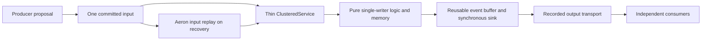

# Deterministic core and zero-allocation target

Decision: 2026-10-05. The replacement runtime implements this contract: one input commit, pure primitive memory
and direct recorded output. Historical commit labels below predate the reset public history; the old two-commit
pipeline is no longer part of it. See [release readiness](release-readiness.md) for current validation and
the historical performance/acceptance documents for earlier measurements.

The user reiterated simplicity on 2026-10-05 and authorized starting over where it improves the result. The original
failure was allowing implementation/recovery machinery to displace the minimal-functional-code objective. The reset
is a clean replacement of the sequencing core inside this repository: keep useful build/schema/test work and delete
obsolete production machinery. Avoid layering a replacement beside the old architecture or maintaining unnecessary
compatibility. Core state can live in the core's fields; a separate state class or sink interface is not mandatory.

Baseline handwritten Java size at `2e23a47`: 2,657 runtime nonblank/noncomment lines, including imports/braces,
excluding generated code, tests/fixtures and the 97-line demo. Sequencing/output contributes 652 lines, including
353 in `CommittedOutputBridge`. The replacement at `6958da3` has 1,138 runtime lines: protocol 262, client 535 and sequencer
341. The application-contract increment adds 11 client lines (1,149 runtime total); the demo has 60 lines. This is a
57% runtime reduction; current performance evidence is separate.

## Governing model

The Cluster input log is authoritative. Given the same initial state, interpreter, ordered input bytes and logged
time, the core produces identical state and output bytes. State and canonical output are materializations of that
history. The reducer owns no files, clocks, randomness, network clients, recording catalog or replay scheduler.

The core has one input application per service callback. There is no canonical self-offer, second canonical
Cluster append, or separate continuously replaying admission reducer/bridge. The synchronous sink consumes borrowed
bytes before the core reuses its buffer. Transport publication and Archive work belong to the service adapter or
downstream agents, not the pure logic.

Snapshots serialize canonical state, including sequence and producer retry state. Restore plus the corresponding
input suffix must regenerate the identical suffix. Retained input from an earlier baseline can regenerate earlier
outputs; a compacted state snapshot alone cannot reconstruct output history before that snapshot.

User scope clarification, 2026-10-08: the core must also execute venue/instrument books, venue-native reconciliation,
continuity/validity and deterministic BBO/pricing evaluation. The [market-state contract](market-state-core.md)
defines that extension. The first runtime increment owns one bounded Binance Spot BTCUSDT L2 book and qualified
BBO, with JSON/SBE native reconciliation. Market state follows the same one-owner, logged-input/time, exact replay and zero-allocation rules; its full state
and pending work live in core snapshots. Independent raw observations remain retained even when they apply the
same market transition. This supersedes the earlier downstream-only market-state boundary.

Application extraction, 2026-11-16: domain ownership is now supplied through the four-method `Application` interface
(`apply`, `snapshot`, `restore`, `validateResult`). `SequencerCore` and `SequencerService` accept an application in
their constructors; their defaults use immutable pass-through behavior. The existing Binance implementation and
market schema live in optional `examples-binance` as `BinanceApplication`, still executing inside the same pure
single writer. This supersedes the embedded market dependency, not its deterministic placement or book behavior.

An admitted input invokes the application once. It returns zero for the unchanged input, or writes a bounded SBE
result with a fixed block and optional groups/variable data; Spine appends the uint32 original-input length and complete
input bytes. Latest producer retries use every cached result byte, sequence and time without repeating the transition.
One accepted input creates one canonical event, including when the application packs several ordered outputs into it.
Cold `ApplicationLimits` declare producer, result and application-state bounds. Defaults remain 1,024/92/2 MiB;
hard limits permit 2 MiB results and 64 MiB state within a 128 MiB maximum complete snapshot. Output buffers,
input bytes and proposal flyweights are borrowed; state and scratch have one owner and are preallocated before use.

Cold restore returns a fully validated private application candidate. The core validates every cached prefix with
that candidate before installing any application or protocol state. Applications compose their own components and
canonical snapshot order directly. Provision an explicit application/semantics/configuration identity for initial
replay and snapshot recovery. Version 1 initialization and SHA-256-protected complete snapshots bind that identity;
configure exact native app-version checks on both Cluster contexts before launch. See the
[application boundary](application-contract.md#replicated-application-boundary) for capacity declarations and transport
sizing. Snapshot receipts store only used result bytes. Native snapshot publication splits the image into bounded
messages; restore validates the complete reassembled image before installation.

## Local reference inspected

The user identified `Desktop/divine-agora`. Inspected tracked sources at
`79d803f546c5ae5043418fde50d9fddaac37b2ba`; no reference code was changed or run. Agora pins Aeron 1.51.1,
Agrona 1.23.1 and SBE 1.38.1. Spine retains its own dependency versions and uses the patterns, not an engine transplant.

Paths below are relative to that reference repository; links pin the inspected commit.

| Reference | Pattern to retain |
|---|---|
| [AgoraClusteredService](https://github.com/launchonsoar/divine-agora/blob/79d803f546c5ae5043418fde50d9fddaac37b2ba/core/src/main/java/com/trysoar/agora/core/AgoraClusteredService.java#L466) | Thin callback calls `logic.onCommand` with committed bytes and Cluster time; no canonical `cluster.offer` |
| [SpineLogic](https://github.com/launchonsoar/divine-agora/blob/79d803f546c5ae5043418fde50d9fddaac37b2ba/core/src/main/java/com/trysoar/agora/core/SpineLogic.java#L119) | Instance-owned SBE flyweights, fixed output buffer and reusable primitive scratch |
| [EventSequence](https://github.com/launchonsoar/divine-agora/blob/79d803f546c5ae5043418fde50d9fddaac37b2ba/core/src/main/java/com/trysoar/agora/core/EventSequence.java) | One sequence owner shared by emitters; snapshots restore that owner's value |
| [SpineState](https://github.com/launchonsoar/divine-agora/blob/79d803f546c5ae5043418fde50d9fddaac37b2ba/core/src/main/java/com/trysoar/agora/core/SpineState.java) | Identity words map to dense integer indexes and primitive state; no hot UUID objects |
| [EventSink](https://github.com/launchonsoar/divine-agora/blob/79d803f546c5ae5043418fde50d9fddaac37b2ba/core/src/main/java/com/trysoar/agora/core/EventSink.java) | Small synchronous borrowed-buffer callback |
| [EgressPublisher](https://github.com/launchonsoar/divine-agora/blob/79d803f546c5ae5043418fde50d9fddaac37b2ba/core/src/main/java/com/trysoar/agora/core/EgressPublisher.java) | Ordinary output publication before best-effort session reply, with explicit infrastructure failure |
| [AllocationTest](https://github.com/launchonsoar/divine-agora/blob/79d803f546c5ae5043418fde50d9fddaac37b2ba/core/src/test/java/com/trysoar/agora/core/AllocationTest.java) | Warm actual router paths, guard allocation accounting, measure per-thread bytes and use a negative control |
| [DeterminismTest](https://github.com/launchonsoar/divine-agora/blob/79d803f546c5ae5043418fde50d9fddaac37b2ba/core/src/test/java/com/trysoar/agora/core/DeterminismTest.java) | Identical fixture runs and mid-stream snapshot/restore produce identical events and state |
| [ReplayFollowSource](https://github.com/launchonsoar/divine-agora/blob/79d803f546c5ae5043418fde50d9fddaac37b2ba/edge/src/main/java/com/trysoar/agora/edge/consume/ReplayFollowSource.java) | Consumer Archive replay can follow an active recording; repair lives downstream |

Agora's actual core recorded transport is IPC, despite older multicast wording. It publishes on every member and
during input replay, and consumers suppress repeated event sequences. Its allocation tests cover warmed pure-core
paths with a no-op sink, not the whole service/Archive/client pipeline. Their small fixed measurement-noise allowance
is not permission for per-event garbage. Spine needs its own end-to-end ownership and allocation gates.

## Replacement wire identities

The initial release uses SBE tooling and binary messages with schema versions starting at 1: protocol 101,
capture 201 and optional market schema 401. The counter test fixture uses schema 501/version 1.

| Field | Replacement |
|---|---|
| Log identity | Nonzero provisioned `uint64`, unique and never reused across retained/imported histories |
| Producer incarnation | Nonzero provisioned `uint64`, never reused within its log; restart/reconnect retains it |
| Canonical, producer and local raw-frame sequences | `uint64`, explicit exhaustion; raw-frame sequence is scoped to source session |
| Source, source configuration revision and clock IDs | `uint32`, with existing unknown/reserved meanings explicit |
| Subevent index | `uint32` |
| Admission status | `uint8` enum |
| Observation timestamps and clock uncertainty | `int64`, retaining `-1` for unavailable/unknown |
| Venue-native event identity | Lossless numeric encoding where applicable, otherwise exact borrowed bytes |

Provision IDs before traffic and retain their meaning in initialization/source definitions and capture configuration.
Do not truncate UUIDs, use random short IDs, or introduce a generic registry service. If identities come from another
namespace, preserve an unambiguous namespace/binding when importing them. Java processing uses primitive `long`/`int`
fields and Agrona collections; uint32 decoder widening does not justify boxed objects. Reserve SBE null values and
bound sequences to `Long.MAX_VALUE` in the schema for simple checked Java arithmetic; exhaustion fails before
wraparound. Raw-frame sequences survive restart within the same source session, or a new session is recorded.

A binary UUID costs 16 bytes; one uint64 costs eight. Replacing each log/producer UUID saves eight bytes
per occurrence. Merely changing int32 to uint32 saves no bytes. Descriptive text stays in infrequent source-definition
records; ordinary observations use numeric references and borrowed raw/native bytes, without String conversion.

## Required zero-allocation boundary

Every Spine-owned steady-state observation and polling path must allocate no heap objects: producer encode,
admission, canonical encode/publication, consumer decode/dispatch and head/status polling. Ordinary duplicates,
retries, rejections (including malformed-input rejection) and
maximum supported payloads are part of that boundary. Source collection and application code need separate measured
contracts; adopting a zero-allocation core does not certify those dependencies.

- Preallocate declared source/producer counts, payload/fragment assembly capacity and scratch before readiness.
  Capacity growth is not ordinary traffic behavior; exhausted bounds return explicit status without hidden queues.
- Give each mutable object one agent owner. Do not add application locks/monitors to the observation path.
- Reuse SBE headers/encoders/decoders and buffer views. Avoid per-message UUID, cursor, metadata, result and receipt
  objects. Use primitive Agrona maps or dense bounded primitive storage where appropriate.
- Use the replacement integer identity layout above. Full external identities may remain as primitive words or
  borrowed exact byte ranges; do not truncate/hash them into identities. A shorter token needs replayable binding.
- Use numeric local frame sequences. Keep numeric native venue IDs numeric and other native identities as lossless
  borrowed bytes. Descriptive strings belong in infrequent definition/configuration records.
- Hash exact ingress using reusable storage/provider state with allocation measurements, rather than temporary
  payload arrays or a newly allocated digest/receipt per event. Preserve exact retry semantics.
- Keep producer pending bytes in bounded owned memory. Pre-admission capture durability, if promised, needs an
  external recorded-input boundary. The historical two forced atomic state replacements per observation must not
  become a core requirement, and removing them must not silently weaken the producer loss boundary.
- Startup, restore, administrative definitions and terminal failures have explicit separate budgets. Snapshot
  encode uses reused bounded workspace. Per-event logging, formatting and cryptographic-provider allocations still
  count even if collections and codecs are allocation-free.

## Recovery that remains outside the core

Determinism eliminates an extra sequencing authority, not transport loss or missing history. Consumers still need
logical cursors and Archive catch-up. Snapshot/restart may emit an already-recorded suffix, and multiple replicas
may emit identical events. Source selection and overlap suppression belong to consumers/transport; cold catalog qualification verifies overlapping retained sources before choosing one recording. Test contiguous application and
identical repeated events without implementing a second admission state machine in the delivery layer.

Output publication acceptance, complete Archive recording and consumer application remain distinct. An attached
recorder and a positive `offer` do not prove that the current event is completely recorded. Recorded heads must use
the complete recorder fence. Before relying on a core snapshot as the only restart baseline, ensure output through
its cursor is recorded, or retain an earlier input baseline for regeneration. This prevents a committed but
unrecorded event being skipped by snapshot-based recovery.

Reuse Aeron Cluster replay and Archive delivery primitives. Implement the smallest required ownership, cursor and
recording-boundary checks; do not transplant Agora's exchange engines, indexes or optional edge topology.

## Next implementation and acceptance

The rewrite replaces the allocating service, bridge, UUID layouts and convenience clients together. Core and
owner-scoped codecs have warmed allocation gates; transport paths have independent measured gates. Cold catalog
qualification and generation changes remain separately budgeted. Keep increments small and diagram each runtime
increment before implementing it.

Acceptance requires:

1. Two runs of identical inputs produce byte-identical output and state. Mid-stream snapshots plus suffix replay
   match uninterrupted runs; tests include logged time, duplicate/conflict/gap/capacity/malformed behavior and raw lineage.
2. Supported, enabled allocation accounting with nonnegative readings, realistic warm-up and an escaping-allocation
   negative control. No per-observation allocation slope is permitted; separately report any fixed measurement
   noise. Measure real decode/mutate/encode/sink paths, then producer and consumer owners, including fragmentation.
3. One accepted input requires one Cluster entry and emits one logical canonical event. Lost replies, recorder
   backpressure, member/replay duplication and snapshot/restart boundaries retain exactly-once consumer application.
4. Preserve recording/catch-up and producer loss guarantees with new direct-output tests. Replace tests specific to
   obsolete second-commit machinery rather than preserving that machinery to satisfy those tests.
5. Rerun the unchanged stage-one fixed load/correctness gate and retain all results. A no-op-sink allocation test
   alone does not establish complete-path allocation or latency, and no result from Agora is a Spine measurement.
