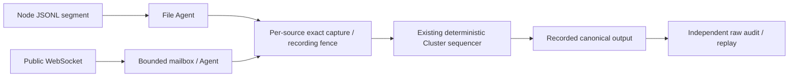

# Runtime increments

Latest increment, 2026-11-16: [composable application results](composable-applications-result.md), with explicit
producer/result/state limits, application-owned SBE batches, exact variable-length retry receipts and segmented native
snapshots. Maintained production Java changes from 3,115 to 3,169 NCLOC. One Cluster commit and one canonical event
per input remain. All Spine-owned formats still start at version 1 for this fresh release.

The [initial release baseline](release-readiness.md) moved Binance state and schema into optional `examples-binance`;
default core/service constructors pass observations through. Its cleanup reduced maintained production Java from
3,123 to 3,115 NCLOC. All 179 tests, strict warmed
allocation gates and independent artifact consumption pass on Java 21 and 25; both fixed Stage One profiles pass on
Java 25. Initialization and complete snapshots bind application identity; consumers qualify retained history
after their trusted checkpoint using Archive protocol authority.

The earlier increment sections retain pre-release measurements and their original counts and commit identifiers. Those
historical commits are not part of the initialized public Git history; the scope of each result is linked above.

## Historical core replacement

Historical baseline `7597951`: 2,657 handwritten runtime NCLOC, excluding generated code/tests/demo; two Cluster
commits, allocating UUID/domain codecs, forced per-event producer state and a continuously replaying output bridge.
Historical performance/acceptance results are summarized in the linked documents; raw reports are local artifacts.

The clean replacement removes those mechanisms together. Schemas 101/201 use numeric IDs; proposals include expected
log scope directly. A pure primitive core accepts one committed input and exposes borrowed output. The service records
that output directly and fences snapshots against complete recording. Consumers qualify overlapping histories and
follow one Archive recording independently. Producer memory has an explicit external captured-input restart boundary.

Acceptance covers deterministic full/snapshot replay, retry/rejection/malformed/unsigned/exhaustion semantics,
maximum payloads, warmed allocation accounting with negative controls, real callback failure, direct output and
separate-process recovery. Actual size and measurement evidence belong in [performance](performance.md).

Both fixed local acceptance profiles passed at this increment. Subsequent increments added real collector capture
and source comparison against that measured foundation. Reliable multicast and distinct-host delivery still need
their own network acceptance and cannot be inferred from local tests.

## Collector/consumer standardization

Added the [application contract](application-contract.md), using existing Agrona Agent lifecycles and schema 201
definitions rather than a new runtime framework. The cold `spine.capture.v1` profile declares parser artifacts,
raw/native boundaries and clock observation points. Collector capture/recovery and grouped/independent consumer
checkpoint responsibilities are explicit.

`ReliableProducer.poll(false)` preserves transport progress while the caller fences capture; `poll()` retains its
existing behavior. `EventHandler.andThen` rewinds before each borrowed callback. The sequencer/protocol are unchanged.
Runtime size is 1,138 → 1,149 NCLOC (+11); the runnable composition/recovery example is 53 → 60, separately counted.

Acceptance adds real maximum-fragment capture/admission gating, egress with admission disabled, handler cursor/failure
semantics and strict warmed allocation gates. The full build passes all 62 component tests and the composed consumer
recovery demo. Real feed conformance, resumption and source-comparison latency remain
the next increment. The retained Stage One reports measure `6958da3`; this change does not replace those runs with a
new latency claim.

## Hyperliquid raw ingestion

Added the [feeds module](../feeds/README.md): one retained node order-diff segment, public `l2Book` WebSocket, and an
application-owned `CapturedIngress` that records exact proposals before allowing admission. Its cold recovery restores
the latest proposal and validates every node prefix byte. Only a final incomplete, never-admitted capture tail may be
truncated; tests cover repeated restarts. Source definitions are admitted before connection/attachment, and the local
harness retains its exact executable bundle/profile and advances source/clock bindings on restart.

Runtime size is 1,149 → 1,904 NCLOC (+755); core/client/protocol remain unchanged. All 94 component tests pass,
including strict node IO/capture owner and WebSocket UTF-8 assembly allocation gates. JDK networking/demand/sends
remain outside the zero-allocation claim. Public-only five-second capture and a 25-second process/Cluster restart
smoke test retained 10 application messages, 11,534 raw bytes, two definitions and canonical head 12; an actual JSON
pong is recorded. These are functional smoke tests, not a new throughput/latency acceptance measurement.

The next increment needs actual node access plus retained snapshot bootstrap/framing. It will deterministically
rebuild an order book, aggregate matching public depth/precision and compare equivalent states. No live L3 coverage,
provider latency ranking or full book reconstruction is claimed by this ingestion increment. Existing Stage One
budgets/reports still refer to the previously measured replacement.

## Public feed smoke tests

Aligned Hyperliquid's public subscription with qfex-farm's `fast:true` setting and retained full-precision parameters.
A 60-second capture plus 30-second process/Cluster restart retained 167 L2 snapshots, two subscription acknowledgements,
four application pongs and two definitions (canonical head 175, 79,207 raw bytes). An independent cold replay checked
all retained generations; every snapshot contained at most five levels per side and both acknowledgements confirmed
the fast subscription. This is public L2 coverage; live order-level node access remains unavailable.

Added a [test-only Binance Spot launcher and semantic audit](binance-testing.md), reusing the same collector/capture
path. A 60-second capture plus 30-second restart retained 8,833 trades, two acknowledgements and two definitions
(canonical head 8,837, 1,241,012 raw bytes). The original canonical export is an exact byte prefix after restart.
The audit validates actual trade payloads and retained profiles/artifacts separately from raw frame sequencing.

Runtime size is 1,904 → 1,911 NCLOC (+7): optional application heartbeat (+6) and cold Hyperliquid profile parameters
(+1). All 94 component tests pass. The capture-gate test now coordinates Cluster termination before closing its
fixture, avoiding a teardown notification race while retaining every health check. Core/client/protocol are unchanged.
Existing allocation/performance claims retain their measured scope; these
are functional smoke tests. SBE capture/comparison requires an Ed25519 API key and the next small binary-adapter
increment. Neither public Binance depth nor these trade tests closes the original L3 gate.

## Binary WebSocket capture and paired runner

Extended the existing collector with cold HTTP headers and one tagged binary mode; no second collector class,
queue, schema or sequencer was added. A uint8 text/binary tag precedes exact application payload bytes, preserving
SBE data and JSON controls on one source. Fixed raw storage remains 65,500 bytes (65,499 application bytes in this mode).
Fragment kinds, bounds, demand and terminal failures are checked before publishing a completed mailbox.

Runtime size is 1,911 → 1,936 NCLOC (+25), entirely in the WebSocket collector (169 → 194). Core/client/protocol
remain unchanged. All 101 Java tests and 19 cold Python tests pass, including a real local WebSocket handshake,
payload-preserving RFC pong, maximum fragmented binary capture/replay and strict owned assembly allocation windows.
These tests establish readiness; JDK networking allocation and live provider latency remain unmeasured by this increment.

The [paired test runner](binance-testing.md) reads the SBE key locally, captures both feeds under a shared process clock,
retains the actual bundle/schema/audit and exports through the complete recorded head. Its explicit 120-second Cluster
session timeout accommodates bounded cold socket setup without changing other fixture settings. The cold comparison
checks exact trade identities/decimals/maker/transaction times, coverage, duplicates, restart bytes and signed callback
arrival distributions. Each run needs equivalent overlap matches and zero payload mismatches. Validation derives from
retained logged time; no current wall clock changes interpretation. The first key-backed live comparison is the next gate.

## Key-independent paired acceptance and ingestion diagnostic

Added two test-only runners around the existing data path: scripted paired WebSockets with a two-JVM retained restart,
and a fixed scheduled workload with same-process timing observation. Strict local audit mode binds every control/data
frame and child trade to a retained expected corpus and prevents synthetic results from passing the live audit.

All 101 Java tests and 29 Python tests pass. The paired gate retains 12 equivalent trades per source/run and exact raw
bytes, wire order, clock/configuration lineage, restart prefix and identical repeated reports through canonical head 44.
The diagnostic accounts for all 2,056 scheduled trades through canonical head 1,289. Its baseline p99 completed-mailbox
wait is about 0.13 ms; submission-to-recorded-consumer p99 is 6.65 ms JSON / 5.94 ms SBE and includes capture/admission,
output recording and consumer polling. These are short local diagnostic samples, not a provider ranking or new budget.

Production size stays **1,936 → 1,936 NCLOC (+0)**; core, schemas, collectors, queues and recording fences are unchanged.
See [paired acceptance](binance-testing.md) and [method/results](collector-ingest-profile.md). The next runtime change
still requires its own component diagram and gate; no tuning, source selection, strategy or ML code is introduced here.

## Collector boundary diagnostic

Added a test-only observer to the existing fixed profile: three pinned live images, preallocated complete-message
assembly and command arrays, and recording-ID/registration-validated counter reads. Exact capture/source/frame
identity joins canonical sequence and the independent Archive follower. Every definition, acknowledgement and data
command is accounted for; original bytes and times remain unchanged. Counter-crossing brackets and signed observation
differences retain polling uncertainty. No production hook, second commit or admission/recording change was added.

Four same-executable OFF/ON/ON/OFF runs pass through head 1,289 each. Capture-fence-to-canonical-publication observation
is the largest measured interval (baseline p99 3.97–4.57 ms); it does not isolate producer scheduling, Cluster
commitment or service work. Direct observer polling accumulates about 87 ms elapsed per enabled run, and adjacent-run tail/median
differences are disclosed without a fixed causal overhead claim. All 106 Java tests and 42 Python tests pass,
including five actual IPC/Archive observer failure/fragmentation cases and independent report fault fixtures.

Production size stays **1,936 → 1,936 NCLOC (+0)**. [Full method, limitations and evidence](collector-ingest-profile.md)
preserve the fixed workload and Stage One budgets. The roadmap still gates live SBE and original L3 access/bootstrap
separately; no runtime tuning or source selection follows from these observer measurements alone.

## Infrastructure idle-strategy comparison

Kept the completed capture → one Cluster commit/core → recorded canonical output → independent Archive follower
architecture and every recording fence. Aeron 1.53.0 defaults let six infrastructure agents park up to 1 ms; five
existing JVM properties select Agrona BusySpinIdleStrategy without adding code or changing the collector owner's
100 µs maximum park. The shared driver and dedicated Archive retain their threading modes.

Acceptance used the same retained executable and fixed workload, in DEFAULT/SPIN/SPIN/DEFAULT order, with observation
enabled throughout. Every run passed exact raw-byte/time, receipt and command accounting through canonical head 1,289.
Independent cold audits matched all reports. Baseline ready-to-recorded-follower p99 fell from 6.61–7.23 ms to
65.75–114.125 µs; full scheduled-send-to-follower p99 was 315.209–458.126 µs with SPIN. Returning to defaults restored
the millisecond tail. Approximate sampled process CPU rose from 0.45–0.46 to 6.26 logical CPUs.

Production size stays **1,936 → 1,936 NCLOC (+0)**; no production or test code changed. The previous 106 Java / 42 Python
tests apply to the unchanged artifact; the new validation is four actual fixed-workload runs and their cold audits.
The [retained breakdown, launch recipe and limits](collector-ingest-profile.md#idle-strategy-comparison-2026-10-06)
keep sender/callback/owner latency, signed observation uncertainty, burst tails and CPU scope explicit. Default
launch policy and Stage One budgets are unchanged. Live feed, high-rate and production tail acceptance retain their
separate gates.

## Command-driven application release

The optional Binance extraction has a retained [byte/performance result](application-boundary-result.md).
Release 1.0.0 binds initialization and snapshots to provisioned application semantics/configuration, protects
complete snapshots with SHA-256, configures exact native versions, and qualifies consumer history relative to restored
state. Archive protocol authority supports consumers on a separate media driver; native three-member tests cover
local leader replacement and retained snapshot/input-suffix recovery. Native failure tests and the reusable neutral
conformance oracle stay outside production code. MIT licensing
and local Maven staging support independent consumers. See [release evidence](release-readiness.md) for the final gates,
code counts and supported deployment envelope. Native timers, multicast output, distinct-host qualification,
host/power-loss durability and external-effect reconciliation remain separate work.
