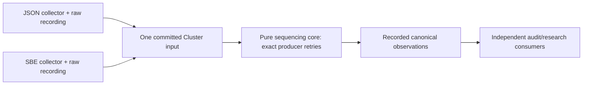
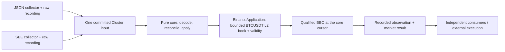

# In-memory market-state core

User clarification, 2026-10-08: Spine must maintain venue books in its deterministic single-writer core, reconcile
redundant feed observations there, and expose a coherent instrument view for BBO, pricing, quoting and cross-venue
evaluation. This supersedes the proposed downstream-only book consumer. The first implementation now owns one
bounded Binance Spot BTCUSDT L2 book, reconciles redundant JSON/SBE depth ranges, and publishes qualified BBO with each original observation. A second venue and cross-venue evaluation
remain later market work.

Extraction, 2026-11-16: `BinanceApplication`, its book/decoder and schema 401 now belong to optional
`examples-binance`. Inject `new BinanceApplication()` into `SequencerCore` or `SequencerService`; the default
constructors pass inputs through unchanged. The application still executes inside the deterministic single writer,
with the same book, reconciliation, output and snapshot behavior. Embedded ownership in the earlier increment below
is superseded by this [application boundary](application-contract.md#replicated-application-boundary).

## Architecture boundaries

Completed before the 2026-10-08 market increment (preserved in Git):

Implemented in that increment; domain state is now owned by the injected Binance application:

Network connections, capture recording, snapshot fetching and external order effects remain outside the pure core.
Bounded decoding, native update reconciliation, book mutation and instrument evaluation share its one owner and
committed input order. Reuse owner-scoped codecs and primitive Agrona storage; add no normalization service, second
Cluster append, continuously replaying bridge or concurrent access to mutable books.

## State and reconciliation contract

- Provision venue/instrument identities, market type, quote currency, quantity units and exact decimal scales through
  retained configuration. Matching a symbol label alone does not establish comparable instruments.
- Keep prices and quantities exact. Validate a complete update in bounded scratch before changing live state.
  Preallocate supported books, levels, pending ranges and snapshot workspace; exhaustion has an explicit outcome.
- Separate producer-retry deduplication from venue-native reconciliation. Preserve every independently admitted raw
  observation and its timing/source lineage, while applying a redundant native transition once. Scope native IDs
  or update ranges by venue, instrument and their declared epoch/event family; raw JSON/SBE equality is unnecessary.
- Select the first valid observation in committed order that advances the book with proven continuity. Do not wait
  for its redundant counterpart. Older observations cannot roll state backward. Different batch boundaries require
  venue-specific range rules; identical final IDs alone do not prove equivalent payloads.
- Each book carries its native frontier, bootstrap/depth coverage, binding table and validity. Selected-frontier
  source provenance is reconstructible from retained observations; `BookResult` does not repeat the selected
  pending source after gap repair. Bound pending
  out-of-order work. An unresolved continuity gap, established conflict, unsupported relevant interpretation or
  exhausted capacity makes the affected view ineligible for pricing until qualified repair. Preserve the observation
  and deterministic failure result. Outer malformed-proposal rejection retains its existing admission semantics.
- A source reconnect does not invalidate a venue book if a sibling feed still proves native continuity. A new venue
  epoch or lost aggregate continuity requires a recorded bootstrap. Fetch repair externally and commit the result.
- Snapshot complete core state: book contents, mappings, frontier/validity, pending work, interpretation versions and
  producer retry progress. Restore plus the committed suffix must reproduce identical state and output bytes.
- Keep one canonical envelope per accepted input, including its observation lineage and deterministic market result.
  A new output/snapshot schema and all maximum-size bounds must be explicit before implementation; do not truncate
  raw data to make room for derived fields. Keep the existing complete output-recording fence before core snapshots.

After each committed input, evaluation sees one coherent global prefix of all owned books. Each venue retains its
own native frontier and observation age. This is the latest qualified observed state, not a claim that exchanges
were observed at one physical instant. Logged time/configuration drives deterministic freshness and pricing eligibility;
idle expiration needs an explicit logged time transition. Unsynchronized collector clocks remain provenance.
Same-owner evaluation can read the books directly. Other agents receive versioned published results with their core
cursor and validity, rather than concurrently reading mutable book storage.

Redundant connections can reduce delivery tails when their delays differ. The improvement must be measured under
the doubled ingestion load, shared upstream stalls and delayed/disconnected subscribers; it is not guaranteed by
opening more sockets. Preserve separate callback, commit, state-application and recorded-result measurements.

## First implementation increment

Implemented one Binance Spot BTCUSDT L2 book in the core with a recorded bootstrap, JSON and SBE depth observations,
native-range reconciliation, validity, BBO output and complete core snapshot recovery. A newly retained Tokyo depth
corpus is checked against an independent exact-decimal oracle after every input. See [implementation evidence](market-state-result.md). The retained Hyperliquid five-level
snapshots remain useful bounded fixtures and later source work, but do not satisfy full order-level reconstruction.

Binance JSON depth batches at 100/1,000 ms while SBE depth batches at 20 ms. Both have first/final update IDs, so
they need not match one-to-one. For a qualified frontier `r`, the merge admits the first committed span
`[U,u]` with `u > r` and `U <= r + 1 <= u`, applies absolute level quantities and advances to `u`; a zero quantity
removes a level. Stale spans remain observations. A later span that cannot prove continuity requires bounded pending
work and explicit repair/ineligibility. Exact-span duplicates compare normalized retained rows. Different-start spans ending at the current frontier
compare provided quantities against the current covered book; a contradiction invalidates it. Older-ending spans
are retained as stale observations without claiming historical equivalence. See the official [JSON bootstrap/update procedure](https://github.com/binance/binance-spot-api-docs/blob/master/web-socket-streams.md#how-to-manage-a-local-order-book-correctly)
and [SBE depth streams](https://github.com/binance/binance-spot-api-docs/blob/master/sbe-market-data-streams.md).

The REST bootstrap covers at most 5,000 levels per side; unchanged deeper levels are unknown. Declare coverage and
prevent pricing beyond proven depth. An entire-venue-book claim needs a complete initial source. The 320,050-byte retained REST snapshot is staged using contiguous `BootstrapChunk` proposals, with a
512 KiB total bound and atomic installation after complete decoding. No bytes are truncated. Initial bid coverage
is prices at or above the lowest snapshot bid; ask coverage is at or below the highest snapshot ask. Updates outside
that domain remain auditable but do not expand qualified coverage. BBO-only streams are a separate state family and cannot reconstruct depth; SBE BBO
auto-culling also means their IDs must not be subjected to diff-depth continuity rules. See the same official docs.

Acceptance:

1. An independent exact-decimal oracle verifies book state, native frontier, validity and BBO after every input.
   Include differently batched JSON/SBE spans, stale/duplicate/reordered arrivals, missing updates, malformed data,
   comparable conflicts, reconnects, bootstrap replacement and all declared capacity limits.
2. Full replay equals core snapshot plus suffix at every cut, including definitions, pending ranges and invalid
   books. Producer retries emit no second observation; redundant sources emit observations but no duplicate mutation.
3. An unresolved gap/conflict or insufficient depth never exposes an eligible price. No live book changes after a
   partially validated frame; compatible sibling continuity survives a source reconnect.
4. Measure zero warmed Spine-owned decode/reconcile/apply/encode/poll allocation with an escaping negative control.
   Disclose cold setup/restore separately. Measure scheduled update-to-state and update-to-recorded-result tails,
   CPU and recorder lag with source delays/failures; distinguish combined application-time upper bounds from exact
   subinterval measurements. Preserve the previous fixed correctness/performance gate.
5. Show handwritten runtime size before and after, with generated code, comments, blank lines and tests excluded.
   The baseline for this increment is 1,936 lines. Add only state and behavior required by this gate.

Then add a second qualified venue book and retained instrument mappings to test composite BBO and cross-venue
evaluation at the same core cursor. Add full order-level bootstrap where required, reproducible pricing experiments,
remote delivery/fault-domain acceptance and replay-safe external execution in separate bounded increments.

## Wire and operational contract

Market schema **401/version 1** and its generated SBE codecs are supplied by `examples-binance`. Admit a `BookSource` binding before observations from its
`(sourceId, configuration, clockId)`. It binds one venue/instrument, positive epoch, format (1 JSON diff, 2 tagged SBE diff,
3 REST bootstrap), exact decimal scales (0–18) and maximum age in logged nanoseconds. This decoder accepts only
Binance Spot BTCUSDT, SBE schema 1/version 0 depth template 10003, and direct JSON depth messages. Format 2 uses the existing binary collector representation: one leading byte
(0=UTF-8 control text, 1=unchanged binary message); decode skips that byte and output preserves it exactly. It does not infer
another symbol or venue from numeric IDs. A newer epoch resets the book; identity, scales and maximum age are fixed
for the configured instance. Reconnection uses a fresh retained configuration and a compatible binding.

Bounds are 16 bindings, 8,192 current levels per side, 8,192 decoded rows per side, eight pending ranges with 512 rows
per side each, and 512 KiB bootstrap staging. A pending-range overflow or book capacity exhaustion suppresses pricing
until bootstrap repair. Captured input retains the existing 65,536-byte inner-payload limit; chunk overhead is 28 bytes.
The producer must completely record each exact binding/chunk/observation proposal before offering it. With
`CapturedIngress`, admit its immutable capture definition first, then the matching typed book binding before opening
the collector. Last application time records the logged time of the selected observation introducing the current
native frontier, including an observation that was held pending; it does not manufacture a fresh time on repair.

Each accepted bound input emits a `BookResult` carrying the exact original inner observation, coverage bounds, native
frontier, last application time, integer BBO/scales, outcome and status. It adds 96 bytes to the inner payload. Status
values are EMPTY=0, VALID=1, GAP=2, CONFLICT=3, CAPACITY=4, INVALID=5, INELIGIBLE=6. The last value is a derived output
status when a structurally valid book has insufficient sides or exceeds configured age; all four BBO fields are zero
whenever output is ineligible. Outcome values are NONE=0, APPLIED=1, STALE=2, PENDING=3, NEEDS_BOOTSTRAP=4,
INVALID_INPUT=6 and CONFLICTING=8. Unbound unrelated sources keep their original payload. A known source with an
unbound configuration/clock invalidates the book. The pinned subscription ACKs with IDs 1 and 2 are retained control
observations; other relevant unsupported messages fail explicitly.

Outer Spine schema **101/version 1** includes application identity, bounded output, retry receipts and complete
snapshot integrity.
Maximum canonical event size is 65,704 bytes. The generic application bound permits 2 MiB of market state plus 1,024 producer
receipts, including each cached market-result prefix. Binance writes a 92-byte SBE header/fixed block; the core appends
the uint32 original-input length and original bytes, retaining the existing 96-byte overhead. Exact producer retries return the original BBO/result even after
other producers advance the book, and emit no second observation. Snapshots retain bindings, full covered book,
last comparison rows, pending arrivals, unfinished bootstrap bytes and cached retry results. Restore validates a fresh
candidate and cached results before atomically replacing application and protocol state. The four application methods
own transition, snapshot, candidate restore and cached-result validation; buffers and codecs remain borrowed on one
owner. Cluster snapshot publications require a sufficiently large message limit; the
launcher and fixtures now use a 32 MiB term (4 MiB maximum message). Ordinary ingress/output terms remain 1 MiB.

This runtime does not fetch REST snapshots or send orders from the core. The first acceptance corpus was captured
from the existing AWS Tokyo host, then replayed locally; a continuously running live depth collector/repair operator,
a second venue, composite BBO, logged idle-expiry transitions and production fault-domain acceptance remain separate
increments.
