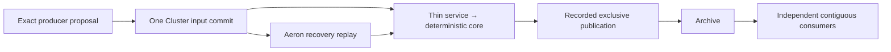

# Performance and container policy

Spine now applies one committed input to a pure single-writer memory core and publishes its deterministic output
through an ordinary recorded publication. There is no second canonical Cluster append or continuously replaying
bridge. The [core contract](deterministic-core.md) defines the required recovery and allocation boundaries.



## Functional-code size

Nonblank/noncomment handwritten Java lines, including imports/braces, excluding generated code and tests/fixtures.
The table retains prior increments; the historical in-core book increment is **1,936 → 2,985 (+1,049)**,
with [behavior, allocation and processing evidence](market-state-result.md).

The application extraction is **2,985 → 3,032 (+47)**; see its [paired byte/timing evidence](application-boundary-result.md).
The command-driven release increment adds identity/integrity and retained-history recovery: **3,032 → 3,123 (+91)**,
including the optional Binance application and feed harness, excluding generated code and tests/fixtures.
The fresh-release reset and cleanup reduce this to **3,115 (−8)**. That baseline passes **179 tests on each of
Java 21 and 25**, including strict warmed allocation gates; see [baseline release verification and measured limits](release-readiness.md).
The subsequent [composability increment](composable-applications-result.md) is **3,115 → 3,169 (+54)** and adds
bounded variable results and segmented snapshots. Its 196-test suites pass on Java 21 and 25, with strict warmed
allocation checks and both unchanged Stage One profiles. The current evidence is linked from that result; retained
baseline measurements below remain historical.

The comparisons below retain measurements from earlier development increments. Their commit IDs identify local
historical baselines, not commits in the fresh public Git history; they do not describe the current code size.

The historical Java/dependency increment left runtime source byte-identical: **2,985 → 2,985 NCLOC (+0)**.
Java 25, Aeron 1.53.3, Agrona 2.6.1, SBE 1.40.2 and Gradle 9.8.1 pass the complete component,
allocation and fixed shared/dedicated recovery gates. Frozen JVM comparisons and full IPC profiles do not
establish a tail-latency winner. A test-only replay warmup reduces first-window core latency; the AOT cache
experiment worsens extreme tails, so neither AOT nor a production readiness warmup is enabled. See the
[version, byte-identity and startup measurements](java-runtime-comparison.md).

| Module | Baseline at 2f8757a | Replacement at 6958da3 | Application contract | Feed adapters at eab0fd3 | Binary capture |
|---|---:|---:|---:|---:|---:|
| Protocol | 572 | 262 | 262 | 262 | 262 |
| Client | 1,433 | 535 | 546 | 546 | 546 |
| Sequencer | 652 | 341 | 341 | 341 | 341 |
| Feeds, including local harness | — | — | — | 755 | 787 |
| Runtime total | **2,657** | **1,138** | **1,149** | **1,904** | **1,936** |
| Runnable consumer example, counted separately | 97 | 53 | 60 | 60 | 60 |

The core/protocol/client replacement shrank by 57%. At that baseline, the sequencer had the 220-line pure core and 121-line service adapter. Deleted
producer files/locks, UUID/domain wrappers, recorded-head actor, self-offer and output bridge belong to that historical baseline.
Code size is an auditability measure; latency and correctness need separate evidence. The feed increment leaves those
core/client/protocol counts unchanged. Its 755 lines comprise 246 for capture/recovery policy, 145 for node-file capture,
163 for WebSocket capture and 201 for the cold local launcher, profile and audit. No venue parser, book projection,
router or second sequencer is introduced.

Public feed testing at `e2828ba` adds seven runtime lines: six let a caller configure or disable the WebSocket application
heartbeat, and one records Hyperliquid's fast/full-precision subscription settings in its cold profile. At that increment,
the WebSocket collector was 169 lines and the local launcher 202; capture and node-file counts were unchanged.
The Binance launcher and semantic/recovery audit are test-only. These live smoke tests establish functional capture
and retained replay, not new latency, throughput, clock-calibration or end-to-end allocation measurements.

Binary capture adds 25 runtime lines (1,911 → 1,936), extending the same WebSocket collector from 169 to 194 lines.
The new mode copies binary fragments into its fixed mailbox and prefixes text/binary tags; header setup is cold.
The paired launcher, schema interpretation, matching and local WebSocket peer are test-only. The sequencer, client,
protocol and local feed launcher remain unchanged.

The key-independent paired restart test and [fixed collector ingestion diagnostic](collector-ingest-profile.md)
add only test/fixture code. Runtime remained 1,936 NCLOC at that increment. Exact end-to-end accounting and short local timing samples
pass; existing allocation claims and Stage One numerical budgets are unchanged.

The test-only boundary observer adds no runtime lines (**1,936 → 1,936 NCLOC**). Four unchanged OFF/ON/ON/OFF workloads
fully reconcile through head 1,289 each, with independent complete-message/counter observations and descriptive
instrumentation costs. Capture-fence-to-canonical-publication p99 observations are 3.97–4.57 ms; they include
admission/Cluster/service/output and polling. They do not measure pure core latency. See the
[boundary method and retained results](collector-ingest-profile.md#boundary-results-2026-10-06).

Changing only existing Aeron/Agrona JVM idle-strategy settings subsequently reduced baseline ready-to-recorded-follower
p99 from 6.61–7.23 ms to 65.75–114.125 µs in a same-executable DEFAULT/SPIN/SPIN/DEFAULT comparison. Full
scheduled-send-to-follower p99 was 315.209–458.126 µs with SPIN. All byte/time/receipt/recording checks passed through
head 1,289 in each run; production remained **1,936 → 1,936 NCLOC (+0)**. Approximate process-wide CPU usage rose
from 0.45–0.46 to 6.26 logical CPUs in the sampled windows. These short fixed-workload diagnostics preserve all
recording fences and disclose the polling/resource tradeoff; they do not change default launch settings or Stage One
budgets. See the [complete idle comparison](collector-ingest-profile.md#idle-strategy-comparison-2026-10-06).

The application-contract increment adds 11 runtime lines for a producer offer gate and decoder-safe handler
composition, with no new runtime class, state buffer or core/schema change. Handler chains allocate during cold
composition; their warmed callbacks and connected gated producer polling have strict zero-byte allocation gates.

## Memory and ownership

| State | Storage and bound |
|---|---|
| Producer lookup | Pre-sized Agrona Long2LongHashMap mapping provisioned uint64 IDs to dense indexes; declared producer bound, default and maximum 1,024 |
| Producer latest retry state | Primitive arrays, 32-byte exact-proposal SHA-256 fingerprints and declared result bytes per producer; default 92 bytes, maximum 2 MiB |
| Core input/output/snapshot workspace | Fixed Agrona UnsafeBuffer views and bounded arrays; 64 KiB admitted inner payload, declared result/state bounds; application state defaults to 2 MiB and can reach 64 MiB, with the complete declared snapshot bounded by 128 MiB |
| Optional Binance application state | One book, 8,192 levels per side, eight pending ranges of 512 rows per side, 16 bindings and 512 KiB bootstrap staging |
| Consumer recent overlap | Fixed 1,024-sequence fingerprint ring and primitive cursor |
| Per-image fragments | Fixed maximum-sized ImageFragmentAssembler backing memory |
| Cold recording qualification | JDK ordered spans and O(retained suffix) temporary hashes, verifying every overlap after the trusted application checkpoint through the recorded head |

Each hot mutable object has one owner. No Spine application locks or per-observation files remain. SHA-256 uses
reused SUN provider state, caller-owned output and scratch bytes. Descriptive UTF-8 definition records, catalog
qualification, restore, connection setup, generation refresh and terminal exceptions are cold operations.

## Allocation measurement

Core/protocol/client tests exercise ordinary accepted, duplicate, conflict, gap, expired, capacity, malformed and
maximum-payload paths, plus snapshot encoding. Accounting must be supported, enabled and nonnegative; escaping
allocation negative controls prove that the counter observes actual heap objects.

The real transport gate measures separate producer and Archive-consumer owner threads while the test observer
queries their paused counters. The service gate brackets the actual core/output/receipt callback. Warm-up contains
10,000 idle polls, 32,768 real 16-byte observations and 4,352 real 64 KiB fragmented observations. Two subsequent
windows of 512 and 1,024 maximum-sized observations require exactly zero bytes on all three paths, without tolerance
or subtraction. Aeron driver/conductor/Archive threads and the synthetic test observer are outside those owner
measurements. Setup and JVM warm-up are not a zero-allocation claim.

The sequencer unit/integration test JVM uses `-Xbatch` so compilation completes synchronously during the fixed
warm-up. A local JFR trace attributed a 256-byte service callback allocation to HotSpot resolving two
`ContainerClientSession` string constants before C2 compilation. A Linux Java 21 job reported the same byte count
after warm-up; that job lacked a trace, so matching its cause remains an inference. Measurement windows, negative
controls and zero-byte assertions are unchanged. Production JVMs and Stage One latency JVMs do not use this option.

The feeds test JVM also uses `-Xbatch`. In a bounded ARM Java 21 experiment, compiler logs showed C2 compilation
starting inside the binary assembly gate's final measurement window; all four synchronous-compilation runs
completed C2 during warm-up and passed. The traces establish compilation timing, not the allocating object's
identity. The fixed 10,000-cycle warm-up, 256/512-cycle measurement windows, escaping control and zero-byte
assertions are unchanged. This setting applies only to the test JVM.

After traffic warm-up the producer also holds a maximum-sized pending proposal with offers disabled. A 10,000-poll
warm-up precedes a measured 10,000-poll window requiring zero owner allocation and no service progress for that proposal.
`EventHandlerTest` separately measures 10,000/100,000 three-handler payload-consuming callbacks at zero bytes after
100,000 warm-up callbacks, with supported accounting and an escaping negative control.

`FeedIntegrationTest` adds actual node-file/direct-buffer reads and `CapturedIngress` publication/recorder-fence/admission
polling on one measured owner thread. A retained source preloads 512-byte lines; 100,000 admitted observations warm the
path in ten fixed 10,000-input turns (12,500 actual 4 KiB source reads), followed by 1,024 measurement-priming
observations and strict independent 512/1,024 windows at zero bytes. The fixed warm-up was expanded after one
Linux worker reported 64 bytes in the first measured window with the former 10,000/32 warm-up.
That observation is not attributed to a specific allocator;
both post-warm-up windows are asserted without retries, and the zero-byte assertions are unchanged.
The observing test thread reads the owner's allocation counter; supported/enabled/nonnegative accounting and an
escaping 4 KiB negative control are required. File creation, Archive administration and assertions are outside the window.

`WebSocketCollectorTest` measures 10,000 warmed maximum-sized Unicode-fragment assembly cycles, then strict 256/512
windows at zero bytes, with a primitive-only demand stub and escaping negative control. This measures Spine-owned
UTF-8 assembly/observation encoding. It does **not** measure JDK networking, callback text creation, demand machinery
or periodic ping sends; those can allocate. The whole live network pipeline is not claimed to be zero allocation.

The tagged binary gate alternates text controls and maximum binary assembly/capture cycles after 10,000 warm-up
cycles, using read-only direct and sliced heap ByteBuffers plus RFC control callbacks. Independent 256/512 windows
require exactly zero bytes, with supported/enabled/nonnegative accounting and an escaping 4 KiB negative control.
`BinaryWebSocketIntegrationTest` separately exercises a real local authenticated handshake, automatic payload-preserving
pong, fragmented 65,499-byte binary message, exact capture/admission and recorded replay. Its networking and test
assertions allocate; this functional integration is not an end-to-end allocation measurement.

Earlier diagnostic failures are meaningful: late fixed String/byte-array pulses appeared at digest invocation,
without a per-event workspace array. The final gate warms the real methods beyond that transition. An additional
hot Archive timeout getter was removed: Aeron 1.53.0's messageTimeoutNs() reads the debug-timeout property, so the
bounded replay now caches that value during setup. See the [patterns reference](../.agents/skills/aeron-agrona/references/patterns.md).

## Fixed end-to-end profiles

```sh
./gradlew :sequencer:stageOneAcceptance -PaeronProfile=shared
./gradlew :sequencer:stageOneAcceptance -PaeronProfile=dedicated
```

Both retain the same 100/second sustained schedule, 100 ms maximum lateness, 256-frame 64 KiB burst, latency,
recovery and observed-heap limits. The immutable pre-traffic manifest records the transport profile, collector
capture contract, sampling cadence and 10 ms exact-proposal retry interval. Shared remains the default; dedicated
uses separate Media Driver agents and more aggressive owner-scoped backoff. No affinity or exclusive cores are claimed.

The collector fixture completely records proposals before offering and correlated actual receipts before advancing.
Stale duplicate receipts are ignored before journaling. Parent heap sampling uses a cached MemoryMXBean at 100 ms;
child samples use the same cadence. Repeated management-object lookups and stale-receipt fences formerly distorted
the scheduled fixture. All numerical budgets are unchanged. See [current measured results](release-readiness.md)
and the [historical Stage One comparison](stage-one-result.md).

The old atomic prepare/ACK baseline failed the same schedule at 34–39 observations/second, with 15.89–19.22 seconds
of accumulated lateness. Its local shared/dedicated reports are summarized in the historical results document.
Those measurements describe the deleted runtime, not the current producer's external-capture boundary.

## Transport boundary

Prefer IPC for local communication and reliable Aeron UDP multicast for cross-host canonical fan-out on supporting
networks. Required recording, optional observers and targeted replay need separate contracts. Output uses local IPC;
consumer catalog authority reads Archive protocol positions and supports a separate consumer media driver. Tests
cover separate-driver UDP replay and native three-member local failover, in addition to local IPC. The output
snapshot fence still uses its local recording authority. Distinct-host networks, multicast performance, host/power
loss and external effects require separate acceptance. See [release limits](release-readiness.md) and the
[transport reference](../.agents/skills/aeron-agrona/references/transport.md).

## Long-term machine-level latency target — 2026-10-08

The user explicitly wants Spine to pursue the lowest practical latency across the full machine and network path.
Future work includes network/NIC drivers, cache-local memory layouts and CPU controls; the current Java/Aeron
implementation is not a ceiling on those experiments. Keep the pure single-writer core, exact recording/recovery
contracts and zero warmed Spine-owned allocation as the baseline.

- Measure the working set touched by each transition, L1/L2/last-level cache misses, cache-line alignment, hot/cold
  separation, primitive layouts and false sharing. An entire book need not fit in L1; optimize its active access path.
- Evaluate CPU affinity/isolation, SMT placement, NUMA-local allocation, interrupt placement, frequency/power policy
  and page-fault/pre-touch behavior on declared hardware. Guest vCPU placement does not establish host-core exclusivity.
- Evaluate native networking and driver/NIC capabilities where the transport supports them. Account for exchange
  geography, public WebSocket/TLS constraints, copies, batching and recording fences in the complete measurement.
- Compare supported JVMs, JIT behavior, safepoints and collectors on the same executable/workload before changing
  defaults. Consider supported native-memory/function APIs and existing library/native transports before custom code.
- Retain scheduled tails/lateness, CPU, allocation, recorder lag and recovery evidence. Off-heap storage, SIMD,
  kernel bypass or a newer JDK is a measured implementation choice, not an automatic performance improvement.

## In-core Binance book increment — 2026-10-08

[Market-state evidence](market-state-result.md) records the new strict-tagged depth core, complete covered-book snapshots,
allocation gates and real Tokyo corpus oracle. Its frozen isolated-core measurement is 0.542 µs p50 / 4.458 µs p99
across 572,800 calls. Transport and cold restore are excluded. Actual complete-capture-to-recorded-follower
measurements include separate local closed-loop and fixed-schedule paired-feed diagnostics. The latter keeps correct
state through synthetic delay/pause phases but exposes scheduling/backlog stalls up to 83.431 ms; a low-tail operating
envelope remains open. Handwritten Java runtime
size is 1,936 → 2,985 NCLOC (+1,049), with generated code/tests excluded. Earlier performance evidence above
remains tied to its original executable and operating envelope.
