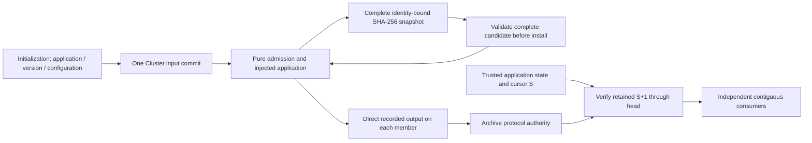

# Command-driven application release increment

This is the retained initial-release baseline. The later [composability increment](composable-applications-result.md)
adds declared capacities, variable result batches and segmented snapshot transport. The test counts, hashes, staged
artifacts, timings and code sizes below describe the baseline; they are not measurements of the later runtime.

The initial release is `1.0.0`. Spine-owned protocol, capture, market and counter schemas start at version 1.
The fresh-release cleanup removes historical schema evolution markers, the old initialization-format guard and
legacy audit fallback. Application identity checks, complete snapshots and exact retries retain their contracts.

## Runtime contract

- Initialization binds the provisioned application ID, semantics version and configuration ID before mutation,
  including replay without a snapshot.
- Complete snapshots bind those identities, sequence, all producer retry receipts and application state with SHA-256.
  Bounds, digest, private application candidate and cached results validate before installation. SHA-256 detects
  accidental corruption; it is not authentication against a writer who can recompute the digest.
- `SequencerService.configure` installs exact native app-version validators on both Cluster contexts before launch.
  The baseline required the complete snapshot to fit the publication's maximum message length. The later
  composability increment segments snapshots. Direct output and the complete recording fence remain.
- A consumer restored at S qualifies every retained output after S through an independently observed head, including
  overlapping hashes. Genesis coverage is unnecessary. Missing suffixes, conflicting bytes and purged replay starts
  fail explicitly. Archive protocol positions support a separate consumer media driver. Qualification scans retained
  history and uses O(retained suffix) temporary hash storage at a cold boundary.
- MIT licensing, locally staged Maven publications with sources/Javadocs, and Java 21/25 CI make the libraries
  independently consumable. No external registry publication or release tag is performed by this increment.

Applications compose ordinary owned components. This release supports command-driven transitions with logged time. Native timer
callbacks, multicast canonical output, distinct-host qualification, host/power-loss durability and external-effect
reconciliation require separate contracts and acceptance; they are not established by localhost tests.

## Reproducible verification

Use [release commands](releasing.md) and the [application conformance fixture](../testkit/README.md). The neutral
counter has an independent Python `struct`/SHA-256 oracle for exact command/time, output and complete snapshot bytes.
Tests compare that oracle, every restore cut, repeated execution, exact retries and rejected restore atomicity.
Allocation tests require working accounting and escaping-allocation negative controls. Setup, restore, cold catalog
qualification, test observers and arbitrary user applications are separately budgeted.

Native recovery tests exercise actual Cluster and Archive paths: maximal snapshots, version refusal, stopped output
recording, closed snapshot publication, lost receipts, multiple snapshots, leader replacement and explicit selection
of an older retained snapshot followed by its committed suffix. This is explicit snapshot invalidation during a test,
not automatic fallback from a corrupt newest snapshot.

Both full builds pass **179 tests, zero failures/errors/skips**: protocol 16, client 29, sequencer 62,
feeds 24, testkit 6 and optional Binance 42. Runtimes are Temurin **21.0.11+10** and **25.0.4.1+1** on
macOS aarch64. The exact neutral output/snapshot oracle digests agree across both runtimes. The outside-checkout
publication consumer passes against staged coordinates on both Java versions, including a separately resolved
optional Binance application; the generic classpath contains no market classes.

- [Java 25 suite](evidence/1.0.0/tests-java25.json) and
  [Java 21 suite](evidence/1.0.0/tests-java21.json).
- Retained independent counter results: [Java 25](evidence/1.0.0/conformance-java25.json) and
  [Java 21](evidence/1.0.0/conformance-java21.json). The [current oracle source](../testkit/src/test/python/counter_oracle.py)
  and fixtures now encode variable-length snapshot receipts.
- [Java 25 publication consumer](evidence/1.0.0/consumer-java25.log),
  [Java 21 consumer](evidence/1.0.0/consumer-java21.log), and
  [artifact inspection](evidence/1.0.0/artifact-inspection.json).

The [checked-in evidence index](evidence/1.0.0/README.md) identifies the tested source tree, commands and report scope.
Full test XML and generated build artifacts remain local or in CI artifacts.

Strict warmed gates report zero bytes for measured producer, core/output and Archive-follow consumer ownership
windows at maximum payload size, and for application receipts, application/core snapshots and exact retries.
The suite also has bounded-noise diagnostic tests. These results do not claim that arbitrary
applications, JDK networking, cold recovery or the entire JVM allocate zero bytes.

The two unchanged Stage One profiles pass on Java 25: 1,000 inputs scheduled at 100/s, the 256 × 64 KiB burst,
captured-producer crash/retry, independent consumer catch-up and snapshot/input-suffix replay. Their scope remains
single-node, single-host IPC/page-cache recording. The separate native three-member/UDP tests are correctness
checks, not remote latency measurements.

| Profile | Admission p99 | Recorded p99 | Applied p99 | Maximum schedule lateness | Live catch-up |
|---|---:|---:|---:|---:|---:|
| [Shared](evidence/1.0.0/stage-one-shared-report.json) | 15.396 ms | 8.754 ms | 8.729 ms | 26.573 ms | 9.719 ms |
| [Dedicated](evidence/1.0.0/stage-one-dedicated-report.json) | 11.384 ms | 1.219 ms | 1.403 ms | 3.442 ms | 9.110 ms |

Admission is producer-local elapsed time; recorded/applied timings are parent-observed signals with control I/O.
They are distinct boundaries and must not be subtracted as sequential phases. Maximum sampled Archive delivery lag
was 1 event shared and 2 dedicated. No CPU gate or affinity was enabled; storage uses `fileSyncLevel=0`.
These samples establish no speed improvement, HFT qualification or hard tail bound.

The Python audit suite passes 42 tests, including rejection of incomplete manifest fields. The independent
counter oracle was regenerated for the version-1 header; it continues to compare exact bytes rather than accepting
a different runtime output as its own expected result.

## Handwritten production size

NCLOC excludes generated code, tests/fixtures, comments and blank lines; imports and braces count. The neutral
counter/conformance oracle and publication consumer are test fixtures, not added production abstractions.

| Module | Before cleanup (internal baseline) | Fresh release |
|---|---:|---:|
| protocol | 296 | 296 |
| client | 558 | 558 |
| sequencer | 477 | 468 |
| feeds | 789 | 789 |
| optional examples-binance | 1,003 | 1,004 |
| **Production total** | **3,123** | **3,115** |

**Net −8 lines:** nine redundant/historical core lines removed; one Binance condition split for readability.
The optional application adds no functional logic. Generic protocol/client/sequencer total 1,322; the consumer demo
remains a separate 60 lines. [Count evidence](evidence/1.0.0/production-ncloc.json)
records the method and the pre-release baseline label; that commit is not in the reset public history.
The deslop and karpathy-guidelines review compared the pre-release branch against its then-current `main` and retained
bounds, ownership comments and lifecycle checks that protect required behavior.

The final staged artifacts target Java 25. Core artifacts have ordinary Maven POMs; test-fixture capabilities use
Gradle module metadata. [The retained publication gate](../testkit/src/test/publication-consumer/check.py)
checks real outside-checkout consumption and is part of both CI Java jobs. Remote publishing and a release tag
remain deliberate release actions.
