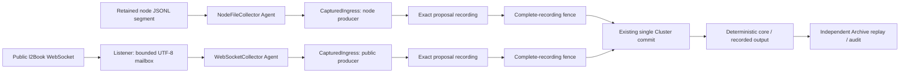
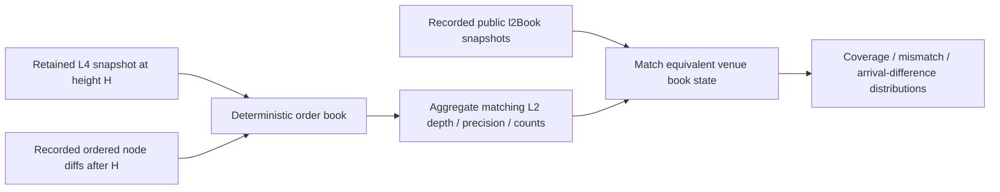

# Raw capture adapters

The first pair is a node order-level JSONL segment and the public `l2Book` WebSocket. Hyperliquid calls its full
per-order data L4. Its public subscription exposes aggregated L2 snapshots, not individual orders.
See the [node schemas](https://hyperliquid.gitbook.io/hyperliquid-docs/for-developers/nodes/l1-data-schemas) and
[public subscriptions](https://hyperliquid.gitbook.io/hyperliquid-docs/for-developers/api/websocket/subscriptions).
These adapters preserve messages; book reconstruction and comparative latency are a subsequent application.

The same text collector also supports an anonymous [Binance Spot trade smoke test](../docs/binance-testing.md).
Its optional heartbeat argument is an application text message; `null` disables it for venues that use RFC
WebSocket ping/pong. The default remains Hyperliquid's JSON ping.

The extended constructor accepts cold HTTP headers and a tagged binary mode. In that mode, every application
message has a leading uint8 tag (`0` = UTF-8 text, `1` = binary) followed by its exact payload bytes. This preserves
JSON control replies alongside SBE market data without guessing from payload contents. The total raw bound remains
65,500 bytes, leaving 65,499 bytes for an application payload. Existing text collectors keep their original framing.
See the [paired Binance runner](../docs/binance-testing.md) for credential configuration and comparison.



## Run the local harness

Use Java 25. Build the executable plus its pinned dependencies into a retained bundle:

```sh
./gradlew :feeds:bundle
java --add-opens java.base/jdk.internal.misc=ALL-UNNAMED \
  --add-opens java.base/java.util.zip=ALL-UNNAMED \
  -jar feeds/build/libs/feeds-1.0.0-bundle.jar \
  /absolute/path/to/retained-run /absolute/path/to/node-jsonl-segment 30 BTC
```

Use `-` instead of the node path for explicit public-only mode. The CLI starts a single-node Cluster, local Archive
and both collectors in the same process; it uses loopback ports 19001–19005, IPC data paths and page-cache recording
(`fileSyncLevel=0`). This is a local capture harness, not an HA or power-loss deployment. Never run two owners against
the same retained directory. Retain the directory for restart; no state directory is deleted on startup.

The fixed sample identities are log 42, node producer/source 10/7 and public producer/source 11/8. Library callers
provision their own non-reused IDs. Both adapters reserve configuration/clock zero for an unbound collector;
supported bindings are uint32 1–4,294,967,294. The harness retains its exact bundle under `artifacts/<sha256>.jar`, records
its digest/entrypoint/JDK version in each source profile, and creates a new configuration and shared process clock binding
on restart. The node keeps the same segment session and continuing raw-frame sequence. Public reconnection uses a
new session, starting at raw frame 1; its missed upstream interval cannot be recreated by Spine.

At a normal timed stop, accepted pending proposals are drained and independently replayed through their canonical
head. `run-<configuration>.json` reports **cumulative retained-history** frames/bytes. The audit checks SBE records and
counts raw bytes; it does not interpret a market book or revalidate every historical artifact. The current bundle is
hashed before use. A complete mailbox message not yet copied into the producer is outside the capture guarantee.

## Source boundaries

`NodeFileCollector` reads one explicit append-only segment. Configure a node to write raw book diffs with block
information and immediate file flushing, using its documented flags `--write-raw-book-diffs`,
`--stream-with-block-info`, and `--disable-output-file-buffering`. Output is stored in hourly segments; deployment
must retain the selected file. See the [node README](https://github.com/hyperliquid-dex/node).

Each LF-terminated line becomes one observation; LF is framing and excluded, while CR and every preceding byte remain
exact. Partial EOF waits for LF. Canonical path plus filesystem identity binds the segment. Cold recovery compares
every captured raw frame against its retained prefix and rejects corruption, missing bytes or a different segment.
There is no automatic rotation follower. A different segment needs an explicitly provisioned new collector identity;
the fixed CLI is for one retained segment. Repeated block numbers remain in original line order; a line does not
establish a complete-block fence.

The harness requests `l2Book` with `fast:true`, matching `qfex-farm`'s default public profile: five levels per side,
with full precision (no `nSigFigs`/`mantissa` aggregation). Those settings are retained in the source definition.
`WebSocketCollector` subscribes to the public endpoint using JDK WebSocket. Its capture boundary is one complete
application text message, strictly reencoded from the JDK's UTF-16 callbacks into UTF-8. It preserves subscription,
JSON pong, malformed and error messages. TLS bytes, WebSocket headers/fragments and RFC Ping/Pong controls are outside
this boundary. One fixed mailbox withholds receive demand until the Agent copies a complete message into its producer.
A bounded JSON ping maintains traffic, following the [heartbeat contract](https://hyperliquid.gitbook.io/hyperliquid-docs/for-developers/api/websocket/timeouts-and-heartbeats).
Close/error/binary/oversize input stops explicitly; there is no reconnect or growing-queue framework.

Both sources use schema 201, subevent index zero and absent native identity: a raw line or public application message
can contain several events. Local raw-frame sequence is lineage, not venue order. Each raw frame is bounded at 65,500
bytes; no frame is silently truncated or split. Full snapshots and large batches need a separately specified framing
profile before support can be claimed. Receive/complete/ready times are nonnegative nanoseconds relative to one shared
process origin; definition receive/complete are unavailable. The 1 ns profile resolution is the nominal timestamp unit,
not measured clock precision or synchronization evidence. File-read and WebSocket-callback timestamps observe different
boundaries and alone do not rank upstream providers.

## Capture and recovery

`CapturedIngress` borrows an Archive, owns its capture publication and `ReliableProducer`, and accepts one slot.
It pins recording ID and counter registration, waits for the entire fragmented proposal to be recorded, then permits
Cluster offers. Heartbeats and receipts continue while gated. An ordinary rejection retains the proposal and stops
the harness; recorder/counter reuse, sequence exhaustion and malformed history also stop.

Recovery cold-replays stopped generations for the exact producer alias/stream, validates contiguous producer sequence
and restores the latest proposal byte-for-byte before connecting. Its original timestamps survive. A terminal incomplete
tail was never eligible for admission: only that tail is truncated to the last complete message before a new generation
is opened. Earlier incomplete history fails. Retain capture history from producer sequence 1; compaction/checkpointed
capture recovery is not implemented. This recovery policy does not add another canonical Cluster commit.

Spine-owned UTF-8 assembly, node polling and capture/admission use fixed buffers. JDK networking, demand/sends,
connection setup, cold definitions/recovery/catalogs, and terminal failures have separate allocation boundaries.
See [performance evidence](../docs/performance.md); zero-allocation claims apply only to the measured owner paths.

## Next acceptance gate: equivalent books



This needs a real node path plus a retained bootstrap snapshot and a framing contract for oversized snapshots.
Missing inputs invalidate the derived book and require rebootstrap. Public snapshots lack a venue sequence, so
ambiguous state/time matches remain unmatched. Individual order IDs identify orders, not distinct order changes.
The first increment tests ingestion/recovery; it does not claim live L3 coverage, equivalent-state matching or provider
latency improvement yet.
